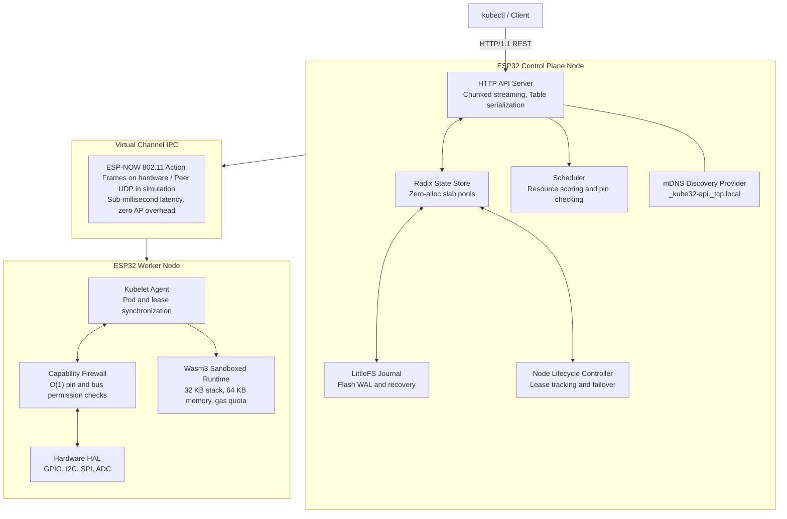

# Kube32

[](https://arterialist.github.io/kube32/)
[](https://github.com/arterialist/kube32/actions/workflows/docs.yaml)

> [!NOTE]
> Detailed documentation, tutorials, and hardware specifications are available at [arterialist.github.io/kube32](https://arterialist.github.io/kube32/).

Kube32 is a Kubernetes-compatible orchestration system for ESP32 microcontrollers. It runs the complete control plane and worker agent on device. The control plane includes an HTTP API server, scheduler, state store, and node lifecycle controller. The worker runs a Kubelet with a sandboxed WebAssembly runtime. Manage the cluster with standard `kubectl`.



## Table of contents

- [Key features](#key-features)
- [Architecture](#architecture)
  - [API server and chunked streaming](#api-server-and-chunked-streaming)
  - [Storage engine](#storage-engine)
  - [Scheduler and node lifecycle controller](#scheduler-and-node-lifecycle-controller)
  - [Kubelet and sandboxed WebAssembly runtime](#kubelet-and-sandboxed-webassembly-runtime)
  - [Distributed computing model](#distributed-computing-model)
- [Quick start](#quick-start)
  - [Prerequisites](#prerequisites)
  - [Host simulator](#host-simulator)
  - [Kubectl interaction](#kubectl-interaction)
- [Workload manifests](#workload-manifests)
  - [Peripheral access pod](#peripheral-access-pod)
  - [Distributed pipeline workload](#distributed-pipeline-workload)
- [Physical hardware deployment](#physical-hardware-deployment)
  - [Flashing an ESP32-S3](#flashing-an-esp32-s3)
  - [Hardware pinout and safety masks](#hardware-pinout-and-safety-masks)
- [Automated testing](#automated-testing)
  - [CTest suites](#ctest-suites)
  - [Python integration suite](#python-integration-suite)
- [Repository structure](#repository-structure)
- [License](#license)

## Key features

- **Standalone embedded cluster.** Runs directly on ESP32 microcontrollers without an external etcd instance, Linux kernel, or container daemon.
- **Kubernetes API compatibility.** Implements core Kubernetes endpoints including `/api/v1/pods`, `/api/v1/nodes`, `/api/v1/namespaces`, `/api/v1/services`, and `/apis/coordination.k8s.io/v1/leases`. Serves `meta.k8s.io/v1 Table` responses for wide terminal output.
- **Low memory streaming.** Streams JSON responses with HTTP chunked transfer encoding using under 512 bytes of RAM per connection. Custom slab pools and monotonic arenas prevent heap fragmentation.
- **Sandboxed execution with hardware access control.** Executes WebAssembly bytecode with Wasm3. Pod manifests declare peripheral permissions for GPIO, I2C, SPI, UART, and ADC. The runtime enforces permissions with O(1) bitmask checks.
- **Virtual channel IPC.** Inter-node communication uses raw 802.11 ESP-NOW action frames on hardware and UDP in simulation. Workloads partition into dataflow pipelines across boards.
- **Heartbeat monitoring and pod failover.** Node agents renew leases every 5 seconds. The controller marks a node `NotReady` after 15 seconds without a heartbeat, then evicts and reschedules pods after 30 seconds.
- **Crash recovery.** Writes state mutations to an append-only LittleFS journal on flash memory with CRC32 checksums and atomic snapshots.

## Architecture

### API server and chunked streaming

Standard Kubernetes tooling sends and receives JSON payloads that can reach tens of kilobytes. On an ESP32 with 512 KB of SRAM, buffering whole payloads in memory triggers heap exhaustion.

Kube32 avoids this with chunked HTTP/1.1 streaming. The serializer traverses the state tree and writes objects into a fixed 256-byte output buffer, flushing each chunk to the socket when full. Memory overhead remains constant regardless of cluster size.

### Storage engine

Cluster state lives in an in-memory radix tree indexed by resource key, such as `/registry/pods/default/sensor-reader`. State mutations append records to an on-flash write-ahead journal managed by LittleFS. During boot, Kube32 replays the journal, validates CRC32 checksums, and restores the tree in memory.

### Scheduler and node lifecycle controller

The scheduler monitors unassigned pods where `spec.nodeName` is empty. It scores candidate nodes using free memory, CPU gas capacity, and hardware peripheral availability.

The node lifecycle controller tracks heartbeats through `coordination.k8s.io/v1` Leases. When a node misses its renewal window, the controller marks it `NotReady` and reschedules pods to healthy nodes.

### Kubelet and sandboxed WebAssembly runtime

The Kubelet agent runs on worker nodes. It syncs assigned pods from the control plane and manages container lifecycles:

1. **Admission and pin allocation.** The capability firewall inspects container resource requests and reserves physical pins. If a requested pin is strapped or already reserved, admission is denied.
2. **Bytecode validation.** The agent validates Wasm bytecode, allocating a 32 KB stack and up to 64 KB of linear memory.
3. **Execution.** The runtime executes in a dedicated FreeRTOS task, metering CPU gas to prevent runaway code from starving the network stack.

### Distributed computing model

Microcontrollers cannot run transparent distributed shared memory. Fetching a remote variable over Wi-Fi takes 1.2 ms, or roughly 288,000 CPU cycles at 240 MHz, compared to 4 ns for local SRAM.

Instead, Kube32 implements coarse-grained pipeline dataflow over virtual channels through `kube32::ipc::Channel`. Pods communicate using four system calls linked into the Wasm environment:

- `kube32_channel_open(name, flags)`. Opens a virtual channel by name.
- `kube32_channel_send(handle, data, len)`. Transmits a frame to channel subscribers.
- `kube32_channel_recv(handle, buf, max_len, timeout_ms)`. Reads an incoming frame.
- `kube32_channel_close(handle)`. Closes the channel handle.

Pipelined workloads, such as feature extraction on node 1 and classification on node 2, maintain compute-to-communication ratios above 15:1.

## Quick start

### Prerequisites

- CMake 3.20 or newer
- C++17 compiler, such as Clang or GCC
- Python 3.9 or newer
- PlatformIO Core for flashing ESP32 hardware

### Host simulator

Build and run a multi-node cluster on your workstation using the POSIX host simulator.

```bash
# Clone the repository
git clone https://github.com/arterialist/kube32.git
cd kube32

# Configure and compile
cmake -B build -S .
cmake --build build -j
```

#### Standalone node

A standalone node runs both the control plane and a local Kubelet agent:

```bash
./build/src/kube32-sim --role standalone --port 6443
```

#### Multi-node cluster

Start the control plane in one terminal:

```bash
./build/src/kube32-sim --role control-plane --port 6443 --ipc-port 7400
```

Join worker nodes from separate terminals:

```bash
# Start worker node 1
./build/src/kube32-sim --role worker --node-name esp32-node-01 --node-id 1 --join http://127.0.0.1:6443 --ipc-port 7401

# Start worker node 2
./build/src/kube32-sim --role worker --node-name esp32-node-02 --node-id 2 --join http://127.0.0.1:6443 --ipc-port 7402
```

### Kubectl interaction

Point your local `kubectl` client to the Kube32 API server:

```bash
# Configure cluster context
kubectl config set-cluster kube32 --server=http://127.0.0.1:6443
kubectl config set-context kube32 --cluster=kube32
kubectl config use-context kube32

# Verify cluster nodes
kubectl get nodes -o wide
```

Output:

```text
NAME            STATUS   ROLES    AGE   VERSION   INTERNAL-IP   OS-IMAGE   KERNEL-VERSION   CONTAINER-RUNTIME
esp32-node-01   Ready    worker   42s   v1.28.0   127.0.0.1     freertos   v5.1.0           wasm3://1.0.0
esp32-node-02   Ready    worker   35s   v1.28.0   127.0.0.1     freertos   v5.1.0           wasm3://1.0.0
```

Deploy a sample workload:

```bash
kubectl apply -f examples/gpio-blinker.yaml
kubectl get pods -o wide
```

Output:

```text
NAME           READY   STATUS    RESTARTS   AGE   IP          NODE            NOMINATED NODE   READINESS GATES
gpio-blinker   1/1     Running   0          12s   127.0.0.1   esp32-node-01   <none>           <none>
```

## Workload manifests

### Peripheral access pod

Workloads request hardware access in `spec.containers.resources.requests` and `securityContext.capabilities`:

```yaml
apiVersion: v1
kind: Pod
metadata:
  name: gpio-blinker
  namespace: default
spec:
  nodeSelector:
    kubernetes.io/arch: xtensa
  containers:
    - name: blinker-task
      image: wasm://embedded/blinker:v1
      resources:
        limits:
          memory: 32Ki
        requests:
          memory: 16Ki
          hardware.kube32.io/gpio: "1"
      securityContext:
        capabilities:
          add:
            - GPIO_WRITE
```

### Distributed pipeline workload

Partitioned tasks exchange data across nodes using virtual channels:

```yaml
# Stage 1: Feature extractor scheduled to Node 1
apiVersion: v1
kind: Pod
metadata:
  name: audio-preprocessor
  namespace: default
spec:
  nodeSelector:
    kubernetes.io/hostname: esp32-node-01
  containers:
    - name: mfcc-extractor
      image: wasm://edge/mfcc-extractor:v1
      resources:
        requests:
          hardware.kube32.io/adc: "1"
      securityContext:
        capabilities:
          add:
            - ADC_READ
            - CHANNEL_IPC
      env:
        - name: KUBE32_IPC_CHANNEL
          value: "audio.features"
---
# Stage 2: Classifier scheduled to Node 2
apiVersion: v1
kind: Pod
metadata:
  name: keyword-classifier
  namespace: default
spec:
  nodeSelector:
    kubernetes.io/hostname: esp32-node-02
  containers:
    - name: tinyml-classifier
      image: wasm://edge/tinyml-classifier:v1
      resources:
        requests:
          hardware.kube32.io/gpio: "1"
      securityContext:
        capabilities:
          add:
            - GPIO_WRITE
            - CHANNEL_IPC
      env:
        - name: KUBE32_IPC_CHANNEL
          value: "audio.features"
```

## Physical hardware deployment

### Flashing an ESP32-S3

Kube32 includes a PlatformIO configuration in `platformio.ini` targeting ESP32-S3 boards.

```bash
# Build firmware
pio run -e esp32s3

# Flash target node. Adjust port as needed: /dev/ttyACM0 on Linux or /dev/cu.usbmodem... on macOS
pio run -e esp32s3 -t upload --upload-port /dev/ttyACM0

# View serial console logs
pio device monitor -b 115200
```

### Hardware pinout and safety masks

The capability firewall prevents workloads from allocating system pins:

| Pin range | Function | Firewall enforcement |
| :--- | :--- | :--- |
| `GPIO 0` | Boot and strapping pin | Protected. Workload allocations are rejected. |
| `GPIO 19 to 20` | Native USB D- and D+ | Protected for JTAG and serial console. |
| `GPIO 26 to 32` | Octal SPI flash and PSRAM bus | Protected to prevent cache corruption. |
| `GPIO 43 to 44` | UART0 debug console | Protected for system logs. |
| `GPIO 1 to 18, 21, 38 to 42` | General purpose IO | Available for workload allocation with capability grants. |

> [!IMPORTANT]
> Pods that request pins reserved by the bootloader or flash buses will fail admission with `CrashLoopBackOff`.

## Automated testing

Kube32 includes both a C++ unit test suite and a Python end-to-end integration test runner.

### CTest suites

Build with AddressSanitizer and UndefinedBehaviorSanitizer enabled:

```bash
cmake -B build -S . -DCMAKE_BUILD_TYPE=Debug
cmake --build build -j
ctest --test-dir build --output-on-failure
```

CTest validates 21 test targets, covering:
- [x] OSAL threading, mutexes, and sockets
- [x] Slab allocator bounds and double-free protections
- [x] Radix tree concurrency and LittleFS journal recovery
- [x] Chunked HTTP serialization under load
- [x] Capability firewall denial rules and memory quotas
- [x] Virtual channel reassembly and packet corruption handling

### Python integration suite

The integration runner tests complete cluster workflows against simulated nodes:

```bash
python3 tests/runner.py --self-test
```

The test runner verifies:
- [x] Node registration and lease maintenance
- [x] Pod admission, state updates, and deletion
- [x] Table formatting and wide output negotiation
- [x] Node failure detection, eviction, and pod rescheduling
- [x] Inter-node channel IPC transmission and fragment reassembly

## Repository structure

```text
├── CMakeLists.txt              # Host build and test configuration
├── platformio.ini              # ESP32-S3 PlatformIO hardware build configuration
├── sdkconfig.defaults          # ESP-IDF kernel settings and C++ exception flags
├── partitions.csv              # Flash partition map for app, LittleFS, and NVS
├── include/                    # Public subsystem headers
│   ├── api/                    # HTTP server and chunked Table serializers
│   ├── controller/             # Node lifecycle and lease controllers
│   ├── hal/                    # Hardware abstraction layer and capability firewall
│   ├── ipc/                    # Virtual channel IPC and packet reassembly
│   ├── kubelet/                # Node agent and API client
│   ├── mem/                    # Slab pools and monotonic arenas
│   ├── osal/                   # Portable OS abstraction layer for FreeRTOS and POSIX
│   ├── runtime/                # Wasm3 runtime, host functions, and gas metering
│   └── storage/                # Radix state store and LittleFS write-ahead journal
├── src/                        # Subsystem implementations and host daemon
├── tests/                      # Unit test suites, adversarial fuzzers, and E2E runner
└── examples/                   # Kubernetes Pod manifests for embedded workloads
```

## License

Kube32 is open source software licensed under the [Apache License 2.0](LICENSE).
