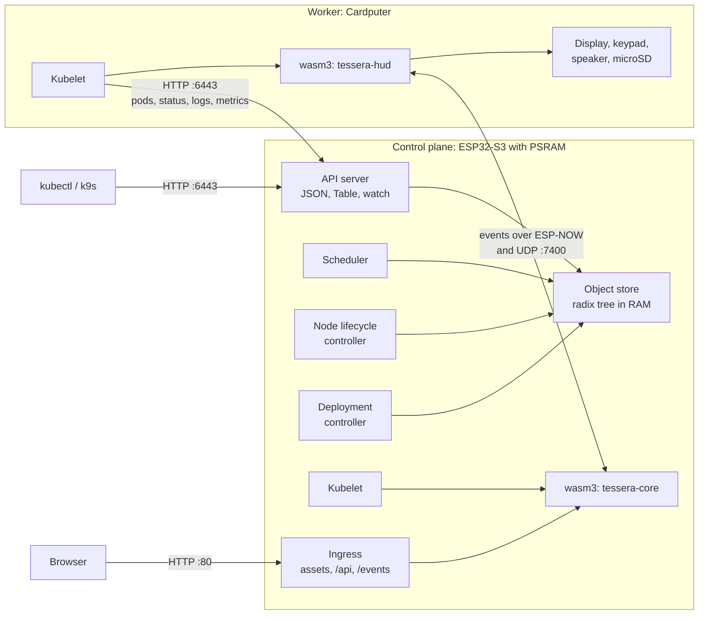

# Kube32

[](https://github.com/arterialist/kube32/actions/workflows/ci.yml)
[](https://github.com/arterialist/kube32/actions/workflows/docs.yaml)

Kube32 is a small Kubernetes-compatible control plane and node agent written
in C++17 for the ESP32-S3. One firmware image runs on every board. The board
with external PSRAM becomes the control plane: an HTTP API server that
`kubectl` and k9s talk to, a scheduler, a node lifecycle controller, a
Deployment controller and an in-memory object store. Every board runs a
kubelet that executes pods as WebAssembly modules in the
[wasm3](https://github.com/wasm3/wasm3) interpreter, with access to the
display, keypad, speaker and microSD card gated per pod by a capability
firewall.

The same sources build a host simulator, `kube32-sim`, that runs the API
server and two simulated nodes in one process on macOS or Linux. The
repository also holds a demo application, Tessera: an issue tracker whose
backend is a WebAssembly pod on the control plane and whose device front end
is a second pod on a board with a screen and keypad. Kube32 is an experiment
in how much of the Kubernetes model fits on a microcontroller. It is not a
production orchestrator; see [What is not done](#what-is-not-done).

## What runs today

Measured on the two boards described under [Hardware](#hardware) during
development in October 2026:

- Both boards join an existing 2.4 GHz Wi-Fi network as stations. Roles come
  from PSRAM presence, with an override stored in NVS.
- A native-USB flash of one board with `scripts/flash.sh` takes about 26 s.
  The cluster reports both nodes Ready about 10 s after a reset.
- `kubectl get`, `describe`, `logs`, `top` and `get events` work against the
  control plane, and so does k9s (it uses watch streams with the WatchList
  bookmark).
- Tessera runs as two pods. The core pod loads in about 0.5 s, `k32_init`
  takes 0.26 s, and it seeds 2,400 issues in the background in about 40 s
  while already answering requests. A list of 25 issues takes about 0.2 s and
  the 50 KB board view about 0.6 s, with PSRAM clocked at 80 MHz.
- Keys typed on the Cardputer reach the browser: keypad, HUD pod, ESP-NOW or
  UDP, control plane, core pod, server-sent events.
- The microSD card on the Cardputer mounts at boot. Pulling images from the
  card and pod volumes are tested on the host simulator (`test_sd_card`); see
  [docs/sd-card.md](docs/sd-card.md).
- On Android 17, Chrome reaches a board on the LAN only after it has been
  granted the "Local network" permission.

Run on the host for this README (macOS 27, Apple M3 Pro): the host build, the
23 CTest suites, the 1,244 Tessera core checks, the 62 `kube32-cli` tests, the
Rust SDK build and the firmware build all pass. On Ubuntu 24.04 with GCC 13,
5 of the 23 host test programs currently fail or hang; see
[CONTRIBUTING.md](CONTRIBUTING.md#tests).

## What is not done

- **No authentication or TLS.** The API server (port 6443) and the ingress
  (port 80) speak plain HTTP, and access reviews always answer "allowed".
  Anyone who can reach the board can create pods. Use it on a network you
  control.
- **Cluster state lives in RAM on the board.** A control-plane reboot loses
  every object. Workers then re-register, find no pods assigned to them, and
  stop theirs. The host simulator can persist state to a directory with
  `--enable-flash`.
- **One control plane and one worker.** Node names are fixed by role
  (`esp32-node-01`, `esp32-node-02`), so a second worker would register under
  the name of the first.
- **No restarts.** `restartPolicy` is not read. A pod that traps stays
  `Failed`, and a pod whose entry point returns is reported `Succeeded`
  (`kubectl` shows `Completed`) even when it returned non-zero.
- **Running pods are not updated.** A changed manifest for an existing pod is
  ignored; delete and recreate the pod.
- **Partial API.** Pods, Nodes, Deployments (with scale), Events, Leases,
  Namespaces, ConfigMaps, Secrets and Services are served. Services,
  ConfigMaps and Secrets are only stored: there is no pod networking, no
  ClusterIP and no environment injection. There are no DaemonSet or Job
  controllers; creating either object writes pods with made-up status
  instead. `limit`/`continue`, `dryRun` and
  server-side apply are not implemented. `kubectl apply` works; the server
  publishes a minimal OpenAPI v3 index without schemas and rejects unknown
  top-level and `metadata` fields (nested fields are not checked). See
  [docs/api-reference.md](docs/api-reference.md).
- **Firmware wiring is specific to Tessera.** The ingress on the control plane
  serves one app, named in `src/main_esp32.cpp`.
- **GPIO, ADC, I2C and UART imports exist but are unexercised.** No example
  uses them. I2C and UART drivers are never installed, so those calls fail on
  a board.
- **PSRAM must be quad SPI.** `sdkconfig.defaults` selects quad mode. Boards
  with octal PSRAM have not been tried.
- **`scripts/flash.sh` is not portable yet.** It calls PlatformIO at a fixed
  path under the author's home directory.

## Hardware

| Role | Board | What it adds |
| --- | --- | --- |
| Control plane (`esp32-node-01`) | Generic ESP32-S3 devkit with 2 MB quad PSRAM | API server, controllers, store, ingress on port 80, Tessera core pod |
| Worker (`esp32-node-02`) | M5Stack Cardputer (ESP32-S3, no PSRAM) | 240x135 ST7789 display, key matrix, NS4168 I2S speaker, microSD slot, Tessera HUD pod |

These two boards are the only hardware Kube32 has run on. The partition table
assumes 8 MB of flash. Pin assignments and memory figures are in
[docs/hardware-spec.md](docs/hardware-spec.md).

## Quick start: host simulator

Requirements: CMake 3.16 or newer, a C++17 compiler (Apple Clang or GCC),
Python 3 (the build embeds the Wasm images with `tools/embed_assets.py`) and
`kubectl`. Everything below was run on macOS with kubectl 1.33.

```
$ cmake -S . -B build
$ cmake --build build -j8
$ ctest --test-dir build
...
100% tests passed out of 23
```

Start a standalone simulator: the API server on port 6443 and two simulated
nodes. `--ingress-port` also serves the Tessera web app. The pod port is moved
off the default 7000 because macOS's AirPlay Receiver listens there.

```
$ ./build/kube32-sim --ingress-port 8080 --pod-port 17000
...
[INIT] Seeded simulated cluster nodes (esp32-node-01, esp32-node-02).
[INIT] Node Lifecycle Controller active (NotReady: 15000ms, Evict: 30000ms).
[INIT] Autonomous scheduler started with LeastAllocated scoring.
[INIT] Deployment controller active.
[READY] Kube32 API Server listening on http://0.0.0.0:6443
...
[APP] pod HTTP server on :17000 (2 workers)
[APP] ingress on :8080 serving app 'tessera'
```

In a second terminal, give kubectl its own kubeconfig so your other contexts
stay untouched:

```
$ export KUBECONFIG=$PWD/build/kubeconfig
$ kubectl config set-cluster kube32-sim --server=http://127.0.0.1:6443
$ kubectl config set-context kube32-sim --cluster=kube32-sim
$ kubectl config use-context kube32-sim
$ kubectl get nodes
NAME            STATUS   ROLES    AGE   VERSION
esp32-node-01   Ready    worker   2s    v1.33.0-kube32
esp32-node-02   Ready    worker   2s    v1.33.0-kube32
$ kubectl apply -f examples/tessera.yaml
pod/tessera-core created
pod/tessera-hud created
service/tessera created
$ kubectl get pods
NAME           READY   STATUS    RESTARTS   AGE
tessera-core   1/1     Running   0          3s
tessera-hud    1/1     Running   0          3s
```

The simulated nodes' capacity, OS image and kernel version are fixed values
declared by the simulator, not measurements.

Open <http://127.0.0.1:8080/> and sign in as `mara` with password `demo`. The
simulator ticks pods once a second, so seeding the 2,400 issues takes about
four minutes there; the list grows while you watch. The HUD pod's display and
speaker calls are printed to the simulator's log.

Writing your own pod (Rust, C or AssemblyScript), checking it and deploying it
without reflashing is covered in
[docs/app-development.md](docs/app-development.md).

## Quick start: two boards

Requirements: [PlatformIO Core](https://platformio.org/install/cli) 6.1
(`platformio.ini` pins the `espressif32 @ 6.13.0` platform, which brings
ESP-IDF 5.5.3), Python 3 with `pyserial`, and two ESP32-S3 boards as above.

1. **Build and flash.** Flash one board at a time, with no serial monitor
   holding the port:

   ```
   pio run -e esp32s3
   bash scripts/flash.sh <serial port> 921600
   ```

   On macOS a native USB port looks like `/dev/cu.usbmodem101`. The script
   paces writes on CH340 USB-UART bridges and resets native USB boards with
   the watchdog after flashing. It runs PlatformIO from
   `~/.platformio`; on another machine, edit the two paths
   in the script or run the `esptool write-flash` command it builds yourself.

2. **Provision over the serial console.** Open each board's USB serial port at
   115200 baud with any terminal, for example
   `python3 -m serial.tools.miniterm --echo <port> 115200`. Opening the port
   resets some boards, so wait for the boot log to finish. Then type one
   command per line; each stores a value in NVS and reboots the board:

   ```
   K32_CMD:BOARD:cardputer          # Cardputer only: enable display, keypad, speaker, microSD
   K32_CMD:WIFI:<ssid>:<password>   # both boards: join this 2.4 GHz network
   K32_CMD:AP:off                   # control plane: do not also start its own access point
   ```

   Once its access point is off, the control plane prints its address on the
   network at boot: `[CONTROL-PLANE] API server http://<address>:6443, ...`
   (with the access point on, this line shows the access point's own address,
   192.168.4.1). Tell the worker where the control plane is:

   ```
   K32_CMD:API:<control plane address>
   ```

   The SSID may not contain `:`. Credentials are stored only on the board.
   The full command list is in
   [docs/flashing-troubleshooting.md](docs/flashing-troubleshooting.md).

3. **Point kubectl at the control plane** and deploy Tessera:

   ```
   kubectl config set-cluster kube32 --server=http://<control plane address>:6443
   kubectl config set-context kube32 --cluster=kube32
   kubectl config use-context kube32
   kubectl get nodes
   kubectl apply -f examples/tessera.yaml
   ```

   Then open `http://<control plane address>/` in a browser.

Without stored Wi-Fi credentials, the control plane starts its own access
point, `Kube32-Cluster` (the password is in `src/main_esp32.cpp`), and the
worker joins it. That mode exists, but it is not the configuration measured
above: the Cardputer's connection to it was unstable.

## Architecture



- **One image, two roles.** `src/main_esp32.cpp` checks for PSRAM at boot.
  With PSRAM it starts the control-plane services, a local kubelet and the
  ingress; without it, a kubelet that talks to the control plane over Wi-Fi.
  `K32_CMD:ROLE:` overrides the choice. `src/main_host.cpp` assembles the same
  components for the simulator.
- **API server** (`src/api/`): HTTP/1.1, JSON only (protobuf requests get 415),
  `meta.k8s.io/v1` Table output for kubectl, chunked responses, watch streams
  with bookmarks, pod logs, events and `metrics.k8s.io`.
- **Object store** (`src/storage/`): a radix tree keyed like etcd
  (`/registry/pods/<ns>/<name>`), with a version check on writes. On the boards
  it is not persisted.
- **Scheduler and controllers** (`src/scheduler/`, `src/controller/`):
  filters on node readiness, heap memory, PSRAM, peripheral counts, node
  selector and node name, then scores by free memory and free GPIO. The node
  lifecycle controller marks a node NotReady after 15 s without a heartbeat
  and unbinds its pods after 30 s.
- **Kubelet** (`src/kubelet/`): every 2 s on the boards it lists the pods bound
  to its node. It resolves each image from the microSD card, the firmware's
  embedded registry or an inline annotation, admits the pod through the
  capability firewall, and runs it. It reports status, logs, metrics and
  events back.
- **Runtime** (`src/runtime/`, `include/runtime/k32_app_abi.h`): request pods
  export `k32_handle` and are called once per HTTP request; `app_main` pods
  run on a thread of their own. Host imports cover responses, logging, time,
  environment, events, display, keypad, tone and files.
- **Events between nodes** (`src/ipc/`): `k32_event_emit` publishes a frame
  to every peer over ESP-NOW and UDP port 7400. Peers are found with HELLO
  frames and also seeded from node addresses, which keeps events flowing when
  the boards sit on different access points. `kube32_channel_send` stays on
  the local node.
- **Serial console**: `K32_CMD:*` commands for provisioning and diagnostics,
  and a framed HTTP relay that `tools/kube32_serial_gateway.py` uses to reach
  the API over USB.

Details: [architecture overview](docs/architecture/index.md).

## Repository layout

| Path | Contents |
| --- | --- |
| `src/`, `include/` | Firmware and simulator sources |
| `apps/tessera/` | Demo app: C core (`core/`), HUD pod (`hud/`), web client (`web/`) |
| `apps/echo/`, `apps/sdnote/` | Small example pods (request echo, microSD notes) |
| `images/` | Prebuilt Wasm images and gzipped web assets embedded into the firmware |
| `sdk/rust/` | `kube32-sdk` crate and two example pods |
| `tools/kube32-cli` | Build, check, deploy, embed and `sd-push` Wasm pods |
| `tools/kube32_serial_gateway.py` | Reach a board's HTTP servers over its USB serial port |
| `tools/tessera_loadtest.py` | Latency percentiles against a running Tessera ingress |
| `scripts/flash.sh` | Flash one board |
| `examples/` | Manifests: Tessera, sdnote, an unschedulable pod |
| `tests/` | C++ unit tests (CTest) and older Python end-to-end suites |
| `federation/` | Go virtual kubelet that registers a Kube32 cluster as a node of another Kubernetes cluster; its unit tests pass, and it has not been run against the current firmware |
| `docs/` | Documentation site (MkDocs) |
| `third_party/wasm3/` | The wasm3 interpreter |

## Documentation

- [Quick start](docs/quickstart.md)
- [Writing app pods](docs/app-development.md)
- [microSD card](docs/sd-card.md)
- [Flashing and the serial console](docs/flashing-troubleshooting.md)
- [Hardware](docs/hardware-spec.md)
- [Architecture](docs/architecture/index.md)
- [Kubernetes API coverage](docs/api-reference.md)
- [Tools](docs/cli-reference.md)
- [Tessera demo](docs/tessera.md)

The site is published at <https://arterialist.github.io/kube32/>.

## Contributing

See [CONTRIBUTING.md](CONTRIBUTING.md). The rule that matters most: every
claim in code, docs and commit messages has to be true of what actually ran.

## License

Apache License 2.0, see [LICENSE](LICENSE). wasm3 in `third_party/wasm3` is
under its own MIT license (`third_party/wasm3/LICENSE`).
