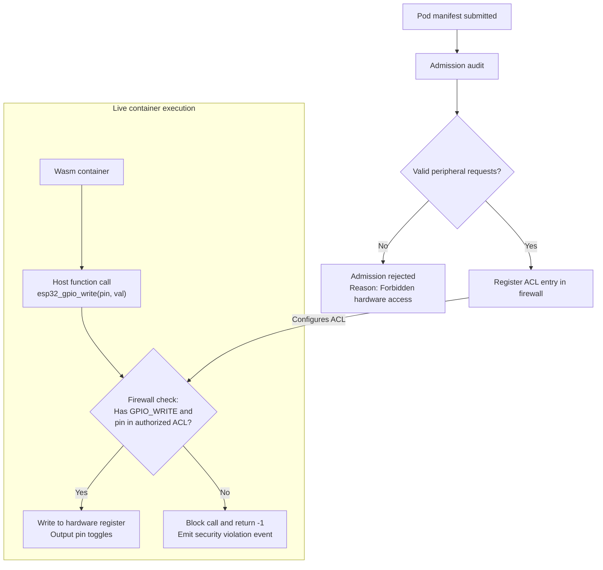

# Hardware capability firewall

<div class="blueprint-card">
  <strong>Component</strong>: <code>kube32::hal::CapabilityFirewall</code><br>
  <strong>Enforcement boundary</strong>: Host function trap handler.<br>
  <strong>Security model</strong>: Declarative peripheral capabilities with exclusive pin claims.
</div>

In cloud Kubernetes, containers request specific OS permissions through Linux capabilities like `CAP_NET_ADMIN` or `CAP_SYS_PTRACE`.

On microcontrollers, the primary risk is unauthorized access to physical peripherals. Toggling the wrong GPIO line can cause an electrical short, corrupt SPI flash communication, or disrupt serial boot strapping. Kube32 introduces hardware-level capabilities declared in standard Kubernetes `securityContext` blocks. The capability firewall verifies these permissions every time a container calls a hardware host function.

---

## Declaring hardware capabilities

Capabilities are listed in the `securityContext.capabilities.add` array of the container specification:

```yaml
apiVersion: v1
kind: Pod
metadata:
  name: gpio-blinker
  namespace: default
spec:
  containers:
    - name: blinker-task
      image: wasm://embedded/blinker:v1
      securityContext:
        capabilities:
          add:
            - GPIO_WRITE      # Grants permission to toggle designated output pins
            - CHANNEL_IPC     # Grants permission to send and receive ESP-NOW frames
```

---

## Supported hardware capabilities

| Capability flag | Target peripheral | Permitted operations | Restricted operations |
| :--- | :--- | :--- | :--- |
| `GPIO_WRITE` | General purpose I/O | `gpio_set_level()` on assigned pins | Pin mode reconfiguration, strapping pins |
| `GPIO_READ` | General purpose I/O | `gpio_get_level()` on assigned pins | Interrupt mask changes |
| `ADC_READ` | Analog-to-digital converter | `adc1_get_raw()` on assigned channels | Reference voltage modifications |
| `UART_READ` | Serial UART controller | Read bytes from secondary UART lines | Console UART0 access |
| `CHANNEL_IPC` | Virtual channel layer | Send and receive on designated channel names | Raw 802.11 packet injection |

---

## Admission checks and runtime enforcement



---

## Preventing pin conflicts

The capability firewall enforces three rules to protect physical hardware:

1. **Exclusive pin ownership**: When Pod A acquires `GPIO_WRITE` on Pin 10, no other container can acquire Pin 10 until Pod A terminates.
2. **System console lockout**: Pins 43 and 44 (UART0 console) and Pins 19 and 20 (USB-JTAG) are locked by the firmware. Any pod attempting to claim these pins is rejected immediately:
   ```
   Admission rejected: GPIO pin 43 is reserved for system console.
   ```
3. **Automatic pin release on pod termination**: When a pod is deleted, the Kubelet releases its peripheral claims and resets the pins to high-impedance input mode (`GPIO_MODE_INPUT`).
