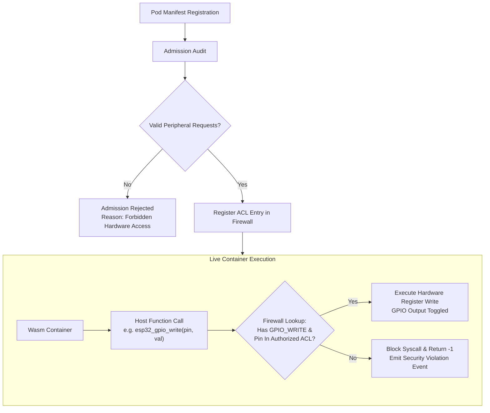

# Hardware Capability Firewall

<div class="blueprint-card">
  <strong>Component</strong>: <code>kube32::hal::CapabilityFirewall</code><br>
  <strong>Enforcement Point</strong>: Wasm Host Call Interception Boundary<br>
  <strong>Security Model</strong>: Principle of Least Privilege with Declarative Hardware Capabilities
</div>

The Hardware Capability Firewall enforces strict peripheral sandboxing on physical microcontrollers. Containers running on Kube32 cannot manipulate GPIO pins, sample ADC channels, or transmit packets unless explicitly granted in their Pod manifest.

---

## Security Context Specification

Capabilities are declared in the `securityContext.capabilities.add` array of the container specification:

```yaml
apiVersion: v1
kind: Pod
metadata:
  name: gpio-blinker
  namespace: default
spec:
  containers:
    - name: blinker-task
      image: wasm://embedded/blinker:v1
      securityContext:
        capabilities:
          add:
            - GPIO_WRITE      # Grants permission to toggle designated pins
            - CHANNEL_IPC     # Grants permission to send/recv ESP-NOW frames
```

---

## Supported Hardware Capabilities

| Capability Flag | Target Hardware | Permitted Operations | Restricted Operations |
| :--- | :--- | :--- | :--- |
| `GPIO_WRITE` | General Purpose I/O | `gpio_set_level()` on assigned pins | Pin mode reprogramming, strapping pins |
| `GPIO_READ` | General Purpose I/O | `gpio_get_level()` on assigned pins | Interrupt manipulation |
| `ADC_READ` | Analog-to-Digital Converter | `adc1_get_raw()` on assigned channels | Reference voltage alterations |
| `UART_READ` | UART Serial Controllers | Reading bytes from auxiliary UARTs | Modifying Console UART0 |
| `CHANNEL_IPC` | Virtual Channel Layer | Subscribing and sending on named channels | Raw 802.11 promiscuous injection |

---

## Peripheral Access Control Architecture



---

## Pin Conflict Prevention & Exclusive Pin Claims

The Capability Firewall prevents race conditions and hardware electrical shorts by enforcing exclusive pin ownership:

1. **Exclusive Claims**: If `Pod A` is granted `GPIO_WRITE` on Pin 10, no other container can acquire `GPIO_WRITE` on Pin 10 simultaneously.
2. **System Console Guard**: Pin 43 and Pin 44 (UART0 console lines) and Pin 19/20 (USB-JTAG lines) are hard-locked by the firewall. Any container requesting these pins is immediately rejected with:
   ```
   Admission Rejected: GPIO pin 43 is reserved for system console.
   ```
3. **Automatic Cleanup on Termination**: When a Pod is deleted, the Kubelet releases all claimed peripheral ACLs, returning the pins to high-impedance safe states.
