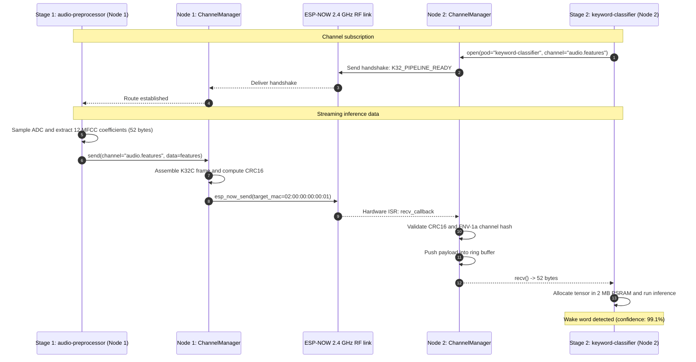

# ESP-NOW virtual channel IPC

<div class="blueprint-card">
  <strong>Component</strong>: <code>kube32::ipc::ChannelManager</code> and <code>EspNowTransport</code>.<br>
  <strong>Wire protocol</strong>: <code>K32C</code> embedded packet frame (magic <code>0x4B333243</code>, version <code>0x01</code>).<br>
  <strong>Integrity</strong>: CRC16-CCITT frame checksum and 32-bit FNV-1a channel hashing.
</div>

In cloud Kubernetes, inter-pod networking relies on CNI plugins that manage overlay networks (such as VXLAN) across Linux network namespaces.

On microcontrollers, maintaining active TCP/IP sockets between boards consumes significant resources. Each open lwIP TCP socket requires 10 KB to 12 KB of RAM for send and receive buffers. TCP three-way handshakes, ARP resolutions, and retransmission state machines also add latency over 2.4 GHz Wi-Fi.

Kube32 bypasses the TCP/IP stack for inter-pod telemetry and sensor pipelines. It uses Espressif's connectionless ESP-NOW protocol to transmit raw 802.11 action frames directly between MAC addresses. Over this link, Kube32 runs a virtual channel protocol named `K32C`.

---

## Wire frame layout (`K32C`)

Inter-node frames use a compact 22-byte binary header:

```
 0                   1                   2                   3
 0 1 2 3 4 5 6 7 8 9 0 1 2 3 4 5 6 7 8 9 0 1 2 3 4 5 6 7 8 9 0 1
+-+-+-+-+-+-+-+-+-+-+-+-+-+-+-+-+-+-+-+-+-+-+-+-+-+-+-+-+-+-+-+-+
|       Magic: 'K' '3' '2' 'C' (0x4B333243)                     |
+-+-+-+-+-+-+-+-+-+-+-+-+-+-+-+-+-+-+-+-+-+-+-+-+-+-+-+-+-+-+-+-+
|  Version (1)  |   Flags (1)   |        Sequence number (2)    |
+-+-+-+-+-+-+-+-+-+-+-+-+-+-+-+-+-+-+-+-+-+-+-+-+-+-+-+-+-+-+-+-+
|                 Channel hash (FNV-1a 32-bit)                  |
+-+-+-+-+-+-+-+-+-+-+-+-+-+-+-+-+-+-+-+-+-+-+-+-+-+-+-+-+-+-+-+-+
|                 Sender hash  (FNV-1a 32-bit)                  |
+-+-+-+-+-+-+-+-+-+-+-+-+-+-+-+-+-+-+-+-+-+-+-+-+-+-+-+-+-+-+-+-+
|                 Target hash  (FNV-1a 32-bit)                  |
+-+-+-+-+-+-+-+-+-+-+-+-+-+-+-+-+-+-+-+-+-+-+-+-+-+-+-+-+-+-+-+-+
|  Frag index   |  Frag count   |      Payload length (2)       |
+-+-+-+-+-+-+-+-+-+-+-+-+-+-+-+-+-+-+-+-+-+-+-+-+-+-+-+-+-+-+-+-+
|                    Payload data (0 - 200 bytes)               |
|                              ...                              |
+-+-+-+-+-+-+-+-+-+-+-+-+-+-+-+-+-+-+-+-+-+-+-+-+-+-+-+-+-+-+-+-+
|             CRC16-CCITT checksum (2 bytes)                    |
+-+-+-+-+-+-+-+-+-+-+-+-+-+-+-+-+-+-+-+-+-+-+-+-+-+-+-+-+-+-+-+-+
```

### Header fields

- **Magic (4 bytes)**: `0x4B333243` ("K32C"). Rejects non-Kube32 frames.
- **Version (1 byte)**: Protocol version `0x01`.
- **Channel hash (4 bytes)**: 32-bit FNV-1a hash of the channel name (for example, `fnv1a_32("audio.features")`).
- **Sender and target hash (4 bytes each)**: FNV-1a hashes of the sending and receiving pod names.
- **Payload length (2 bytes)**: Exact payload size, up to 200 bytes per frame.
- **CRC16-CCITT (2 bytes)**: Checksum covering the full header and payload. Frames with invalid CRCs are dropped by the hardware interrupt handler.

---

## Inter-node dataflow pipeline

The virtual channel layer connects distributed processing stages across separate microcontrollers:



---

## Protocol comparison

| Characteristic | Standard TCP/IP socket | Kube32 ESP-NOW virtual channel |
| :--- | :--- | :--- |
| Transfer latency | 20 ms - 45 ms (DHCP, ARP, TCP handshake) | Under 2.5 ms (direct MAC frame) |
| Header overhead | 54 bytes (Ethernet + IP + TCP) | 22 bytes (K32C frame header) |
| RAM buffering | ~12 KB per active TCP socket | 512-byte ring buffer per channel |
| AP association required | Yes | No (direct radio frames) |
