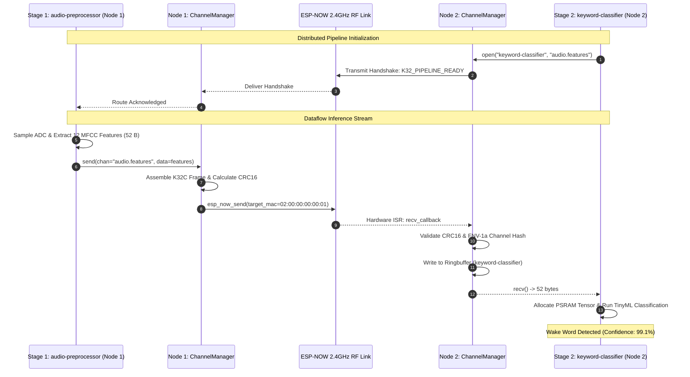

# ESP-NOW Virtual Channel IPC

<div class="blueprint-card">
  <strong>Component</strong>: <code>kube32::ipc::ChannelManager</code> &amp; <code>EspNowTransport</code><br>
  <strong>Wire Protocol</strong>: <code>K32C</code> Embedded Packet Frame (Magic <code>0x4B333243</code>, Version <code>0x01</code>)<br>
  <strong>Data Integrity</strong>: 16-bit CRC16-CCITT Checksum + 32-bit FNV-1a Endpoint Hashing
</div>

Kube32 enables inter-pod and inter-node communication through a lightweight Virtual Channel IPC layer implemented over physical ESP-NOW packets, bypassing TCP/IP routing overhead.

---

## Wire Frame Specification (`K32C`)

All inter-node frames are encoded into a compact, fixed-overhead binary wire format:

```
 0                   1                   2                   3
 0 1 2 3 4 5 6 7 8 9 0 1 2 3 4 5 6 7 8 9 0 1 2 3 4 5 6 7 8 9 0 1
+-+-+-+-+-+-+-+-+-+-+-+-+-+-+-+-+-+-+-+-+-+-+-+-+-+-+-+-+-+-+-+-+
|       Magic: 'K' '3' '2' 'C' (0x4B333243)                     |
+-+-+-+-+-+-+-+-+-+-+-+-+-+-+-+-+-+-+-+-+-+-+-+-+-+-+-+-+-+-+-+-+
|  Version (1)  |   Flags (1)   |        Sequence Number (2)    |
+-+-+-+-+-+-+-+-+-+-+-+-+-+-+-+-+-+-+-+-+-+-+-+-+-+-+-+-+-+-+-+-+
|                 Channel Hash (FNV-1a 32-bit)                  |
+-+-+-+-+-+-+-+-+-+-+-+-+-+-+-+-+-+-+-+-+-+-+-+-+-+-+-+-+-+-+-+-+
|                 Sender Hash  (FNV-1a 32-bit)                  |
+-+-+-+-+-+-+-+-+-+-+-+-+-+-+-+-+-+-+-+-+-+-+-+-+-+-+-+-+-+-+-+-+
|                 Target Hash  (FNV-1a 32-bit)                  |
+-+-+-+-+-+-+-+-+-+-+-+-+-+-+-+-+-+-+-+-+-+-+-+-+-+-+-+-+-+-+-+-+
|  Frag Index   |  Frag Count   |      Payload Length (2)       |
+-+-+-+-+-+-+-+-+-+-+-+-+-+-+-+-+-+-+-+-+-+-+-+-+-+-+-+-+-+-+-+-+
|                    Payload Data (0..200 B)                    |
|                              ...                              |
+-+-+-+-+-+-+-+-+-+-+-+-+-+-+-+-+-+-+-+-+-+-+-+-+-+-+-+-+-+-+-+-+
|             CRC16-CCITT Checksum (2 Bytes)                    |
+-+-+-+-+-+-+-+-+-+-+-+-+-+-+-+-+-+-+-+-+-+-+-+-+-+-+-+-+-+-+-+-+
```

### Frame Fields Definition
- **Magic (4 bytes)**: `0x4B333243` ("K32C"). Rejects non-Kube32 802.11 vendor frames.
- **Version (1 byte)**: Protocol revision `0x01`.
- **Channel Hash (4 bytes)**: 32-bit Fowler–Noll–Vo (FNV-1a) hash of the channel name (e.g. `fnv1a_32("audio.features")`).
- **Sender / Target Hash (4 bytes each)**: FNV-1a hashes of the sending and receiving workload names.
- **Payload Length (2 bytes)**: Exact payload byte count (up to 200 bytes per single ESP-NOW frame).
- **CRC16-CCITT (2 bytes)**: Calculated across the entire header and payload. Packets with mismatched CRCs are silently dropped at the physical layer.

---

## Inter-Node Dataflow Pipeline

The Virtual Channel layer enables coarse-grained pipeline partitioning across physical silicon:



---

## Performance Comparison: ESP-NOW vs TCP/IP

| Metric | Standard TCP Socket | Kube32 ESP-NOW Virtual Channel |
| :--- | :--- | :--- |
| **Transmission Latency** | 22 ms – 45 ms (DHCP, ARP, TCP 3-way) | **&lt; 2.5 ms (Direct MAC Frame)** |
| **Header Overhead** | 54 Bytes (Ethernet + IP + TCP) | **22 Bytes (K32C Wire Frame)** |
| **RAM Buffering** | ~12 KB per active TCP socket | **512 B ringbuffer per channel** |
| **Wi-Fi Association Required** | Yes (Must maintain AP connection) | **No (Peer-to-peer over 2.4GHz)** |
