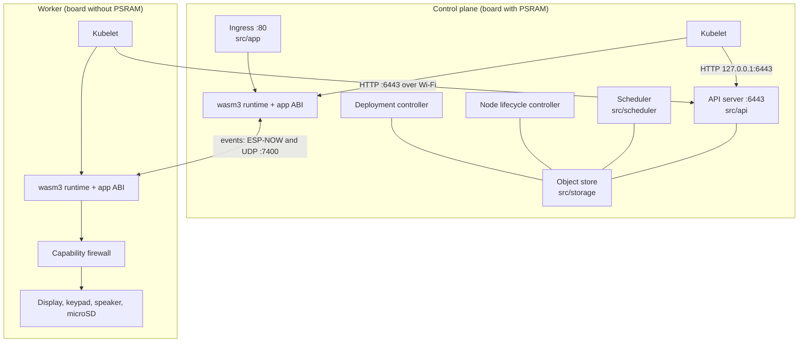

# Architecture overview

Kube32 is one C++17 code base built two ways:

- **Firmware.** `pio run -e esp32s3` builds it for the ESP32-S3 on ESP-IDF
  5.5.3 and FreeRTOS. `src/main_esp32.cpp` is the entry point.
- **Host simulator.** CMake builds it for macOS or Linux on POSIX threads and
  sockets. `src/main_host.cpp` is the entry point.

Everything else under `src/` is shared. The OS abstraction in `src/osal/`
wraps threads, mutexes, timers and sockets for both targets.

## Boot sequence on a board

`app_main` initialises NVS and starts the `k32_cluster` task, which does the
following in order (`cluster_task` in `src/main_esp32.cpp`):

1. **Identity.** A board with PSRAM is the control plane (`esp32-node-01`);
   any other board is a worker (`esp32-node-02`). The NVS key `role`
   (`K32_CMD:ROLE:`) overrides this. The NVS key `board` = `cardputer`
   enables the display, keypad, speaker and microSD hooks. The boot banner
   prints the MAC address, but the MAC plays no part in choosing the role.
2. **Memory reservations**, made while the heap is still unfragmented:
   - Without PSRAM: 67 KiB of internal RAM for one 64 KiB pod, a 40 KiB pod
     thread stack, and 1 KiB log rings.
   - With PSRAM: a 1,340 KiB PSRAM block for one large pod (the Tessera
     core's 1,280 KiB linear memory plus headers).
3. **Peripherals** of the Cardputer profile: the ST7789 display, the I2S
   speaker, the key-matrix scanner and the microSD card. The boot log prints
   one `[SD]` line with the card's figures and what the mount cost in RAM.
4. **Wi-Fi.** With credentials stored by `K32_CMD:WIFI:` the board joins that
   network as a station. A control plane also runs the `Kube32-Cluster`
   access point unless `K32_CMD:AP:off` is stored. Without credentials the
   control plane runs the access point only, and a worker tries to join it.
   SNTP sets the wall clock when there is an uplink. Until the first sync, API
   timestamps are left out rather than invented.
5. **Channels**: ESP-NOW plus UDP port 7400, with HELLO peer discovery every
   3 s. See [Events between nodes](espnow-ipc.md).
6. **Image registry.** The Wasm images compiled into the firmware are
   registered from `images/*.wasm`.
7. **Role services.**
   - On the control plane: the object store, the node lifecycle controller,
     the scheduler, the Deployment controller, the API server on port 6443, a
     local kubelet that talks to `127.0.0.1:6443`, and the ingress on port 80.
   - On a worker: the kubelet, pointed at the address stored by
     `K32_CMD:API:` (default `192.168.4.1`, the access point's address).
8. **Console, ticks and housekeeping.** The console task starts, then a tick
   thread that calls `k32_tick` on every pod once a second, or every 10 ms
   while a pod reports pending work. A housekeeping loop:
   - publishes a stats event every second;
   - pushes cluster telemetry to browsers every 2 s;
   - seeds UDP peers from node addresses every 10 s;
   - logs memory every 30 s.

`K32_CMD:TASKS` prints the live task table with stack high-water marks. Use it
rather than any stack figure written in a document; the sizes are tuned often.

## Creating a pod, end to end

1. `kubectl apply` sends the Pod to the API server. The server stamps `uid`,
   `creationTimestamp` and `resourceVersion` and stores the object under
   `/registry/pods/<ns>/<name>`. If `spec.nodeName` is empty, the scheduler
   binds the pod at once; the scheduler's loop (every 3 s on the boards) picks
   up anything left unbound.
2. Every 2 s the kubelet on each node lists the pods bound to it. For a new
   pod it:
   - resolves the image (microSD card, then the embedded registry, then the
     `kube32.io/wasm-base64` annotation);
   - admits the pod through the capability firewall;
   - loads and links the module in wasm3, and runs `k32_init`;
   - either registers the pod as a request handler or starts its entry point
     on a thread.
3. The kubelet patches the pod's status (`Running`, `Failed` with a reason, or
   `Succeeded` when an entry point returns). It records events, ships the
   pod's log ring and sends metrics with its 5 s heartbeat.
4. If the pod disappears from the API, the kubelet stops it. Changes to the
   manifest of a pod that is already running are not applied.

## Serving an app

The ingress on the control plane, port 80 (`src/app/ingress.cpp`), routes
requests as follows:

| Path | Handling |
| --- | --- |
| `/` and other asset paths | gzip-compressed assets embedded from `images/web/<app>/`; a client that does not accept gzip gets 406 |
| `/api/*` | forwarded to the app's core pod. A pod on the same node is called directly through `k32_handle`. A pod on another node is proxied to that node's pod HTTP server on port 7000, which boards start only when they have PSRAM |
| `/events` | server-sent events: everything published on `<app>.events`, plus cluster telemetry |
| `/api/cluster` | the ingress's own JSON summary of nodes and pods |
| `/healthz` | `ok` |

On the boards the app name is fixed to `tessera`, with core pod
`tessera-core`, in `src/main_esp32.cpp`. The simulator takes `--app` and
`--core-pod`.

## Host simulator differences

- `--role standalone` (the default) runs the API server, the controllers and
  two kubelets (`esp32-node-01`, `esp32-node-02`) in one process. The two
  Node objects are seeded with declared capacity and version strings.
- Pods are ticked once a second, never every 10 ms.
- Channels use UDP only, on port 7400 plus the node ID.
- Display, keypad and speaker calls print to the log, and `k32_key_read`
  finds no keys.
- `--enable-flash --data-dir <dir>` persists the object store to one JSON file
  per key and recovers it at start. The boards do not persist the store.
- Worker processes (`--role worker`) find the API server through `--join
  <url>`, or through a plain-text UDP discovery exchange on port 5354. That
  exchange is not mDNS, and the firmware does not use it.
