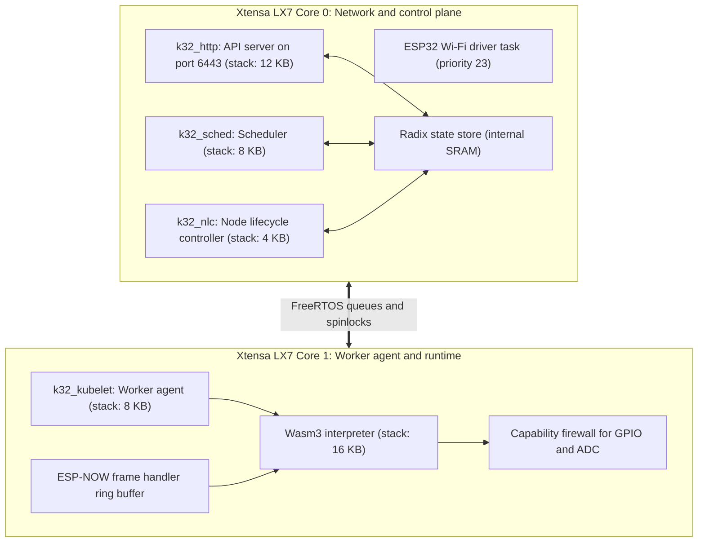
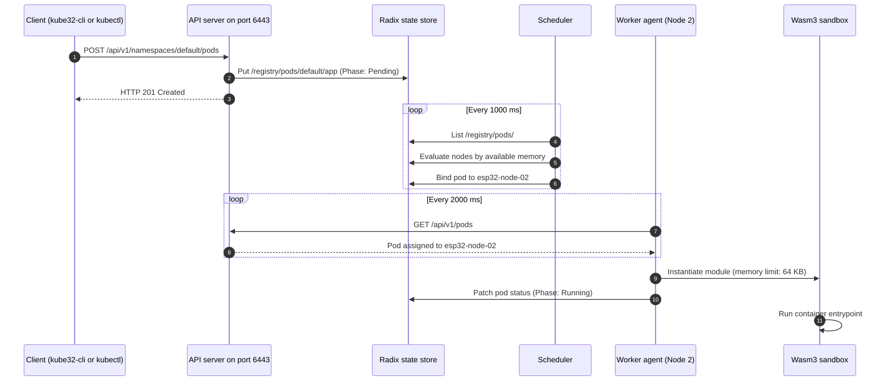

# Architecture overview

  <strong>Design pattern</strong>: Distributed micro-kernel orchestrator for dual-core MCUs. 
  <strong>Concurrency</strong>: FreeRTOS SMP with pinned tasks on Xtensa LX7. 
  <strong>Inter-node networking</strong>: 802.11 SoftAP for TCP/IP and ESP-NOW for low-latency messaging.

Kube32 implements the Kubernetes separation between control plane and worker agent directly on dual-core microcontrollers, without Linux or container daemons.

---

## Dual-core task partitioning

The ESP32-S3 contains two Xtensa LX7 cores running at 240 MHz. FreeRTOS can schedule tasks across both cores, but Wi-Fi packet processing and serial interrupts require consistent latency. Kube32 pins networking, cluster state storage, and scheduling to Core 0. Core 1 runs the worker agent, guest WebAssembly bytecode, and peripheral access audits.

### Core 0 subsystems

- **Wi-Fi driver**: Handles the 802.11 physical layer, generates SoftAP beacons, and routes inbound IP frames.
- **HTTP API server (`k32_http`)**: Accepts TCP connections on port 6443. Parses Kubernetes REST requests and routes them to the radix store. Uses a 12 KB task stack.
- **Scheduler (`k32_sched`)**: Evaluates unassigned pods every 1,000 ms. Disqualifies nodes that lack requested memory or hardware pins, then scores candidate nodes by available memory. Uses an 8 KB task stack.
- **Node lifecycle controller (`k32_nlc`)**: Monitors worker heartbeats. Marks a node as `NotReady` if heartbeats stop for 15 seconds, and begins pod eviction after 30 seconds. Uses a 4 KB task stack.

### Core 1 subsystems

- **Worker agent (`k32_kubelet`)**: Checks for newly scheduled pods assigned to this node, initializes sandboxes, and reports execution state back to the control plane. Uses an 8 KB task stack.
- **Wasm3 interpreter**: Executes guest WebAssembly modules inside a memory sandbox bounded between 32 KB and 64 KB. Uses a 16 KB task stack.
- **Capability firewall**: Intercepts guest host calls such as `esp32_gpio_write` and `esp32_adc_read`. Checks each call against permissions granted in the pod manifest.
- **ESP-NOW frame handler**: Inspects incoming radio frames, verifies CRC16 checksums, and pushes payloads into container ring buffers.

---

## State synchronization flow

When a client creates a pod, the control plane persists the manifest and schedules it to a qualified node. The worker node pulls the pod definition and starts the WebAssembly container.

---

## Task memory and stack limits

| Task name | Core affinity | Stack size | Priority | Purpose |
| :--- | :--- | :--- | :--- | :--- |
| `k32_http` | Core 0 | 12 KB | 5 | Kubernetes REST API server |
| `k32_sched` | Core 0 | 8 KB | 4 | Pod scheduling and node scoring |
| `k32_nlc` | Core 0 | 4 KB | 3 | Node health and lease monitoring |
| `k32_kubelet` | Core 1 | 8 KB | 4 | Pod synchronization and container supervision |
| `wifi` | Core 0 | 6.5 KB | 23 | Espressif 802.11 PHY driver |
