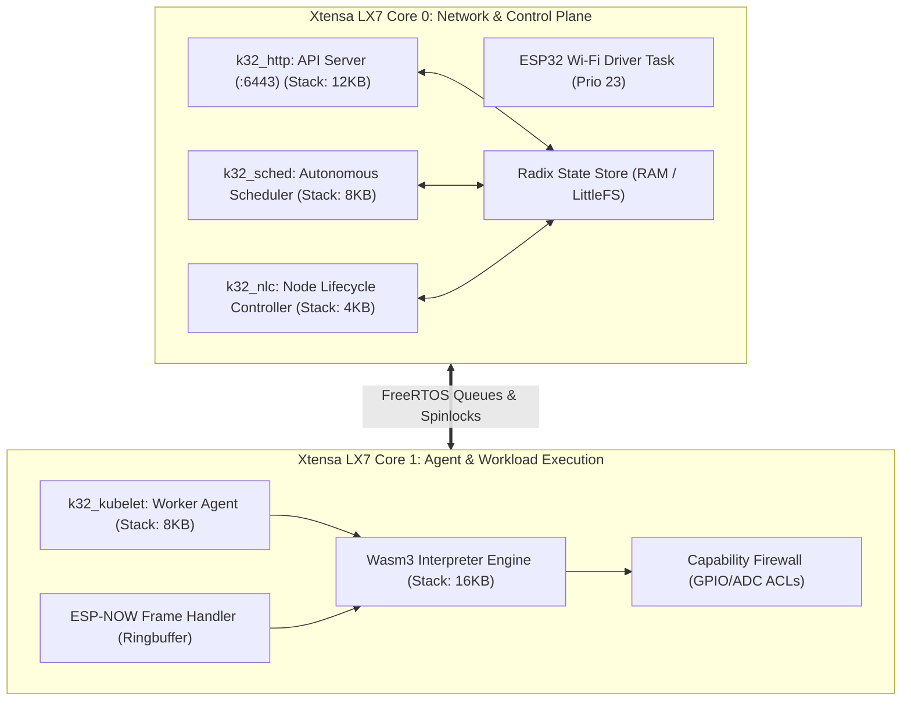
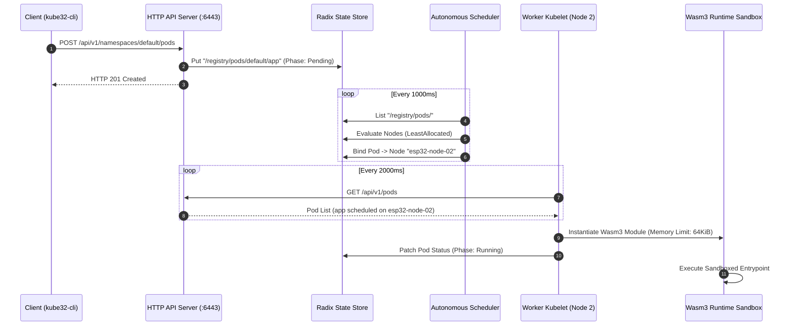

# System Architecture

  <strong>System Pattern</strong>: Distributed Micro-Kernel Orchestrator for Dual-Core Embedded MCUs 
  <strong>Core Concurrency</strong>: FreeRTOS SMP with Task Priority Affinity on Xtensa LX7 
  <strong>Inter-Node Transports</strong>: 802.11 SoftAP + ESP-NOW Virtual Channel Layer

Kube32 implements the core architectural separation of Kubernetes—control plane vs worker agent—on resource-constrained dual-core microcontrollers without the overhead of Linux or container daemons.

---

## Dual-Core Xtensa LX7 Task Partitioning

The ESP32-S3 contains two 32-bit Xtensa LX7 cores running at 240 MHz. Kube32 pins timing-sensitive tasks to specific cores to avoid thread contention:

### Core 0: Control Plane Subsystems
1. **Network Driver**: Manages the Wi-Fi PHY, SoftAP beacon generation, and station packet reception.
2. **HTTP API Server (`k32_http`)**: Accepts connections on TCP port 6443, parses Kubernetes REST routes, and routes requests to the Radix store. Stack size: 12,288 bytes.
3. **Autonomous Scheduler (`k32_sched`)**: Evaluates unassigned pods every 1,000 ms, scoring nodes based on available memory and capabilities. Stack size: 8,192 bytes.
4. **Node Lifecycle Controller (`k32_nlc`)**: Monitors worker heartbeats, transitioning absent nodes to `NotReady` after 15 seconds and evicting workloads after 30 seconds.

### Core 1: Worker Agent Subsystems
1. **Kubelet Agent (`k32_kubelet`)**: Periodically syncs assigned pods against the API server via HTTP or direct memory pointer. Stack size: 8,192 bytes.
2. **Wasm3 Interpreter Engine**: Executes guest WebAssembly binaries inside an isolated 32KB to 64KB sandbox.
3. **HAL Capability Firewall**: Audits and gates all guest host calls (`esp32_gpio_write`, `esp32_adc_read`, etc.).
4. **ESP-NOW Frame Handler**: Validates incoming `K32C` packets and routes them to container ring buffers.

---

## State Synchronization Flow

---

## Resource Bounds & Stack Limits

| Task Name | Core Affinity | Stack Size | Priority | Function |
| :--- | :--- | :--- | :--- | :--- |
| `k32_http` | Core 0 | 12,288 B | 5 | Kubernetes REST API Server |
| `k32_sched` | Core 0 | 8,192 B | 4 | Autonomous LeastAllocated Scheduler |
| `k32_nlc` | Core 0 | 4,096 B | 3 | Node Lifecycle & Eviction Controller |
| `k32_kubelet` | Core 1 | 8,192 B | 4 | Pod Synchronization & Container Runner |
| `wifi` | Core 0 | 6,656 B | 23 | Espressif 802.11 PHY Driver |
