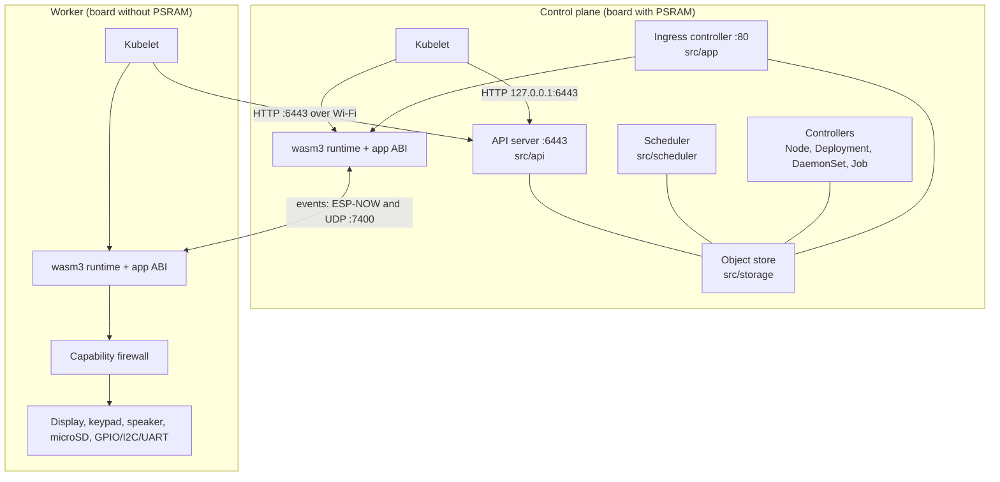

# Architecture overview

Kube32 is a C++17 codebase built for two targets:

- `pio run -e esp32s3` builds firmware for the ESP32-S3 on ESP-IDF 5.5.3 and FreeRTOS (`src/main_esp32.cpp`).
- CMake builds the host simulator for macOS or Linux on POSIX threads and sockets (`src/main_host.cpp`).

Both targets share the code under `src/`. The OS abstraction layer in `src/osal/` wraps threads, mutexes, timers, and sockets.

See the detailed pages for each subsystem:

- [Object store](radix-store.md)
- [Scheduler and controllers](scheduler.md)
- [Wasm runtime](wasm-runtime.md)
- [Capability firewall](capability-firewall.md)
- [Events between nodes](espnow-ipc.md)

## Boot sequence on a board

`app_main` initializes NVS and starts the `k32_cluster` task (`cluster_task` in `src/main_esp32.cpp`), which runs these steps in order:

1. Read node identity from hardware and NVS. A board with PSRAM becomes the control plane, and any other board becomes a worker, unless overridden by `K32_CMD:ROLE:control-plane|worker|auto`. The node name comes from `K32_CMD:NAME:<name>` or defaults to `esp32-` plus the last three Wi-Fi MAC bytes in hex. `K32_CMD:BOARD:cardputer|generic` selects the peripheral profile.
2. Reserve pod memory while the heap is unfragmented. Boards without PSRAM reserve 80 KiB of internal RAM for pods and their 28 KiB interpreter stack, and 1 KiB log rings. Boards with PSRAM reserve one 1,284 KiB PSRAM block for one large pod.
3. Initialize peripherals and storage. On the `cardputer` profile, this starts the ST7789 display, I2S speaker, and key-matrix scanner. The node mounts its storage root on the microSD card (`/sd`) if present, or on the internal flash FAT partition (`/data`). It then configures the [capability firewall](capability-firewall.md) with the board profile's available pins and buses. It also reads its running firmware image: version, SHA-256, app slot, and whether it booted from an unconfirmed update ([firmware updates](../firmware-updates.md)).
4. Start Wi-Fi. With credentials from `K32_CMD:WIFI:<ssid>:<password>`, the board joins that network as a station and waits up to 10 s for SNTP time sync. Objects created before clock sync receive backfilled timestamps once the clock synchronizes. A control plane also runs the `Kube32-Cluster` access point unless `K32_CMD:AP:off` is set. Without stored credentials, the control plane runs only the access point, and workers join it using the password set by `K32_CMD:APPASS`. A control plane without a stored password generates one at boot.
5. Start [event channels](espnow-ipc.md) over ESP-NOW and UDP port 7400, with peer discovery every 3 s.
6. Register embedded Wasm images compiled from `images/*.wasm`.
7. Start role services. The control plane recovers the [object store](radix-store.md), starts the node lifecycle, [scheduler, Deployment, DaemonSet, and Job controllers](scheduler.md), starts the API server on port 6443 (serving HTTP and TLS on the same port), starts a local kubelet pointing to `127.0.0.1:6443`, and starts the Ingress controller on port 80. A worker starts its kubelet pointing to `K32_CMD:API:<host>` (default `192.168.4.1`) and, if the board has PSRAM, starts a pod HTTP server on port 7000.
8. Start the serial console task, the pod tick thread (calling each pod's `k32_tick` once per `kube32.io/tick-interval`, 1 s by default, or after 10 ms when a tick returns pending work), and the 1 s housekeeping loop (flushing batched controller and deferred node heartbeat store writes, ticking the Ingress controller, running the firmware rollout controller every 3 s, and seeding UDP peers from node `InternalIP` addresses every 10 s).

Run `K32_CMD:TASKS` on the serial console to inspect the live task table and stack high-water marks.

## Creating a pod

1. `kubectl apply` sends the Pod manifest to the API server on port 6443. The server validates fields, assigns `uid`, `creationTimestamp`, and `resourceVersion`, and writes the object to the [object store](radix-store.md) under `/registry/pods/<ns>/<name>`.
2. If `spec.nodeName` is empty, the [scheduler](scheduler.md) filters nodes by readiness, selectors, memory, `esp32.io/psram`, and peripheral claims, then binds the pod. Any unbound pod is picked up by the scheduler's 3 s reconciliation loop.
3. Every 2 s, the kubelet on the target node lists pods bound to its node name. For a new pod, the kubelet resolves `env` and `envFrom` references, checks claims against the [capability firewall](capability-firewall.md) and installs required I2C or UART drivers, resolves the Wasm binary (`wasm://sd/<name>`, `wasm://embedded/<name>`, or the `kube32.io/wasm-base64` annotation), loads the module into the [wasm3 runtime](wasm-runtime.md), and runs `k32_init`.
4. The kubelet registers a request pod (`k32_handle`) with the local host or starts an entry-point pod (`_start`, `app_main`, or `main`) on its own thread.
5. The kubelet patches the pod status to `Running`, ships container logs, and renews its node Lease every 5 s. When an entry-point pod exits or traps, the kubelet applies `restartPolicy` (`Always`, `OnFailure`, or `Never`) with exponential back-off (10 s doubling to 5 min). When a pod is deleted from the API, the kubelet stops it and reclaims its memory and hardware claims.

## Reaching a pod through Ingress

The Ingress controller on the control plane listens on port 80 (`src/app/ingress_controller.cpp`) and routes requests using `networking.k8s.io/v1` Ingress objects. It rebuilds its route table within 250 ms when an Ingress, Service, or Pod changes.

1. The controller matches the request `Host` header (exact match, then `*.domain` wildcard, then catch-all) and selects the longest matching rule path (`Exact` or segment-wise `Prefix`, falling back to `defaultBackend`).
2. For a `StaticBundle` resource backend (`apiGroup: kube32.io, kind: StaticBundle`), the controller serves build-time assets from `images/web/<bundle>/`, preferring `.gz` files (`Content-Encoding: gzip`) and falling back to `index.html` for extension-less SPA paths.
3. For a `Service` backend, the controller selects a `Running`, non-terminating pod matching the Service selector in the same namespace. If the pod runs on the control plane, the worker calls `k32_handle` in-process. If the pod runs on another node, the controller proxies the HTTP request to that node's IP and target port with the `X-Kube32-Pod` header. If no backing pod is available, it returns `503`.
4. Paths configured in the `kube32.io/event-stream` annotation stream [channel topics](espnow-ipc.md) and built-in `kube32.cluster` or `kube32.presence` topics as Server-Sent Events (SSE). The `kube32.io/cluster-telemetry` annotation serves a JSON summary of nodes and pods at the configured path, and `kube32.io/stats-topic` publishes request rate and viewer counts once a second.

## Persistence

Each board mounts one node storage root: `/sd` when a microSD card is inserted, or `/data` on the 384 KB internal flash FAT partition (with wear levelling).

| Path under `<root>/kube32/` | Contents |
| --- | --- |
| `store/journal.img` (microSD) or raw `journal` partition (internal flash) | Control-plane [object store](radix-store.md) log-structured journal with CRC-checked records (1 MiB in the `journal` partition at `0x6A0000` on internal flash, 4 MiB on microSD). API writes commit before the server responds; controller writes flush within 1 s, node heartbeats flush at most every 10 min, and Leases and Events stay in RAM. |
| `volumes/<claim>` | Pod directories mounted from a `persistentVolumeClaim` (`claimName: <claim>`) and accessed via the `k32_fs_*` ABI. |
| `logs/<ns>_<pod>/<container>.log` | Container logs (capped at 32 KiB, rotated to `.log.1` on restart, and served by `kubectl logs --previous`). Deleted when the pod is deleted. |
| `images/<name>.wasm` | Wasm binaries loaded via `wasm://sd/<name>` (microSD only) and optional static assets under `images/<name>/` served by `k32_resp_asset`. |

You can upload, list, read, or delete files on any node's storage over the API node proxy subresource `/api/v1/nodes/<node>/proxy/storage/<path>` or with `tools/kube32-cli push <file> --node <node> --path <path>`.

## Host simulator differences

- `--role standalone` (the default) runs the API server, controllers, and simulated kubelets (`--kubelet-name`, default `esp32-node-01`, and `--workers`, default `esp32-node-02`) in one process. Nodes report host OS, CPU, and memory figures, plus a host memory block set by `--psram` (default `1284Ki` on the control plane, `0` on workers).
- The Ingress controller is disabled by default; pass `--ingress-port <port>` to enable it. All simulated nodes run the pod HTTP server on `--pod-port` (default `7000`).
- Pods are ticked once a second, never every 10 ms. Per-pod in-RAM log rings are 16 KiB.
- Event channels use UDP only on `--ipc-port` (default `7400` plus `--node-id`).
- Display, keypad, and speaker calls log to stdout, and `k32_key_read` returns no keys.
- The object store stays in RAM unless `--enable-flash` is passed, which writes `kube32/store/journal.img` under `--data-dir` (or `$KUBE32_SD_ROOT` when set).
- Separate worker processes (`--role worker`) locate the API server via `--join <url>` or UDP discovery on port 5354 (`_kube32-api._tcp`), which the firmware does not use.
