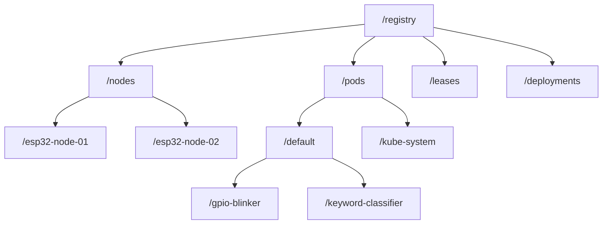

# Radix State Store

<div class="blueprint-card">
  <strong>Component</strong>: <code>kube32::storage::RadixTreeStore</code><br>
  <strong>Memory Complexity</strong>: O(k) prefix tree lookup, zero dynamic heap allocations on read path<br>
  <strong>Storage Modes</strong>: In-Memory DRAM (high performance) with optional LittleFS flash persistence
</div>

The Radix State Store serves as the cluster's single source of truth, replacing external distributed databases (`etcd`) with an embedded prefix tree running within internal SRAM.

---

## Prefix Namespace Hierarchy

All Kubernetes objects are indexed deterministically using standard Kubernetes API key paths:



### Key Mapping Rules
- **Nodes**: `/registry/nodes/{node_name}`
- **Pods**: `/registry/pods/{namespace}/{pod_name}`
- **Leases**: `/registry/leases/{namespace}/{lease_name}`
- **Deployments**: `/registry/deployments/{namespace}/{deploy_name}`

---

## Zero-Copy Query Path via MonotonicArena

To eliminate memory fragmentation across millions of API read operations, query serialization uses a bump-allocated memory arena:

```cpp
// Fast query path without FreeRTOS heap fragmentation
kube32::mem::MonotonicArena arena(32768);

std::vector<std::string> pod_records;
store.list("/registry/pods/default/", pod_records);

// Serialize Kubernetes Table format in arena memory
TableSerializer::serialize_pods_table(arena, pod_records);
arena.reset(); // Instant O(1) memory recycling
```

### Memory Allocation Comparison

| Operation | Standard etcd / JSON Parser | Kube32 Radix Store + Arena |
| :--- | :--- | :--- |
| **Get Pod Manifest** | 12 heap allocations (`malloc`) | 0 heap allocations (bump pointer) |
| **List 20 Pods** | ~240 heap allocations | 1 scratch buffer slice |
| **Lookup Time** | O(log N) B-Tree disk seek | O(K) memory traversal (~4 microseconds) |
| **Heap Fragmentation** | High (frequent reallocations) | **Zero (arena recycled in place)** |

---

## Concurrency & Thread Safety

The Radix State Store provides thread-safe operations across FreeRTOS tasks through a reader-writer spinlock:

```cpp
class RadixTreeStore : public Store {
public:
    Status put(std::string_view key, std::string_view value, bool create_only = false) override;
    Status get(std::string_view key, std::string& out_value) const override;
    Status remove(std::string_view key) override;
    Status list(std::string_view prefix, std::vector<std::string>& out_values) const override;
private:
    mutable osal::Mutex mutex_;
    RadixNode* root_{nullptr};
};
```
