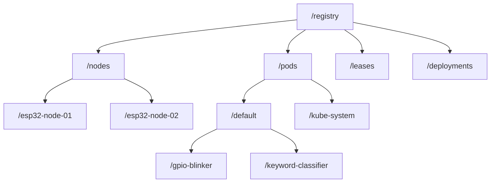

# Radix state store

<div class="blueprint-card">
  <strong>Component</strong>: <code>kube32::storage::RadixTreeStore</code><br>
  <strong>Lookup complexity</strong>: O(k) prefix tree walk where k is key length.<br>
  <strong>Memory footprint</strong>: In-memory SRAM storage with arena-allocated query serialization.
</div>

Standard Kubernetes clusters store object manifests in etcd. Operating etcd requires disk storage, distributed consensus over Raft, and dozens of megabytes of memory. Microcontrollers have only a few hundred kilobytes of internal SRAM, and writing repeatedly to SPI flash wears out flash blocks quickly.

Kube32 replaces etcd with an embedded radix tree kept in SRAM. Object keys follow standard Kubernetes API paths. Tree lookups take time proportional to key length rather than cluster size, and range queries for namespaces or resource types match naturally along tree branches.

---

## Prefix key hierarchy

Objects are stored under hierarchical prefixes matching the Kubernetes REST resource model:



### Key mapping format

- **Nodes**: `/registry/nodes/{node_name}`
- **Pods**: `/registry/pods/{namespace}/{pod_name}`
- **Leases**: `/registry/leases/{namespace}/{lease_name}`
- **Deployments**: `/registry/deployments/{namespace}/{deploy_name}`

---

## Memory arena for queries

When a client queries all pods in a cluster, typical JSON serializers make dozens of small heap allocations. On FreeRTOS, repeatedly allocating and freeing small heap blocks fragments internal SRAM. Over time, memory fragmentation causes allocation failures even when total free memory appears adequate.

To prevent fragmentation on read paths, Kube32 serializes query responses using a bump-allocated memory arena:

```cpp
// Preallocated 32 KB scratch buffer on Core 0
std::vector<uint8_t> arena_buf(32768);
kube32::mem::MonotonicArena arena(arena_buf.data(), arena_buf.size());

std::vector<std::string> pod_records;
store.list("/registry/pods/default/", pod_records);

// Build Kubernetes Table format directly within the arena
TableSerializer::serialize_pods_table(arena, pod_records);

// Reset pointer to zero in O(1) time
arena.reset();
```

### Memory allocation behavior

| Metric | Typical JSON parser | Kube32 Radix store and arena |
| :--- | :--- | :--- |
| Allocations to read one pod | 12 heap allocations (`malloc`) | 0 heap allocations (bump pointer) |
| Allocations to list 20 pods | ~240 heap allocations | 1 scratch buffer slice |
| Lookup latency | O(log N) disk seek | O(K) memory traversal (under 5 microseconds) |
| Heap fragmentation risk | High | Zero (arena resets in place) |

---

## Concurrency and locking

The radix store handles concurrent access across FreeRTOS tasks on both Xtensa cores using a mutex lock:

```cpp
class RadixTreeStore : public Store {
public:
    Status put(std::string_view key, std::string_view value, bool create_only = false) override;
    Status get(std::string_view key, std::string& out_value) const override;
    Status remove(std::string_view key) override;
    Status list(std::string_view prefix, std::vector<std::string>& out_values) const override;
private:
    mutable osal::Mutex mutex_;
    RadixNode* root_{nullptr};
};
```

Tasks release the lock before streaming responses over sockets or serial ports. This keeps lock hold times short and prevents the HTTP server from stalling the scheduler loop.
