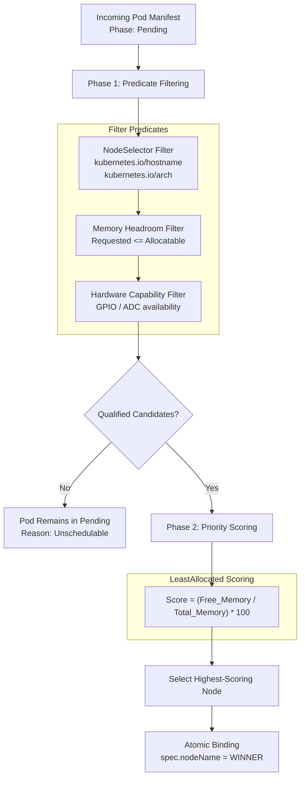

# Autonomous Scheduler

  <strong>Component</strong>: <code>kube32::scheduler::AutonomousScheduler</code> 
  <strong>Scoring Strategy</strong>: <code>LeastAllocated</code> (Prioritizes nodes with greatest unused memory headroom) 
  <strong>Filter Predicates</strong>: Node Selector, Architecture Match, Memory Limits, Peripheral Quotas (GPIO/ADC)

The Kube32 Autonomous Scheduler operates on Xtensa Core 0, running a continuous reconciliation loop that binds pending Pods to optimal physical hardware nodes.

---

## Two-Phase Scheduling Algorithm

---

## Phase 1: Predicate Filtering

Each registered node is checked against strict feasibility conditions:

1. **Architecture Predicate**: Ensures the pod's `nodeSelector` matches the Xtensa LX7 processor architecture (`kubernetes.io/arch: xtensa`).
2. **Hostname Affinity**: If the pod specifies an explicit `kubernetes.io/hostname: esp32-node-02`, other nodes are immediately disqualified.
3. **Memory Capacity**: Compares `pod.spec.containers[0].resources.requests.memory` against the node's allocatable memory:
   - Node 1: 400 KiB allocatable SRAM
   - Node 2: 2048 KiB allocatable PSRAM
4. **Peripheral Quotas**: Evaluates requested hardware peripherals (e.g. `hardware.kube32.io/gpio: "1"` or `hardware.kube32.io/adc: "1"`).

---

## Phase 2: LeastAllocated Priority Scoring

When multiple nodes pass the predicate filter, Kube32 prioritizes the node with the highest unallocated memory percentage:

$$\text{Score}(N) = \left( \frac{\text{AllocatableMemory}(N) - \text{RequestedMemory}(N)}{\text{AllocatableMemory}(N)} \right) \times 100$$

### Example Placement Calculation

Suppose a pod requests `memory: 32Ki`:

| Candidate Node | Total Allocatable | Currently Allocated | Free Memory | Score | Verdict |
| :--- | :--- | :--- | :--- | :--- | :--- |
| **Node 1 (Cardputer)** | 400 KiB | 64 KiB | 336 KiB | **84.0** | |
| **Node 2 (DevKit + PSRAM)** | 2048 KiB | 48 KiB | 2000 KiB | **97.6** | **WINNER (Selected)** |

Node 2 is selected because its 2MB external PSRAM provides higher headroom, preserving internal SRAM on Node 1 for control-plane operations.

---

## Quota Enforcement & Unschedulable States

If a pod requests resources exceeding all cluster nodes (e.g. `memory: 1024Ki` when targeted to Node 1):
1. The scheduler leaves `spec.nodeName` empty (`<none>`).
2. The pod status remains `phase: Pending`.
3. The scheduler emits a warning event: `0/2 nodes are available: 1 Insufficient memory, 1 nodeSelector mismatch`.
