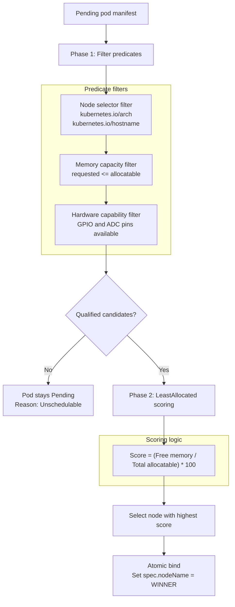

# Autonomous scheduler

<div class="blueprint-card">
  <strong>Component</strong>: <code>kube32::scheduler::AutonomousScheduler</code><br>
  <strong>Scoring algorithm</strong>: <code>LeastAllocated</code> (prefers nodes with the most free memory).<br>
  <strong>Filter checks</strong>: Node selector, architecture, memory limits, and hardware pins (GPIO, ADC).
</div>

In Kubernetes, `kube-scheduler` watches for pods that lack an assigned node, filters out nodes that do not meet requirements, scores the survivors, and writes an assignment back to the store.

On microcontroller clusters, scheduling decisions must account for physical hardware differences. An ESP32-S3 without external PSRAM has only 320 KB to 512 KB of internal SRAM. A dev board with Quad PSRAM has 2 MB to 8 MB of RAM. Different boards also expose different GPIO pins. Kube32 runs a continuous reconciliation loop on Core 0 that evaluates pending pods every second against these constraints.

---

## Two-phase scheduling algorithm



---

## Phase 1: Filter predicates

The scheduler tests candidate nodes against four feasibility checks:

1. **Architecture predicate**: Verifies that the pod's `nodeSelector` matches the Xtensa LX7 processor architecture (`kubernetes.io/arch: xtensa`).
2. **Hostname affinity**: If the pod sets an explicit `kubernetes.io/hostname` such as `esp32-node-02`, all other nodes are disqualified immediately.
3. **Memory capacity**: Checks whether `pod.spec.containers[0].resources.requests.memory` fits within the node's allocatable memory:
   - Node 1: 400 KB allocatable SRAM
   - Node 2: 2,048 KB allocatable PSRAM
4. **Hardware peripheral quotas**: Checks that requested peripherals (such as `hardware.kube32.io/gpio: "1"` or `hardware.kube32.io/adc: "1"`) are present and not already locked by another running pod.

---

## Phase 2: LeastAllocated scoring

If more than one node satisfies all predicate filters, the scheduler prioritizes the node with the highest percentage of unallocated memory:

$$\text{Score}(N) = \left( \frac{\text{AllocatableMemory}(N) - \text{RequestedMemory}(N)}{\text{AllocatableMemory}(N)} \right) \times 100$$

### Placement example

Suppose a pod requests 32 KB of memory:

| Candidate node | Total allocatable | Currently allocated | Free memory | Score | Result |
| :--- | :--- | :--- | :--- | :--- | :--- |
| **Node 1 (Control plane)** | 400 KB | 64 KB | 336 KB | 84.0 | Discarded |
| **Node 2 (Worker with PSRAM)** | 2,048 KB | 48 KB | 2,000 KB | 97.6 | **Selected** |

Node 2 receives the pod because its 2 MB external PSRAM provides wider headroom, saving Node 1's internal SRAM for API server connections and packet routing.

---

## Unschedulable workloads

If a workload requests resources exceeding all cluster nodes (such as requesting 1,024 KB of RAM when pinned to Node 1):

1. The scheduler leaves `spec.nodeName` blank.
2. The pod status remains `phase: Pending`.
3. The scheduler emits a warning event:
   ```
   0/2 nodes are available: 1 insufficient memory, 1 nodeSelector mismatch.
   ```
