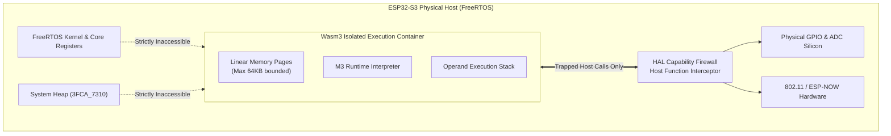
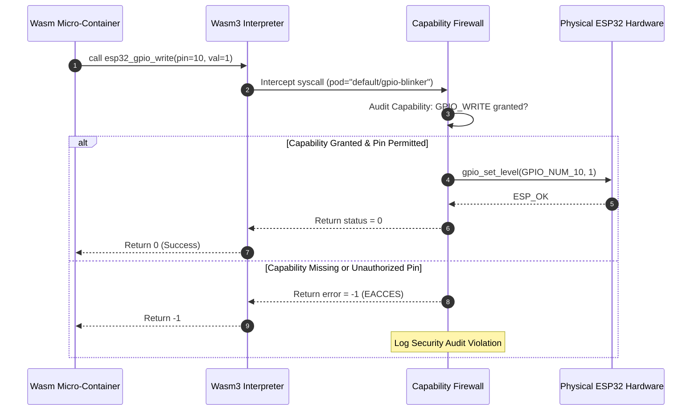

# Wasm3 Runtime Sandbox

<div class="blueprint-card">
  <strong>Execution Engine</strong>: Wasm3 Universal WebAssembly Interpreter<br>
  <strong>Linear Memory Sandboxing</strong>: 32KB - 64KB bounded pages with hardware fault trap handler<br>
  <strong>Host Call Boundary</strong>: Capability-gated host bindings via <code>runtime/host_functions.cpp</code>
</div>

Kube32 replaces native Linux container binaries (`elf`, `runc`) with sandboxed WebAssembly (Wasm) modules executed via the embedded `Wasm3` interpreter engine.

---

## Isolation Architecture



---

## Host Function Linkage & Interception

Guest WebAssembly modules interact with the physical world exclusively through registered host functions. Every host call passes through `hal::CapabilityFirewall`:

```cpp
// Registered host call signatures in Wasm3
m3_LinkRawFunction(module, "env", "esp32_gpio_write",   "i(ii)",   &raw_esp32_gpio_write);
m3_LinkRawFunction(module, "env", "esp32_gpio_read",    "i(i)",    &raw_esp32_gpio_read);
m3_LinkRawFunction(module, "env", "esp32_adc_read",      "i(i)",    &raw_esp32_adc_read);
m3_LinkRawFunction(module, "env", "esp32_channel_send", "i(iiii)", &raw_esp32_channel_send);
m3_LinkRawFunction(module, "env", "esp32_channel_recv", "i(iiii)", &raw_esp32_channel_recv);
```

### Host Function Execution Pipeline



---

## Memory Sandboxing & Fault Containment

### 1. Pointer Boundary Clamping
In WebAssembly, all memory access occurs within a contiguous 64KB page array. Addresses are indexed from `0` to `linear_memory_size - 1`. The interpreter clamps or traps any offset outside this buffer:
- Guest code cannot read host memory pointers.
- Guest code cannot modify FreeRTOS task control blocks (TCBs).

### 2. Trap Handlers & Host Survival
If guest code panics (e.g., division by zero, stack overflow, or memory out-of-bounds):
1. Wasm3 raises a execution trap (`m3Err_trapOutOfBoundsMemory`).
2. The `kubelet` worker catches the trap exception.
3. The pod phase transitions to `Failed` (`CrashLoopBackOff`).
4. **The ESP32 host kernel continues running normally** without rebooting or corrupting cluster state.
