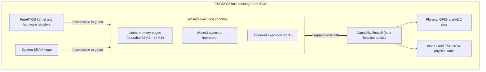
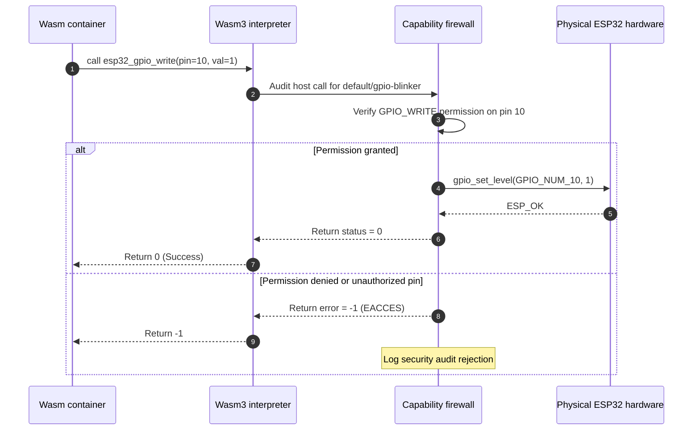

# Wasm3 runtime sandbox

<div class="blueprint-card">
  <strong>Execution engine</strong>: Wasm3 interpreter.<br>
  <strong>Memory isolation</strong>: 32 KB to 64 KB linear memory pages with hardware trap catches.<br>
  <strong>Host interface</strong>: Capability-gated host bindings via <code>runtime/host_functions.cpp</code>.
</div>

Standard Kubernetes relies on Linux kernel primitives (cgroups, namespaces, seccomp, and chroot) managed by containerd or runc. Microcontrollers run on bare metal or real-time operating systems like FreeRTOS, with no memory management unit (MMU) for virtual memory translation and no process address spaces. If an application writes to an invalid memory pointer, it corrupts kernel state or causes a processor panic that reboots the microcontroller.

WebAssembly solves this through software fault isolation. A WebAssembly module operates strictly within a contiguous linear byte array. Memory accesses cannot read or write physical addresses outside the guest module's allocated pages. Kube32 embeds the Wasm3 interpreter to run these sandboxed modules directly inside FreeRTOS tasks.

---

## Isolation model



---

## Host function calls and audits

Guest modules cannot write to memory-mapped hardware registers directly. They interact with peripherals through exported host functions:

```cpp
// Registered host bindings in Wasm3
m3_LinkRawFunction(module, "env", "esp32_gpio_write",   "i(ii)",   &raw_esp32_gpio_write);
m3_LinkRawFunction(module, "env", "esp32_gpio_read",    "i(i)",    &raw_esp32_gpio_read);
m3_LinkRawFunction(module, "env", "esp32_adc_read",      "i(i)",    &raw_esp32_adc_read);
m3_LinkRawFunction(module, "env", "esp32_channel_send", "i(iiii)", &raw_esp32_channel_send);
m3_LinkRawFunction(module, "env", "esp32_channel_recv", "i(iiii)", &raw_esp32_channel_recv);
```

When a container calls one of these functions, Kube32 pauses guest execution, inspects the calling pod's permissions, and only executes the hardware write if authorized:



---

## Fault isolation and error containment

### Linear memory bounds
In WebAssembly, memory indexing runs from `0` to `linear_memory_size - 1`. The interpreter clamps or faults any offset outside this boundary:
- Guest code cannot inspect host pointers or read Wi-Fi network buffers.
- Guest code cannot corrupt FreeRTOS task control blocks (TCBs).

### Traps and host stability
If guest code divides by zero, exhausts its stack, or attempts an illegal memory access:
1. Wasm3 raises an execution trap (`m3Err_trapOutOfBoundsMemory`).
2. The `k32_kubelet` worker catches the exception.
3. The pod status changes to `Failed` (`CrashLoopBackOff`).
4. The worker reclaims the sandbox memory buffer.
5. The ESP32-S3 kernel and all other running pods continue without interruption.
