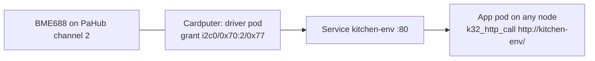

# Devices

A Device is a part that is wired to a node. Examples are an I2C sensor, a button on a GPIO pin, and the chip's own temperature sensor. For each Device, the control plane runs a driver pod on the node that has the part. It also creates a Service with the Device's name. Apps read the part over HTTP from any node, for example another board or a `kube32-sim` worker on a laptop. Apps never use the bus themselves.



Each node finds the I2C parts on its own buses. It also finds parts behind a PCA9548A multiplexer, for example the M5Stack PaHub. The control plane creates a Device for each part that it can identify. Discovery cannot find buttons, switches or parts at other addresses. For these parts, write a Device manifest.

By default a Device is `OnDemand`: its driver runs only while something uses the Device, and for 5 minutes after the last use (see [Activation](#activation)).

```
kubectl get devices
NAME                                  DRIVER      NODE         ADDRESS            PHASE     AGE
bme688-cardputer-b0-m70c2-77          bme688      cardputer    i2c0/0x70:2/0x77   Running   3m
miniscale-cardputer-b0-m70c3-26       miniscale   cardputer    i2c0/0x70:3/0x26   Idle      3m
rfid-cardputer-b0-m70c4-28            rfid        cardputer    i2c0/0x70:4/0x28   Idle      3m

kubectl label device bme688-cardputer-b0-m70c2-77 location=kitchen
```

## The Device resource

`kube32.io/v1` `Device` is a namespaced resource. Its plural is `devices` and its short name is `dev`. It supports `get`, `list`, `watch`, `create`, `update`, `patch` (JSON merge and strategic merge) and `delete`. It also has the `status` subresource.

```yaml
apiVersion: kube32.io/v1
kind: Device
metadata:
  name: kitchen-env
  labels:
    location: kitchen          # copied onto the driver pod
spec:
  driver: bme688               # a driver of the catalog
  nodeName: cardputer          # the node the part is wired to
  i2c:
    bus: 0
    address: "0x77"
    mux:                       # behind a PCA9548A / TCA9548A
      address: "0x70"
      channel: 2
  intervalMs: 5000             # reading period
  config:                      # driver settings
    heater-temp: "320"
  activation: OnDemand         # the driver runs while the Device is in use
  idleSeconds: 300             # and this long after the last use
```

| Field | Meaning | Default |
| --- | --- | --- |
| `spec.driver` | Driver from the [catalog](#driver-catalog) | Required |
| `spec.nodeName` | Node the part is wired to | One of `nodeName` and `nodeSelector` is required |
| `spec.nodeSelector` | Node labels instead of a name. The controller picks the first `Ready` node that matches, boards before `kube32-sim` nodes. It keeps the chosen node in `status.nodeName` while that node still matches | |
| `spec.i2c.bus` | I2C controller, `0` or `1` | `0` |
| `spec.i2c.address` | 7-bit address, `"0x08"` to `"0x77"` | The driver's address |
| `spec.i2c.mux.address` | Multiplexer address, `"0x70"` to `"0x77"` | `"0x70"` |
| `spec.i2c.mux.channel` | Multiplexer channel, `0` to `7` | Required with `mux` |
| `spec.pins` | GPIO drivers: pin names to GPIO numbers (`0`-`21`, `26`-`48`) | The driver's pins are required |
| `spec.intervalMs` | Reading period, `50` to `3600000` | The driver's period |
| `spec.config` | Settings for the driver. Values are strings, numbers or booleans | |
| `spec.image` | Driver image instead of the catalog's, a `wasm://` reference | `wasm://embedded/driver-<driver>` |
| `spec.activation` | `OnDemand`: the driver runs while the Device is in use. `Always`: the driver runs all the time | `OnDemand` |
| `spec.idleSeconds` | `OnDemand`: how long the driver runs after the last use, `10` to `86400` | `300` |

The API server rejects a Device in these conditions:

- The driver is not in the catalog.
- An I2C field is out of range, or the driver does not use I2C.
- The address is the multiplexer's own address.
- A pin is missing, the driver does not know the pin, or the pin is not a GPIO pad of the ESP32-S3.
- `activation` is not `OnDemand` or `Always`, or `idleSeconds` is not a whole number from `10` to `86400`.

You can write an address without quotes (`address: 0x77`). The API server stores it as a string. It also stores the defaults of `activation` and, for an `OnDemand` Device, `idleSeconds`.

The Device controller writes the status:

| Field | Meaning |
| --- | --- |
| `phase` | `Pending`, `Running`, `Idle` (an `OnDemand` Device that nobody uses: no driver pod), `Failed` or `Absent` (discovery no longer finds the part) |
| `nodeName` | Node the driver runs on |
| `podName` | The driver pod, while there is one |
| `chip` | The chip that discovery identified at the Device's address |
| `message` | Why the Device is not `Running`: the driver pod's waiting or failure reason, the scheduler's message, a conflict, or `idle: the driver starts on the next use` |

`kubectl get devices -o wide` adds the `CHIP`, `POD`, `ACTIVATION` and `MESSAGE` columns. `kubectl describe device` lists the controller's Events: `Discovered`, `SuccessfulCreate`, `Activated`, `Idle`, `Replacing`, `Absent` and `Present`.

## Driver pods

The Device controller (`src/controller/device_controller.cpp`) runs on the control plane. For each Device, it keeps two objects that the Device owns:

- Pod `<device>-driver` in the Device's namespace. A `kubernetes.io/hostname` node selector pins the pod to the Device's node. The pod never runs on another node.
- Service `<device>`, which sends port `80` to the pod's `http` port and selects `kube32.io/device: <device>`.

The driver pod has these settings:

- The Device's labels, plus `kube32.io/device: <device>` and `kube32.io/driver: <driver>`.
- `restartPolicy: Always`.
- `enableServiceLinks: false`. A driver calls no Service, and each Device adds a Service to the namespace.
- The `CHANNEL_IPC` capability and `hardware.kube32.io/ipc`.
- The driver's memory as the request and the limit.
- A container port `http` with the node's pod port (`status.daemonEndpoints.kubeletEndpoint.Port`, 7000 on boards).

The controller sets this environment:

| Variable | Value |
| --- | --- |
| `DEVICE_NAME`, `DEVICE_NAMESPACE`, `DEVICE_DRIVER` | The Device |
| `NODE_NAME` | `fieldRef` `spec.nodeName` |
| `DEVICE_TOPIC` | `device.<device>`, the channel topic for the driver's readings |
| `DEVICE_INTERVAL_MS` | `spec.intervalMs` or the driver's period |
| `I2C_BUS`, `I2C_ADDR` | I2C drivers: bus number and address (`0x77`) |
| `PIN_<NAME>` | GPIO drivers: the GPIO number of each pin (`PIN_PIN=4`) |
| `CONFIG_<KEY>` | Each `spec.config` entry. The key is upper case, and `-` and `.` become `_` |

The controller also sets these annotations and resources:

- `kube32.io/tick-interval` with the reading period.
- For an I2C driver, the device grant `kube32.io/i2c-device` (see [shared I2C buses](#shared-i2c-buses)).
- A driver that only reads its pins (`button`) requests `esp32.io/gpio-input-<n>` for each pin. This resource also admits GPIO 0, the boot button.
- A driver that drives its pins (`switch`) requests `esp32.io/gpio-<n>`.
- `chip-temp` requests `hardware.kube32.io/chip-temp`.

The controller keeps the driver pod in step with the Device:

- When the Device's labels change, it updates the pod's labels in place.
- When the driver, address, pins, period, config, image or node changes, it replaces the pod.
- When someone deletes the pod, it creates the pod again (an `OnDemand` Device: while it is in use).
- It replaces a `Failed` pod after 1 minute. If the replacement fails again, the wait doubles each time, up to 10 minutes.

When you delete the Device, the controller deletes its pod and its Service. If a Service with the Device's name exists and the Device does not own it, the controller does not change that Service. The Device's message tells about the conflict.

## Activation

An `OnDemand` Device has a driver pod only while it is in use. A Device without a use is `Idle`: its Service stays, without endpoints, and the driver takes no memory on its node. Each of these is a use:

- A call to a Service that selects the driver pod, from any node: `k32_http_call` to the Device's Service or to an app's own Service that selects drivers by label, and a request to an Ingress rule with such a Service as its backend.
- A pod that subscribes to `device.<device>` (`kube32.io/event-topics`), on any node, while it is neither terminating nor `Succeeded` or `Failed`. Its subscription counts as a use on each controller pass.
- A client of an Ingress event stream (`kube32.io/event-stream`) that carries `device.<device>`, for a Device in the Ingress's namespace.
- `kube32-cli devices`, which reads the Devices it lists.
- `POST /apis/kube32.io/v1/namespaces/<ns>/devices/<device>/activate`, the `activate` subresource. It answers `200` with a `Status`, or `404` for a Device that does not exist. `kubectl create --raw <path> -f <file with {}>` sends it.

The control plane keeps the time of the last use of each Device in memory. It stores nothing, so a use writes nothing to the journal on flash and starts no watch event. The Device controller deletes the driver pod `idleSeconds` after the last use, gracefully, and sets the phase to `Idle`. A driver pod that runs when the control plane starts gets a full `idleSeconds` before it goes.

Callers report uses to the control plane with the `activate` subresource; on the control plane itself, the Service client and the Ingress controller call the Device controller directly. A caller learns which Devices a Service selects from the Service's Endpoints: the API server gives them the annotation `kube32.io/on-demand-devices: "<device>:<node>:<idleSeconds>[,...]"`. Each node reports a Device at most once per `idleSeconds / 4` while its driver answers, and at most once a second while callers wait for the driver to start. The record of these reports takes about 40 bytes for each Device that the node's pods call.

When a Service has no ready driver, a call to it waits:

1. The caller reports the use, and the Device controller makes a pass at once.
2. The controller creates the driver pod on the Device's node, and the scheduler binds it in the same pass.
3. The control plane tells the node's kubelet over the channel fabric, and the kubelet lists its pods at once. It loads the driver (about 100 ms on a board) and reports the pod `Running`. Each start also writes the pod's status and its events to the API server, about 2 seconds on a board over Wi-Fi. A board without PSRAM starts its pods one after another.
4. The caller sees the endpoint (it checks every 200 ms) and makes the call. A driver answers `503` until its first reading; the call that started the driver asks again every 100 ms until the driver has one.

The first call thus takes the driver's start plus its first reading: about 2 seconds for one driver on a board, and about 2 seconds more for each further driver that starts on the same board at the same time (three drivers on a Cardputer: about 6 seconds). Later calls do not wait. A call waits at most 10 seconds and never longer than its own timeout. When the driver does not start in time, `k32_http_call` returns `503` with `{"device":"<device>","ok":false,"error":"the driver of Device <device> did not start within <ms> ms (<why>)"}`, and the Ingress controller answers `503 {"error":"unavailable",...}` with `Retry-After: 2`.

On a node with a shared interpreter stack (every board), a pod that calls a Device's Service holds that stack until the call returns, and a driver needs it to start. Such a caller therefore does not wait for a driver that starts on its own node: it reports the use and gets `503` with `the driver of Device <device> starts on this node once this call returns: call again` at once. The driver starts after the call, and the next call reads it.

An `Always` Device keeps its driver pod all the time, as long as the Device exists and its node has the part. Set `activation: Always` for a Device whose driver must run without readers, for example a switch whose output must stay set, or a part whose events an Ingress or another cluster consumes without a subscribed pod.

## Driver catalog

One table in the firmware (`src/models/device.cpp`) supplies the API server's validation, the Device controller and discovery. Each driver runs from the image `wasm://embedded/driver-<driver>` with 3 KiB of linear memory.

| Driver | Bus | Address | Identified by | Readings / actions | Period |
| --- | --- | --- | --- | --- | --- |
| `bme688` | I2C | `0x77` (`0x76`) | Register `0xD0` reads `0x61` and variant register `0xF0` reads `0x01` | `temperature_c`, `pressure_hpa`, `humidity_pct`, `gas_ohms` | 5 s |
| `miniscale` | I2C | `0x26` | Register `0xFF`, the unit's I2C address, reads `0x26`, and the button register `0x20` reads `0` or `1` | `weight_g`, `raw` / `tare`, `led` | 1 s |
| `rfid` | I2C | `0x28` | Version register `0x37` reads `0x15` (WS1850S), `0x88` or `0xB2` (FM17522), `0x91` or `0x92` (MFRC522) | `tag`, `present`. An event for each tag | 200 ms |
| `chip-temp` | Internal | | Not discovered | `temperature_c` of the die. It is above room temperature while the chip works | 10 s |
| `button` | GPIO pin `pin`, read only (GPIO 0 allowed) | | Not discovered | `pressed`, an event on change. Config `pull` (`up`, `down`, `none`) and `active` (`low`, `high`) | 50 ms |
| `switch` | GPIO pin `pin` | | Not discovered | `on` / `{"action":"set","on":true}` | 30 s |

## Driver API

A driver pod answers on its `http` port. Thus the Device's Service answers on port 80:

| Request | Answer |
| --- | --- |
| `GET /` | `200 {"device":"kitchen-env","driver":"bme688","node":"cardputer","ok":true,"at":<unix ms or 0>,"uptime_ms":<ms>,"readings":{"temperature_c":21.43,"pressure_hpa":1007.2,"humidity_pct":41.0,"gas_ohms":51234}}`, or `503 {"device":"...","driver":"...","ok":false,"error":"<why>"}` when the part does not answer |
| `GET /describe` | `200 {"driver":"bme688","readings":{"temperature_c":"C","pressure_hpa":"hPa",...},"actions":[...]}` |
| `POST /` with `{"action":"tare"}` | `200 {"ok":true,...}` or `400 {"ok":false,"error":...}` |

Reading keys use snake case with a unit suffix: `temperature_c`, `humidity_pct`, `pressure_hpa`, `gas_ohms`, `weight_g`, `pressed`, `on`, `tag`.

The driver also publishes each reading on the channel topic `device.<device>`, with the body of `GET /`. An actuator also publishes each change of its state. An event carries at most 200 bytes, so an event body can omit `uptime_ms`, `node` and `device`.

## Discovery

Each node scans the I2C buses on its board's default pins (`src/hal/i2c_discovery.cpp`). It scans before it registers, and then every 10 seconds. A scan probes addresses `0x08` to `0x77` with zero-length writes.

The scan identifies a PCA9548A multiplexer as follows. The address is in the range `0x70` to `0x77` and is not a catalog part. The scan writes the control bytes `0x01`, `0x80` and `0x00` to it, and the part keeps each byte. Then the scan selects each of the eight channels alone. It probes the addresses that answer on the channel and not on the bus itself. At the end, it deselects all channels.

Discovery identifies a part at a catalog address with the catalog's register reads. Discovery writes only multiplexer control bytes and one-byte register pointers. It identifies a part when the part first appears. It does not read a part that a driver pod's device grant holds.

Discovery reports its results in two ways:

- Node labels `i2c.kube32.io/0x<address>`. The value is `bus-<n>` for a part on the bus itself. For a part behind a multiplexer, the value is `bus-<n>.mux-<hh>.<channel>`, for example `i2c.kube32.io/0x77: bus-0.mux-70.2`. This label appears only when no part at that address is on a bus itself. A `nodeSelector` on these labels puts a pod on the node that has the part.
- Node annotation `kube32.io/i2c-devices`, a JSON list of all parts with their multiplexer channels and identifications:

```json
[{"bus":0,"address":"0x70","chip":"PCA9548A"},
 {"bus":0,"mux":"0x70","channel":2,"address":"0x77","chip":"BME688","driver":"bme688"}]
```

The scan follows these rules for buses that are in use:

- Discovery does not scan a bus that a pod claims whole (`esp32.io/i2c-bus-<n>`). The node keeps the results of its last scan of that bus.
- Discovery scans a bus that device grants share while the drivers run. It does one transfer at a time under the same bus lock.
- Discovery does not scan a free bus whose lines read low with the internal pull-ups on.
- The node lends a free bus to the scan. Pod admission waits for the scan to end. With a multiplexer, the scan takes a few hundred milliseconds.

### Devices from discovery

The control plane checks each identified catalog part. If no Device has the same node, bus, multiplexer channel and address, it creates a Device in the `default` namespace. The name is `<driver>-<node>-b<bus>[-m<mux>c<channel>]-<address>`, for example `bme688-cardputer-b0-m70c2-77`. If the name is longer than 63 characters, the control plane cuts it and adds a hash.

The Device has the labels `kube32.io/discovered: "true"` and `kube32.io/driver: <driver>`. It is `OnDemand` with `idleSeconds: 300`: its driver runs only while something uses the part. Change either field with `kubectl patch`. Labels that you add later with `kubectl label` stay. If you write a Device for the same part, discovery does not create a second Device.

A part that one scan misses stays in the report for one more scan. Thus a single failed transfer does not stop a driver. If two scans in a row do not find a discovered part (about 20 seconds), the control plane sets its Device to `Absent`. It deletes the driver pod, but the Device, its labels and its Service stay. When the part answers again, the driver starts again on the next use. If you delete a discovered Device while its part is attached, the next pass creates the Device again.

## Shared I2C buses

A driver pod reaches its part through a device grant, not through a claim of the whole bus. The grant is the annotation `kube32.io/i2c-device: "bus=<n>,addr=0x<hh>[,mux=0x<hh>:<channel>]"`. The capability firewall (`src/hal/capability_firewall.cpp`) admits any number of grants on one bus, with one pod for each part. The shared bus follows these rules:

- The first grant claims the board's default pins of the bus and installs the I2C driver at 100 kHz. When the last grant goes, the firewall uninstalls the I2C driver. Until then, other pods cannot use these pins.
- A pod's `esp32_i2c_write` and `esp32_i2c_read` reach only its own address. Any other address, including the multiplexer's, returns `K32_ERR_PERM`. The firewall logs `[FIREWALL] denied <pod>: i2c <bus> address 0x<hh> write`.
- The bus lock lets only one transfer run at a time. Before a transfer through a multiplexer, the bus writes the control byte (`1 << channel`) if the multiplexer is on another channel. Before a transfer to a part on the bus itself, the bus deselects each multiplexer that it switched. Thus a driver never sees the multiplexer, and two drivers on different channels can mix their register accesses safely.
- After a failed transfer, the bus resets the lines (`i2c_master_bus_reset`), as it does for a bus that a pod claims whole. The bus then treats the multiplexer state as unknown, so the next transfer writes the channel again.

One pod can claim a bus whole (`esp32.io/i2c-bus-<n>`), or grants can share it. The first one that the node admits keeps the bus. The other pod stays `Pending` with the waiting reason `BusInUse`. It starts when the bus is free:

```
I2C bus 0 is shared by 3 device grant(s) (kube32.io/i2c-device): the pod claims it whole (esp32.io/i2c-bus-0) once they are released; retrying every 5 s
```

The node's allocatable `esp32.io/i2c` does not count a shared bus.

## Reading Devices from apps

An app selects drivers by Device labels with its own Service. It calls the Service with `k32_http_call`, which needs the `SERVICE_CALL` capability:

```yaml
apiVersion: v1
kind: Service
metadata:
  name: kitchen-air
spec:
  selector:
    kube32.io/driver: bme688
    location: kitchen
  ports:
    - port: 80
      targetPort: http
```

```c
static uint8_t buf[512];
uint32_t len = 0;
int32_t status = k32_http_call("GET", 3, "http://kitchen-air/", 19, 0, 0, 0, 0, buf, sizeof buf, &len, 2000);
```

The Device's own Service works the same way (`http://kitchen-env/`). An app can also subscribe to `device.<device>` with `kube32.io/event-topics`. It then receives each reading when the driver takes it, and the driver of an `OnDemand` Device runs while the app exists.

The first call to an `Idle` Device starts its driver and waits for its first reading ([Activation](#activation)). Give that call a timeout of a few seconds.

Each Service in a namespace adds about eight variables to the environment of each pod that starts there, and each Device adds a Service. An app that reaches Devices by name can set `enableServiceLinks: false`. On a board without PSRAM, each variable uses about 100 bytes of the internal heap while the pod runs.

## Compute on a laptop

A `kube32-sim` worker can join a cluster of boards and run app pods. Driver pods stay on the boards that have their parts:

```
kube32-sim --role worker --join http://<control-plane-ip>:6443 --node-ip <laptop-ip> --node-name laptop --pod-port 17000
```

`--node-ip` must be an address that the boards can reach. An app on the laptop calls a driver at its board's address. Drivers and Services reach the laptop's pod server at the laptop's address.

The pod server uses the node's own port. Endpoints, Ingress routes and Service calls reach a pod on the laptop at the port that the laptop reports, whatever its `containerPort` is.

`kube32-sim` nodes have the label `kube32.io/simulator: "true"`. If a Device selects its node by labels, the controller puts it on a matching board. It uses a `kube32-sim` node only when no board matches.

On a `kube32-sim` node, a driver uses the simulator's stub HAL. The stub HAL answers for the simulated parts that the simulator starts with:

```
kube32-sim --sim-i2c pahub,bme688@2,miniscale@3,rfid@4
```

| Part | Address | Behaviour |
| --- | --- | --- |
| `pahub` | `0x70` | PCA9548A. The control byte selects channels. Parts written `@<channel>` are behind it |
| `bme688` | `0x77` | Chip id, variant and calibration of a BME688. A forced measurement fills the result registers |
| `miniscale` | `0x26` | Unit Mini Scales registers: raw value, weight, button, LED, gap, tare |
| `rfid` | `0x28` | MFRC522 registers with version `0x15` and an empty field |

`<part>:0x<address>` puts a part at another address. With no simulated parts, a driver on a `kube32-sim` node reports that its part does not answer.

## Memory

| Where | Cost |
| --- | --- |
| Each driver pod | Like any pod: its 3 KiB of linear memory, its module's compiled code and the runtime's structures for the pod. The admission estimate is 16 to 29 KiB of a board's pod pool. On the Cardputer, a BME688, a Mini Scales unit and an RFID 2 reader use 69 KB together (25.4 + 20.1 + 23.5 KB). The pool has 80 KiB. The firewall keeps 6 bytes for each grant |
| A node with shared buses | One I2C driver for each bus, with up to four device handles for all grants. Discovery keeps about 50 bytes for each part that it finds. The node annotation uses about 70 bytes for each part |
| An `Idle` Device | No driver pod: nothing of the pod pool and nothing of its node's internal RAM |
| Control plane | The Device controller's thread (12 KiB stack in PSRAM). It makes a pass when a Device, a driver pod, a Service, a pod that subscribes to `device.*` topics, or what it reads of a Node changes, at most every 2 seconds, at once when an `Idle` Device gets a use, and every 30 s without a change. A Device, its pod and its Service use about 2.5 KiB of the object store. The time of the last use takes about 60 bytes for each Device |
| Each node that calls Devices | The time of its last report, about 40 bytes for each Device. Reports use no thread of their own: they go out on the caller's thread |

## Limitations

- A pod holds at most one device grant.
- A shared bus runs on the board's default pins at 100 kHz.
- Discovery identifies catalog parts only at their catalog addresses.
- Discovery does not scan a multiplexer behind another multiplexer.
- `Absent` applies only to Devices that discovery created. A Device that you wrote stays `Running` when its part stops answering, and its driver answers `503`.
- On a board, a call from a pod to an `Idle` Device whose driver starts on the same board gets `503` at once; the next call reads the driver.
- A request through an Ingress rule that starts a driver gets the driver's first answer, which is `503` when the driver has no reading yet. `k32_http_call` waits for the first reading.
