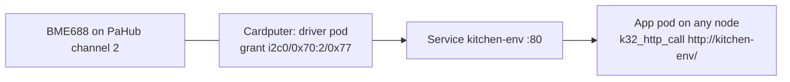

# Devices

A Device is a part wired to a node: an I2C sensor, a button on a GPIO pin, or the chip's own temperature sensor. For every Device the control plane runs a driver pod on the node the part is wired to and creates a Service with the Device's name. Apps read the part over HTTP from any node, including another board or a `kube32-sim` worker on a laptop, and never touch the bus themselves.



Nodes find I2C parts on their own buses, including behind a PCA9548A multiplexer such as the M5Stack PaHub, and the control plane creates a Device for every part it can identify. Parts discovery cannot see, such as buttons, switches and parts at other addresses, are described with a Device manifest.

```
kubectl get devices
NAME                                  DRIVER      NODE         ADDRESS            PHASE     AGE
bme688-cardputer-b0-m70c2-77          bme688      cardputer    i2c0/0x70:2/0x77   Running   3m
miniscale-cardputer-b0-m70c3-26       miniscale   cardputer    i2c0/0x70:3/0x26   Running   3m
rfid-cardputer-b0-m70c4-28            rfid        cardputer    i2c0/0x70:4/0x28   Running   3m

kubectl label device bme688-cardputer-b0-m70c2-77 location=kitchen
```

## The Device resource

`kube32.io/v1` `Device` is namespaced, with the plural `devices` and the short name `dev`. It supports `get`, `list`, `watch`, `create`, `update`, `patch` (JSON merge and strategic merge), `delete`, and the `status` subresource.

```yaml
apiVersion: kube32.io/v1
kind: Device
metadata:
  name: kitchen-env
  labels:
    location: kitchen          # copied onto the driver pod
spec:
  driver: bme688               # a driver of the catalog
  nodeName: cardputer          # the node the part is wired to
  i2c:
    bus: 0
    address: "0x77"
    mux:                       # behind a PCA9548A / TCA9548A
      address: "0x70"
      channel: 2
  intervalMs: 5000             # reading period
  config:                      # driver settings
    heater-temp: "320"
```

| Field | Meaning | Default |
| --- | --- | --- |
| `spec.driver` | Driver from the [catalog](#driver-catalog) | Required |
| `spec.nodeName` | Node the part is wired to | One of `nodeName` and `nodeSelector` is required |
| `spec.nodeSelector` | Node labels instead of a name: the first `Ready` node that matches, boards before `kube32-sim` nodes. The chosen node is kept in `status.nodeName` while it still matches | |
| `spec.i2c.bus` | I2C controller, `0` or `1` | `0` |
| `spec.i2c.address` | 7-bit address, `"0x08"` to `"0x77"` | The driver's address |
| `spec.i2c.mux.address` | Multiplexer address, `"0x70"` to `"0x77"` | `"0x70"` |
| `spec.i2c.mux.channel` | Multiplexer channel, `0` to `7` | Required with `mux` |
| `spec.pins` | GPIO drivers: pin names to GPIO numbers (`0`-`21`, `26`-`48`) | The driver's pins are required |
| `spec.intervalMs` | Reading period, `50` to `3600000` | The driver's period |
| `spec.config` | Settings passed to the driver; values are strings, numbers or booleans | |
| `spec.image` | Driver image instead of the catalog's, a `wasm://` reference | `wasm://embedded/driver-<driver>` |

The API server rejects a Device whose driver is not in the catalog, whose I2C fields are out of range or set for a driver that does not use I2C, whose address is the multiplexer's own, or whose pins are missing, unknown to the driver, or not GPIO pads of the ESP32-S3. Addresses may be written unquoted (`address: 0x77`); they are stored as strings.

Status, written by the Device controller:

| Field | Meaning |
| --- | --- |
| `phase` | `Pending`, `Running`, `Failed`, or `Absent` (discovery no longer finds the part) |
| `nodeName` | Node the driver runs on |
| `podName` | The driver pod |
| `chip` | What discovery identified at the Device's address |
| `message` | Why the Device is not `Running`: the driver pod's waiting or failure reason, the scheduler's message, or a conflict |

`kubectl get devices -o wide` adds the `CHIP`, `POD` and `MESSAGE` columns. `kubectl describe device` lists the controller's Events: `Discovered`, `SuccessfulCreate`, `Replacing`, `Absent` and `Present`.

## Driver pods

The Device controller (`src/controller/device_controller.cpp`) runs on the control plane and keeps two objects per Device, both owned by it:

- Pod `<device>-driver` in the Device's namespace, pinned to the Device's node with a `kubernetes.io/hostname` node selector. It never runs anywhere else.
- Service `<device>`, port `80` to the pod's `http` port, selecting `kube32.io/device: <device>`.

The driver pod carries the Device's labels plus `kube32.io/device: <device>` and `kube32.io/driver: <driver>`, `restartPolicy: Always`, the `CHANNEL_IPC` capability and `hardware.kube32.io/ipc`, the driver's memory as request and limit, and a container port `http` set to the node's pod port (`status.daemonEndpoints.kubeletEndpoint.Port`, 7000 on boards). Its environment:

| Variable | Value |
| --- | --- |
| `DEVICE_NAME`, `DEVICE_NAMESPACE`, `DEVICE_DRIVER` | The Device |
| `NODE_NAME` | `fieldRef` `spec.nodeName` |
| `DEVICE_TOPIC` | `device.<device>`: the channel topic the driver publishes readings on |
| `DEVICE_INTERVAL_MS` | `spec.intervalMs` or the driver's period |
| `I2C_BUS`, `I2C_ADDR` | I2C drivers: bus number and address (`0x77`) |
| `PIN_<NAME>` | GPIO drivers: the GPIO number of each pin (`PIN_PIN=4`) |
| `CONFIG_<KEY>` | Each `spec.config` entry; keys upper-cased, `-` and `.` become `_` |

Annotations: `kube32.io/tick-interval` set to the reading period, and for an I2C driver the device grant `kube32.io/i2c-device` ([shared I2C buses](#shared-i2c-buses)). A driver that only reads its pins (`button`) requests `esp32.io/gpio-input-<n>` for each, which also admits GPIO 0, the boot button; one that drives them (`switch`) requests `esp32.io/gpio-<n>`. `chip-temp` requests `hardware.kube32.io/chip-temp`.

The controller updates the pod's labels in place when the Device's labels change, replaces the pod when anything else it was made from changes (driver, address, pins, period, config, image, node), creates it again when it is deleted, and replaces a `Failed` pod after 1 minute, doubling the wait for each replacement that fails again up to 10 minutes. Deleting the Device deletes its pod and Service. A Service of the Device's name that the Device does not own is left alone, and the Device's message says so.

## Driver catalog

One table in the firmware (`src/models/device.cpp`) serves the API server's validation, the Device controller and discovery. Each driver runs from the image `wasm://embedded/driver-<driver>` with 3 KiB of linear memory.

| Driver | Bus | Address | Identified by | Readings / actions | Period |
| --- | --- | --- | --- | --- | --- |
| `bme688` | I2C | `0x77` (`0x76`) | Register `0xD0` reads `0x61` and variant register `0xF0` reads `0x01` | `temperature_c`, `pressure_hpa`, `humidity_pct`, `gas_ohms` | 5 s |
| `miniscale` | I2C | `0x26` | Register `0xFF`, the unit's I2C address, reads `0x26`, and the button register `0x20` reads `0` or `1` | `weight_g`, `raw` / `tare`, `led` | 1 s |
| `rfid` | I2C | `0x28` | Version register `0x37` reads `0x15` (WS1850S), `0x88` or `0xB2` (FM17522), `0x91` or `0x92` (MFRC522) | `tag`, `present`; an event per tag | 200 ms |
| `chip-temp` | Internal | | Not discovered | `temperature_c` of the die, above room temperature while the chip works | 10 s |
| `button` | GPIO pin `pin`, read only (GPIO 0 allowed) | | Not discovered | `pressed`, an event on change; config `pull` (`up`, `down`, `none`), `active` (`low`, `high`) | 50 ms |
| `switch` | GPIO pin `pin` | | Not discovered | `on` / `{"action":"set","on":true}` | 30 s |

## Driver API

A driver pod answers on its `http` port, so through the Device's Service on port 80:

| Request | Answer |
| --- | --- |
| `GET /` | `200 {"device":"kitchen-env","driver":"bme688","node":"cardputer","ok":true,"at":<unix ms or 0>,"uptime_ms":<ms>,"readings":{"temperature_c":21.43,"pressure_hpa":1007.2,"humidity_pct":41.0,"gas_ohms":51234}}`, or `503 {"device":"...","driver":"...","ok":false,"error":"<why>"}` when the part does not answer |
| `GET /describe` | `200 {"driver":"bme688","readings":{"temperature_c":"C","pressure_hpa":"hPa",...},"actions":[...]}` |
| `POST /` with `{"action":"tare"}` | `200 {"ok":true,...}` or `400 {"ok":false,"error":...}` |

Reading keys are snake case with a unit suffix: `temperature_c`, `humidity_pct`, `pressure_hpa`, `gas_ohms`, `weight_g`, `pressed`, `on`, `tag`. Every reading, and every change of an actuator's state, is also published on the channel topic `device.<device>` with the body of `GET /`. Events carry at most 200 bytes, so an event body may leave out `uptime_ms`, `node` and `device`.

## Discovery

Every node scans the I2C buses on its board's default pins before it registers and every 10 seconds after (`src/hal/i2c_discovery.cpp`). A scan probes addresses `0x08` to `0x77` with zero-length writes.

An address from `0x70` to `0x77` that is not a catalog part and keeps the control byte written to it (`0x01`, then `0x80`, then `0x00`) is a PCA9548A multiplexer. The scan selects each of its eight channels alone, probes the addresses that answer there and not on the bus itself, and deselects every channel at the end. A part found at a catalog address is identified by the catalog's register reads. Discovery writes nothing but multiplexer control bytes and one-byte register pointers. A part is identified when it first shows up; one that a driver pod's device grant holds is not read.

Discovery reports what it found in two ways:

- Node labels `i2c.kube32.io/0x<address>`: `bus-<n>` for a part on the bus itself, or `bus-<n>.mux-<hh>.<channel>` for a part behind a multiplexer when the address is not on a bus itself (`i2c.kube32.io/0x77: bus-0.mux-70.2`). A `nodeSelector` on these labels places a pod on the node with the part.
- Node annotation `kube32.io/i2c-devices`, a JSON list of every part with its multiplexer channel and identification:

```json
[{"bus":0,"address":"0x70","chip":"PCA9548A"},
 {"bus":0,"mux":"0x70","channel":2,"address":"0x77","chip":"BME688","driver":"bme688"}]
```

A bus that a pod claims whole (`esp32.io/i2c-bus-<n>`) is not scanned, and the node keeps the results of its last scan. A bus shared by device grants is scanned beside the drivers, one transfer at a time under the same bus lock. A free bus whose lines read low with the internal pull-ups on is not scanned. A free bus is lent to the scan; pod admission waits for it, which takes a few hundred milliseconds with a multiplexer.

### Devices from discovery

For each identified catalog part that no Device covers yet (same node, bus, multiplexer channel and address), the control plane creates a Device in the `default` namespace named `<driver>-<node>-b<bus>[-m<mux>c<channel>]-<address>`, for example `bme688-cardputer-b0-m70c2-77`, cut to 63 characters with a hash when longer. It carries the labels `kube32.io/discovered: "true"` and `kube32.io/driver: <driver>`. Labels added later with `kubectl label` stay. A hand-written Device for the same part keeps discovery from creating a second one.

When the node's report no longer lists a discovered part, its Device turns `Absent`: the driver pod is deleted, while the Device, its labels and its Service stay. When the part answers again, the driver comes back. A discovered Device deleted while its part is attached is created again by the next pass.

## Shared I2C buses

A driver pod reaches its part through a device grant, the annotation `kube32.io/i2c-device: "bus=<n>,addr=0x<hh>[,mux=0x<hh>:<channel>]"`, instead of claiming the bus whole. The capability firewall (`src/hal/capability_firewall.cpp`) admits any number of grants on one bus, one pod per part:

- The first grant claims the board's default pins of the bus and installs the driver at 100 kHz; the last grant to go removes it. The pins stay unavailable to other pods in between.
- A pod's `esp32_i2c_write` and `esp32_i2c_read` reach its own address only. Any other address, including the multiplexer's, returns `K32_ERR_PERM` and logs `[FIREWALL] denied <pod>: i2c <bus> address 0x<hh> write`.
- Transfers are serialized by the bus lock. Before a transfer through a multiplexer, the bus writes the multiplexer's control byte (`1 << channel`) when the multiplexer is on another channel. Before a transfer to a part on the bus itself, it deselects every multiplexer it has switched. A driver therefore never sees the multiplexer, and two drivers behind different channels interleave register accesses safely.
- After a failed transfer, the bus is cleared (`i2c_master_bus_reset`) as for a bus a pod claims whole, and the multiplexers' state counts as unknown, so the next transfer writes the channel again.

A bus is either claimed whole by one pod (`esp32.io/i2c-bus-<n>`) or shared by grants. Whichever is admitted first keeps it. The other pod stays `Pending` with the waiting reason `BusInUse` and starts once the bus is free:

```
I2C bus 0 is shared by 3 device grant(s) (kube32.io/i2c-device): the pod claims it whole (esp32.io/i2c-bus-0) once they are released; retrying every 5 s
```

A shared bus is not counted in the node's allocatable `esp32.io/i2c`.

## Reading Devices from apps

An app selects drivers by Device labels with its own Service, and calls it with `k32_http_call` (the `SERVICE_CALL` capability):

```yaml
apiVersion: v1
kind: Service
metadata:
  name: kitchen-air
spec:
  selector:
    kube32.io/driver: bme688
    location: kitchen
  ports:
    - port: 80
      targetPort: http
```

```c
static uint8_t buf[512];
uint32_t len = 0;
int32_t status = k32_http_call("GET", 3, "http://kitchen-air/", 19, 0, 0, 0, 0, buf, sizeof buf, &len, 2000);
```

The Device's own Service works the same way (`http://kitchen-env/`). An app that subscribes to `device.<device>` with `kube32.io/event-topics` receives every reading as it is taken.

## Compute on a laptop

A `kube32-sim` worker joins a cluster of boards and runs app pods. Driver pods stay on the boards their parts are wired to:

```
kube32-sim --role worker --join http://<control-plane-ip>:6443 --node-ip <laptop-ip> --node-name laptop --pod-port 7000
```

`--node-ip` must be an address the boards reach: an app on the laptop calls a driver at its board's address, and drivers and Services reach the laptop's pod server at the laptop's. Nodes of `kube32-sim` carry the label `kube32.io/simulator: "true"`. A Device that selects its node by labels lands on a board when one matches, and on a `kube32-sim` node only when none does.

A Device on a `kube32-sim` node runs its driver against the simulator's stub HAL, which answers for the simulated parts the simulator was started with:

```
kube32-sim --sim-i2c pahub,bme688@2,miniscale@3,rfid@4
```

| Part | Address | Behaviour |
| --- | --- | --- |
| `pahub` | `0x70` | PCA9548A: the control byte selects channels; parts written `@<channel>` sit behind it |
| `bme688` | `0x77` | Chip id, variant and calibration of a BME688; a forced measurement fills the result registers |
| `miniscale` | `0x26` | Unit Mini Scales registers: raw value, weight, button, LED, gap, tare |
| `rfid` | `0x28` | MFRC522 registers with version `0x15` and an empty field |

`<part>:0x<address>` places a part at another address. Without simulated parts, a driver on a `kube32-sim` node reports that its part does not answer.

## Memory

| Where | Cost |
| --- | --- |
| Each driver pod | Its 3 KiB of linear memory, its module's compiled code and the runtime's per-pod structures, as any pod: 16 to 28 KiB of a board's pod pool. A BME688, a Mini Scales unit and an RFID 2 reader take about 77 KiB of the Cardputer's 80 KiB pool. The firewall keeps 6 bytes for a grant |
| A node with shared buses | One I2C driver per bus for all grants, with up to four device handles; discovery keeps about 50 bytes per part found |
| Control plane | The Device controller's thread (12 KiB stack, in PSRAM), a pass every 2 seconds; a Device, its pod and its Service take about 2.5 KiB of the object store |

## Limitations

- A pod holds at most one device grant, and a shared bus runs on the board's default pins at 100 kHz.
- Discovery identifies catalog parts at their catalog addresses only, and does not scan multiplexers behind multiplexers.
- `Absent` applies to Devices created from discovery; a hand-written Device for a part that stops answering stays `Running` while its driver answers `503`.
