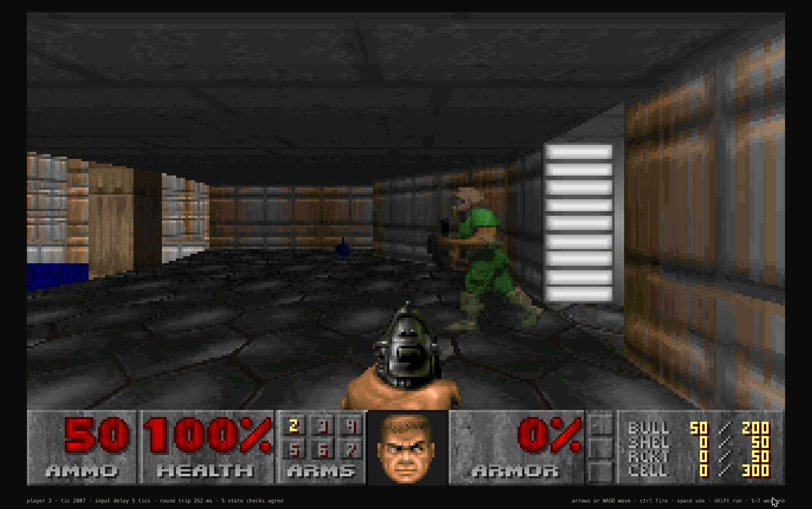
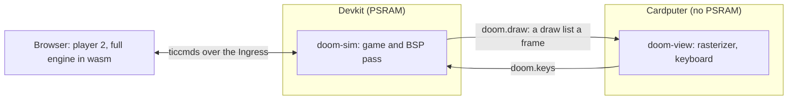
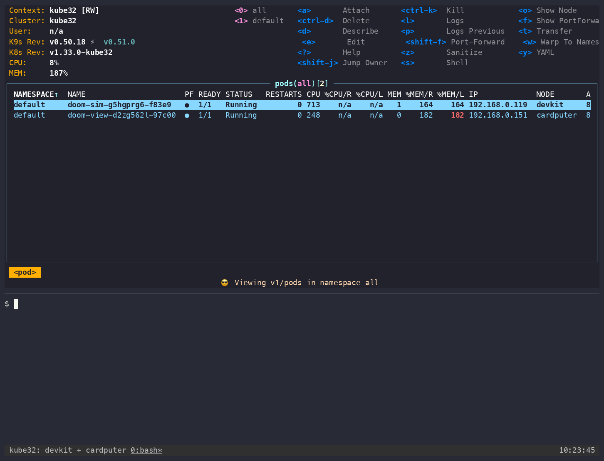
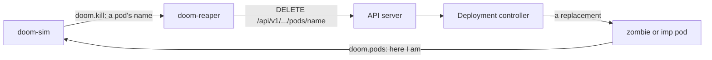

# DOOM

DOOM runs across two boards as two pods. The devkit runs the game, the Cardputer draws it, and a browser joins as player 2 through the devkit's Ingress. One `kubectl apply` replaces it with [wordsketch](wordsketch.md), and another brings it back. A third turns the game on the cluster: in [the hunt](#the-hunt) every demon is a pod.



*Player 2 in the browser with player 1, the green marine, in view. The line under the status bar is the page's lockstep state: tic, input delay, round trip and state checks.*

## How it runs



| Pod | Node | What it runs | Module |
| --- | --- | --- | ---: |
| `doom-sim` | devkit | the game at 35 tics a second, the BSP pass, a draw list a frame, the lockstep with player 2 | 291 KB blob image, 640 KiB of linear memory |
| `doom-view` | Cardputer | draws each list on the 240 x 135 screen with `k32_raster_columns` and `k32_raster_spans`, shows ammo, health, armor and keys, sends the keyboard | 10 KB blob image, 32 KiB of linear memory |

A frame does not fit on either board alone: the renderer's textures and sprites come to 1.4 MB, and the Cardputer's pod pool is 80 KiB. So the devkit decides what is visible and sends that as a list of wall columns, spans and sprites, 3.9 KB on average. The Cardputer holds the textures in a blob in its flash and reads them in place. A host check (`make -C apps/doom verify`) draws the sim's lists and compares them with the engine's own frames pixel for pixel.

Player 2 runs the same engine in the browser and plays only from confirmed ticcmds, so both sides compute the same game. They compare state digests while they play, and `make -C apps/doom verify-net` checks that over a simulated network with delay, loss and outages.

## Run it

The build reads a cut IWAD: the shareware `doom1.wad` or Freedoom (`python3 apps/doom/wad.py fetch`). See [IWAD](https://github.com/arterialist/kube32/tree/main/apps/doom#iwad).

```sh
make -C apps/wordsketch                                  # the modules the manifests carry
make -C apps/llm-diffusion build/llm-diffusion.wasm
make -C apps/doom pods manifest
make -C apps/wordsketch upload SERVER=http://<control-plane-ip>:6443
make -C apps/doom upload SERVER=http://<control-plane-ip>:6443
kubectl apply -f apps/doom/build/doom.yaml
```

Open `http://<control-plane-ip>/doom/` and press Join. Player 1 plays alone until then, and a join restarts the map.

| Player | Move | Fire | Use |
| --- | --- | --- | --- |
| 1, Cardputer | `w` `a` `s` `d` | `f` | space |
| 2, browser | arrows or WASD | ctrl | space |

`GET /doom/stats` and `GET /doom-view/stats` report frames, keys and the sim's time by part; `GET /doom/netstats` reports the lockstep.

## One apply between two apps

`doom.yaml` and `wordsketch.yaml` each hold both apps' Deployments, with the other app at 0 replicas and listed first, so its memory is free before the new pods start. The modules and data stay on the boards as blobs, so a switch copies nothing.



*k9s, against the boards, while kubectl switches apps. The clock at the bottom right is wall time.*

```sh
kubectl apply -f apps/wordsketch/build/wordsketch.yaml
kubectl apply -f apps/doom/build/doom.yaml
```

From the apply to every pod rolled out, a switch takes 12 to 15 s on a home network. Busy networks have taken up to 28 s.

## The hunt

`doom-hunt.yaml` turns the game on the cluster it runs on. Every demon on the map is a pod, and killing a demon deletes that pod through the Kubernetes API. The idea comes from [KubeDoom](https://github.com/storax/kubedoom).

```sh
make -C apps/doom pods manifest
make -C apps/doom upload SERVER=http://<control-plane-ip>:6443
kubectl apply -f apps/doom/build/doom-hunt.yaml     # the hunt
kubectl apply -f apps/doom/build/doom.yaml          # back to the two-player game
```

| On the map | Pod | Node |
| --- | --- | --- |
| Zombieman | `zombie-*`, a Deployment of 4 | devkit |
| Imp | `imp-*`, a Deployment of 1 | Cardputer |
| Red marine | `doom-sim-*`, the pod running the game | devkit |



A shot that kills a demon deletes its pod, and `kubectl get pods` and k9s show it `Terminating`. The Deployment starts a replacement, which announces itself to the game and appears near the player as a new demon. Delete a target pod from outside and its demon leaves the map.

The line along the top of the Cardputer's screen names the pod in the sights, and each kill. A tag over each demon in view shows its Deployment and the pod's suffix. The red marine stands straight ahead of the map's start, with a red tag. Killing it deletes the pod running the game: the screen holds its last frame, the Deployment restarts the pod, and the game comes back at the start of the map with new pod names. The other pods keep running, so demons return within seconds.

The player cannot die and does not run out of ammo. Move with `w` `a` `s` `d` and fire with `f`. A shot takes the demon the top line names, and only the player's shots hurt demons. The two nearest demons hunt the player and the others stand where they appeared, so tics stay on time.

`GET /doom/hunt` reports the pods the game knows, their bearing from the player, and the latest kills, deletes and demons with their times. To start over, `kubectl delete pod -l app=doom,tier=sim`.

The hunt is a single player's game: demons appear at no fixed tic, so a second engine could not stay in step. `POST /doom/join` answers `409`, and `/doom/` says why.

On the boards over Wi-Fi, with k9s and a watch on the pods:

| From a kill to | Median | Slowest |
| --- | ---: | ---: |
| The pod `Terminating` in a watch | 0.3 s | 3.4 s |
| Its `Terminating` row in k9s | 1.3 s | 2.7 s |
| The replacement `Running`, zombie | 3.7 s | 11.8 s |
| The replacement `Running`, imp | 3.9 s | 11.9 s |
| A new demon on the map, zombie | 3.8 s | 11.0 s |
| A new demon on the map, imp | 5.1 s | 15.2 s |
| The game back after killing `doom-sim`: its first frame | 10.8 s | 14.1 s |

The game runs at 35 tics and 2.7 frames a second. A kill reaches the API server as a `DELETE` in 0.25 s (median).

- A pod that holds a 640 KiB game beside others needs room to restart. The devkit restarts `doom-sim` beside 4 zombies and `doom-reaper`; a fifth zombie leaves it waiting for memory.
- One imp fits on the Cardputer beside `doom-view`. A second fails to load while draw lists are in flight.
- k9s redraws its table every 2 s, so a pod that stops within a redraw goes from `Running` to its replacement without a `Terminating` row.
- k9s adds watch streams and lists to the control plane's load. One k9s holds; each extra client brings the API server closer to answering `503`. `doom-reaper` tries a delete again a second later. A `kubectl apply` that answers `503` (`node is out of memory`) stops partway: apply it again.

## Measurements

On the boards over home Wi-Fi, `DOOM_FPS=4`, `DOOM_DETAIL=1`:

| | Frames a second on the Cardputer | Game tics a second | Frames lost |
| --- | ---: | ---: | ---: |
| Player 1 alone | 3.2 | 34 | 0 |
| With player 2 | 1.7 | 28 | 0 |

The game's speed is the sim's limit, not the Cardputer's: a frame costs the devkit about 174 ms of interpreter time, and the Cardputer draws and shows one in about 100 ms. Above `DOOM_FPS=4` the Cardputer's internal heap fragments until its Wi-Fi driver cannot allocate receive buffers. Guest networks that limit traffic between clients drop draw lists and keys, so run the boards on a network that does not.

`llm-diffusion` does not fit beside a switch: stop it before applying `doom.yaml`. The [DOOM README](https://github.com/arterialist/kube32/tree/main/apps/doom) has the frame costs, the pack formats and the lockstep's design.

The code in `apps/doom` is GPL-2.0-or-later; the runtime that runs it stays Apache-2.0.
