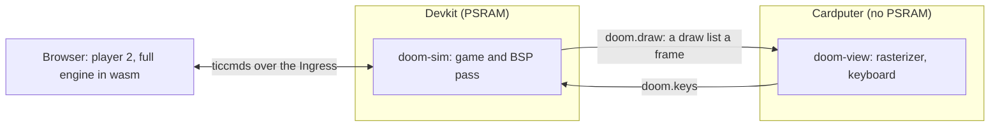

# DOOM

DOOM runs across two boards as two pods. The devkit runs the game, the Cardputer draws it, and a browser joins as player 2 through the devkit's Ingress. One `kubectl apply` replaces it with [wordsketch](wordsketch.md), and another brings it back.


*Player 2 in the browser with player 1, the green marine, in view. The line under the status bar is the page's lockstep state: tic, input delay, round trip and state checks.*

## How it runs



| Pod | Node | What it runs | Module |
| --- | --- | --- | ---: |
| `doom-sim` | devkit | the game at 35 tics a second, the BSP pass, a draw list a frame, the lockstep with player 2 | 283 KB blob image, 640 KiB of linear memory |
| `doom-view` | Cardputer | draws each list on the 240 x 135 screen with `k32_raster_columns` and `k32_raster_spans`, shows ammo, health, armor and keys, sends the keyboard | 9 KB blob image, 32 KiB of linear memory |

A frame does not fit on either board alone: the renderer's textures and sprites come to 1.4 MB, and the Cardputer's pod pool is 80 KiB. So the devkit decides what is visible and sends that as a list of wall columns, spans and sprites, 3.9 KB on average. The Cardputer holds the textures in a blob in its flash and reads them in place. A host check (`make -C apps/doom verify`) draws the sim's lists and compares them with the engine's own frames pixel for pixel.

Player 2 runs the same engine in the browser and plays only from confirmed ticcmds, so both sides compute the same game. They compare state digests while they play, and `make -C apps/doom verify-net` checks that over a simulated network with delay, loss and outages.

## Run it

The build reads a cut IWAD: the shareware `doom1.wad` or Freedoom (`python3 apps/doom/wad.py fetch`). See [IWAD](https://github.com/arterialist/kube32/tree/main/apps/doom#iwad).

```sh
make -C apps/wordsketch                                  # the modules the manifests carry
make -C apps/llm-diffusion build/llm-diffusion.wasm
make -C apps/doom pods manifest
make -C apps/wordsketch upload SERVER=http://<control-plane-ip>:6443
make -C apps/doom upload SERVER=http://<control-plane-ip>:6443
kubectl apply -f apps/doom/build/doom.yaml
```

Open `http://<control-plane-ip>/doom/` and press Join. Player 1 plays alone until then, and a join restarts the map.

| Player | Move | Fire | Use |
| --- | --- | --- | --- |
| 1, Cardputer | `w` `a` `s` `d` | `f` | space |
| 2, browser | arrows or WASD | ctrl | space |

`GET /doom/stats` and `GET /doom-view/stats` report frames, keys and the sim's time by part; `GET /doom/netstats` reports the lockstep.

## One apply between two apps

`doom.yaml` and `wordsketch.yaml` each hold both apps' Deployments, with the other app at 0 replicas and listed first, so its memory is free before the new pods start. The modules and data stay on the boards as blobs, so a switch copies nothing.


*k9s, against the boards, while kubectl switches apps. The clock at the bottom right is wall time.*

```sh
kubectl apply -f apps/wordsketch/build/wordsketch.yaml
kubectl apply -f apps/doom/build/doom.yaml
```

From the apply to every pod rolled out, a switch takes 12 to 15 s on a home network. Busy networks have taken up to 28 s.

## Measurements

On the boards over home Wi-Fi, `DOOM_FPS=4`, `DOOM_DETAIL=1`:

| | Frames a second on the Cardputer | Game tics a second | Frames lost |
| --- | ---: | ---: | ---: |
| Player 1 alone | 3.2 | 34 | 0 |
| With player 2 | 1.7 | 28 | 0 |

The game's speed is the sim's limit, not the Cardputer's: a frame costs the devkit about 174 ms of interpreter time, and the Cardputer draws and shows one in about 100 ms. Above `DOOM_FPS=4` the Cardputer's internal heap fragments until its Wi-Fi driver cannot allocate receive buffers. Guest networks that limit traffic between clients drop draw lists and keys, so run the boards on a network that does not.

`llm-diffusion` does not fit beside a switch: stop it before applying `doom.yaml`. The [DOOM README](https://github.com/arterialist/kube32/tree/main/apps/doom) has the frame costs, the pack formats and the lockstep's design.

The code in `apps/doom` is GPL-2.0-or-later; the runtime that runs it stays Apache-2.0.
