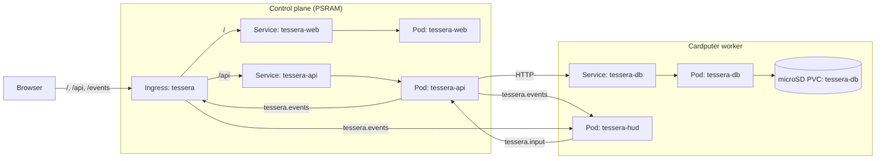

# Tessera

Tessera is a multi-pod issue tracker with a kanban board, filterable issue list, full-text search, issue pages with comments, an activity feed, and analytics.

## Architecture

Four WebAssembly pods, three Services, and an Ingress make up the application (`examples/tessera.yaml`):



| Pod | Node | Memory limit | Role |
| --- | --- | --- | --- |
| `tessera-web` | Control plane | `4Ki` | Serves the single-page web client from `images/web/tessera-web/` via `k32_resp_asset` (`apps/tessera/web`). |
| `tessera-api` | Control plane | `48Ki` SRAM, `1280Ki` PSRAM | Holds the in-memory store and search index. Answers `/api/*` requests (`apps/tessera/api`). Runs with `kube32.io/execution-budget: "off"`. |
| `tessera-db` | Cardputer | `8Ki` | Store of record (`apps/tessera/db`). Appends and reads records on the microSD volume claim `tessera-db` (`/sd/kube32/volumes/tessera-db/`). |
| `tessera-hud` | Cardputer | `1Ki` | `k32_tick`/`k32_event` pod (`apps/tessera/hud`). Subscribes to `tessera.events` via `kube32.io/event-topics`, draws open issues, request rate, and viewer count on the LCD, and reads the keypad. |

Services and Ingress routing:

* `Service/tessera-web`, `Service/tessera-api`, and `Service/tessera-db` expose port 80 targeting container port `http` (7000).
* `Ingress/tessera` routes `/api` to `tessera-api` and `/` to `tessera-web`.
* `tessera-web` serves compressed bundle assets via `k32_resp_asset` with gzip. `/` and client routes such as `/board` return `index.html` with `Cache-Control: no-cache`, while versioned `app.js` and `styles.css` URLs (`?v=...`) use `Cache-Control: public, max-age=31536000, immutable`.
* The Ingress serves `GET /api/cluster` (`kube32.io/cluster-telemetry`) and streams `tessera.events`, `kube32.cluster`, and `kube32.presence` as Server-Sent Events on `/events` (`kube32.io/event-stream`).
* Once per second, the Ingress publishes request rate and viewer counts to `tessera.events` (`kube32.io/stats-topic`).
* `tessera-hud` publishes keystrokes on `tessera.input`. `tessera-api` subscribes via `kube32.io/event-topics: tessera.input` and appends characters to a live note on the most recently viewed issue. Pressing Enter stores the note as a comment by `keypad`.
* `tessera-hud` is silent by default (`HUD_SOUND: "0"` and no speaker grant in `examples/tessera.yaml`). To enable event and keystroke tones, set `HUD_SOUND` to `"1"`, request `hardware.kube32.io/speaker: "1"`, and add the `SPEAKER` capability.

## Storage and write-through flow

`tessera-db` stores records in 32 KiB segment files (`00000.seg`, `00001.seg`, up to 256 segments or 8 MiB) on the microSD card. Each record has a 12-byte header with a sequence number and CRC-32, and a payload of at most 1,280 bytes (`TLOG_PAYLOAD_MAX`). Each append request accepts up to 2,048 bytes (`TDB_APPEND_MAX`). On startup, `tessera-db` verifies the last segment and pads any interrupted tail in place.

`tessera-api` keeps the serving copy and inverted index in its 1,280 KiB PSRAM arena (default capacities `MAX_ISSUES=2900`, `MAX_COMMENTS=5300`, `MAX_TERMS=1024`):

1. On startup, `k32_tick` fetches `/stats` from `http://tessera-db`, reads records in 16 KiB pages via `GET /records?after=<seq>`, verifies CRCs, and applies 32 records per tick (`LOAD_CHUNK`). Read requests work against the loaded subset while `GET /api/stats` reports `"loading":{"done":N,"total":M}` alongside `"storage"`.
2. Write requests (`POST`, `PATCH`, `DELETE`, and keypad comments) encode a log record and send `POST /append?expect=<next_seq>&log=<id>` to `tessera-db` via `k32_http_call`.
3. `tessera-api` updates its in-memory store and emits a `tessera.events` message only after `tessera-db` acknowledges the write. A `2xx` response means the record is on the microSD card.
4. While `tessera-api` is loading or when `tessera-db` is unreachable, writes return `503` with `Retry-After: 2` and reads continue from memory. If `tessera-db` returns `409` (sequence or log ID mismatch), `tessera-api` reloads the store from the log on the next tick.

## Generating and loading the dataset

The boards do not generate seed data. An empty volume produces an empty tracker.

Generate the sample dataset on the host (2,400 issues, 4,800 comments, 9,001 records, 878,525 bytes across 28 segments):

```sh
make -C apps/tessera dataset
```

This writes segment files to `apps/tessera/build/card/kube32/volumes/tessera-db/`.

Copy `apps/tessera/build/card/kube32` to the root of the Cardputer microSD card, or upload the directory over the network to the running worker node (28 files, about 880 KB):

```sh
tools/kube32-cli push apps/tessera/build/card/kube32/volumes/tessera-db --node <worker-node> --path volumes/tessera-db
```

On the host simulator, point `KUBE32_SD_ROOT` at `apps/tessera/build/card` before starting `kube32-sim`. To run the worker in a separate simulator process (or attach a physical Cardputer worker), pass `--workers ""` on the control-plane simulator so it starts without an in-process worker. Like the boards, the simulator ticks pods that return a positive value from `k32_tick` every 10 ms and other pods at 1 Hz.

## Deploying and signing in

Apply the manifest:

```sh
kubectl --context kube32 apply -f examples/tessera.yaml
```

Open `http://<control-plane-ip>/` in a browser (or `http://127.0.0.1:8080/` on the simulator with `--ingress-port 8080`). Sign in as `mara` with password `demo`. Every user in the sample dataset shares the password `demo`.

To run a load test against the Ingress:

```sh
python3 tools/tessera_loadtest.py http://<control-plane-ip> --clients 4 --seconds 60
```

## Building and testing the pods

Build all four `.wasm` modules into `images/` and the compressed web assets into `images/web/tessera-web/`:

```sh
make -C apps/tessera
```

Run the native test suites for `tessera-db`, `tessera-api`, and `tessera-web`:

```sh
make -C apps/tessera test
```

Inspect the memory layout and dataset sizing:

```sh
make -C apps/tessera size
```

For frontend work without a cluster, run the standalone mock server:

```sh
python3 apps/tessera/web/mock_server.py
```

## Limitations

* When the search dictionary reaches `MAX_TERMS` (1,024), new words in issues and comments are not indexed.
* The live keypad note drops characters beyond 200 bytes until you press Backspace or Enter.
