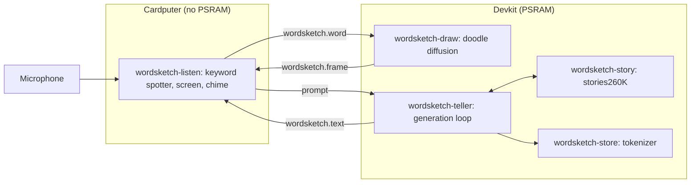

# wordsketch

wordsketch turns a word spoken to the Cardputer into a drawing and a short story. Three neural networks run in five pods on two boards: a keyword spotter hears the word, a diffusion model draws it, and a language model writes about it. The Cardputer's screen shows the drawing forming from noise next to the story as it is written.



| Pod | Node | Model | Weights |
| --- | --- | --- | --- |
| `wordsketch-listen` | Cardputer | [keyword spotter](models.md), eight classes, 25 K weights | read in place from a blob |
| `wordsketch-draw` | devkit | [doodle denoiser](models.md), 294 K weights, 8 DDIM steps | read in place from a blob |
| `wordsketch-story` | devkit | stories260K, five layers | read in place from a blob |
| `wordsketch-teller` | devkit | tokenizer and generation loop | none |
| `wordsketch-store` | devkit | the tokenizer blob over HTTP | none |

The words are the six the two models share: cat, dog, bird, house, tree, bed.

## Run it

```sh
make -C apps/wordsketch
make -C apps/wordsketch upload SERVER=http://<control-plane-ip>:6443
kubectl apply -f apps/wordsketch/build/wordsketch.yaml
```

Say one of the words to the Cardputer, or send it through the Ingress and watch the tokens arrive:

```sh
curl -s -X POST 'http://<control-plane-ip>/wordsketch/word?w=cat'
curl -sN http://<control-plane-ip>/wordsketch/events
```

## Measurements

The word's class comes 185 to 230 ms after the spotter's window is ready. On the devkit, 8 denoising steps take 7.1 to 8.8 s while the story runs on the other core, and the 80-token story ends 15.8 to 17.4 s after the drawing starts, at 6 to 11 tokens a second. The numbers vary with the network, because the story and the drawing share the devkit with the traffic to the Cardputer.

`apps/doom/build/doom.yaml` and `apps/wordsketch/build/wordsketch.yaml` switch the boards between this app and [DOOM](doom.md) with one apply each. The [wordsketch README](https://github.com/arterialist/kube32/tree/main/apps/wordsketch) has the audio pipeline, the memory budget on the Cardputer and the training details.
