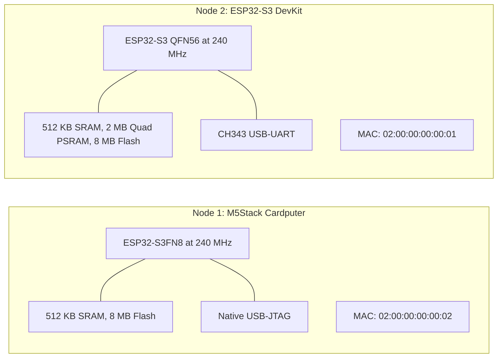

# Hardware specifications

<div class="blueprint-card">
  <strong>Processor</strong>: Espressif ESP32-S3 dual-core Xtensa LX7 at 240 MHz.<br>
  <strong>Memory architecture</strong>: 384 KB ROM, 512 KB internal SRAM, optional external Quad SPI PSRAM.<br>
  <strong>Radios</strong>: 2.4 GHz Wi-Fi (802.11 b/g/n) and ESP-NOW 2.0.
</div>

Kube32 runs on bare metal on physical ESP32-S3 silicon. This page outlines the pin mappings, memory allocations, and hardware boundaries.

---

## Board details



### Node 1: M5Stack Cardputer (Master control plane)
- **Processor**: ESP32-S3FN8 with 8 MB embedded flash.
- **PSRAM**: None. The control plane runs inside internal SRAM.
- **MAC address**: `02:00:00:00:00:02`.
- **Role**: Master control plane (`esp32-node-01`).
- **Power switch**: Slide switch on the left edge. Keep it in the UP position to power the USB controller.
- **Serial port**: Native USB-JTAG (`303A:1001`).

### Node 2: ESP32-S3 DevKit (Worker node)
- **Processor**: ESP32-S3 QFN56 revision v0.2.
- **PSRAM**: 2 MB Quad SPI PSRAM (`APMemory APS1604M-3SQR`).
- **MAC address**: `02:00:00:00:00:01`.
- **Role**: Worker node (`esp32-node-02`).
- **Serial port**: Dedicated CH343 USB-UART bridge (`1A86:55D3`).

---

## Memory layout

The ESP32-S3 memory splits between the FreeRTOS kernel, networking buffers, and Kube32 components:

```
0x3FC8_0000 +-----------------------------------------------+
            | FreeRTOS kernel and system DRAM (128 KB)      |
0x3FCA_7310 +-----------------------------------------------+
            | Internal heap (265 KB)                        |
            | - In-memory radix store (Node 1)              |
            | - Wi-Fi and socket buffers                    |
0x3FCE_9710 +-----------------------------------------------+
            | DMA and peripheral reserved SRAM (32 KB)      |
0x3FCF_0000 +-----------------------------------------------+
            | IRAM and instruction cache                    |
0x3C00_0000 +===============================================+
            | External SPI PSRAM (Node 2: 2048 KB)          |
            | - Wasm3 container memory                      |
            | - TinyML tensor buffers                       |
            | - Shared IPC ringbuffers                      |
0x3C20_0000 +-----------------------------------------------+
```

The firmware automatically detects whether PSRAM is installed via `CONFIG_SPIRAM_IGNORE_NOTFOUND=y`. If external RAM is absent, as on the Cardputer, the memory allocator limits container allocations to internal SRAM.

---

## Pin allocations and capabilities

| Physical pin | Hardware function | Matching capability | Description |
| :--- | :--- | :--- | :--- |
| **GPIO 10** | Digital output | `GPIO_WRITE` | Status LED on dev board |
| **GPIO 1** | Analog input | `ADC_READ` | ADC1 channel 0 sensor input |
| **GPIO 43** | UART0 TX | System console | Dedicated to system logs |
| **GPIO 44** | UART0 RX | System console | Dedicated to system logs |
| **GPIO 19** | USB D- | Native JTAG | Cardputer USB data line |
| **GPIO 20** | USB D+ | Native JTAG | Cardputer USB data line |

---

## Watchdogs and brownout protection

Kube32 configures two hardware watchdogs to keep nodes from freezing:
1. **Task watchdog (TWDT)**: Tasks feed the watchdog on each loop iteration via `osal::System::feed_watchdog()`. If a task blocks longer than 5 seconds, FreeRTOS recovers the task.
2. **Interrupt watchdog (IWDT)**: If an interrupt handler runs longer than 300 milliseconds, the hardware resets the CPU.
3. **Brownout detector**: Set to a 2.7V threshold so sudden power dips during Wi-Fi transmission do not corrupt flash.
