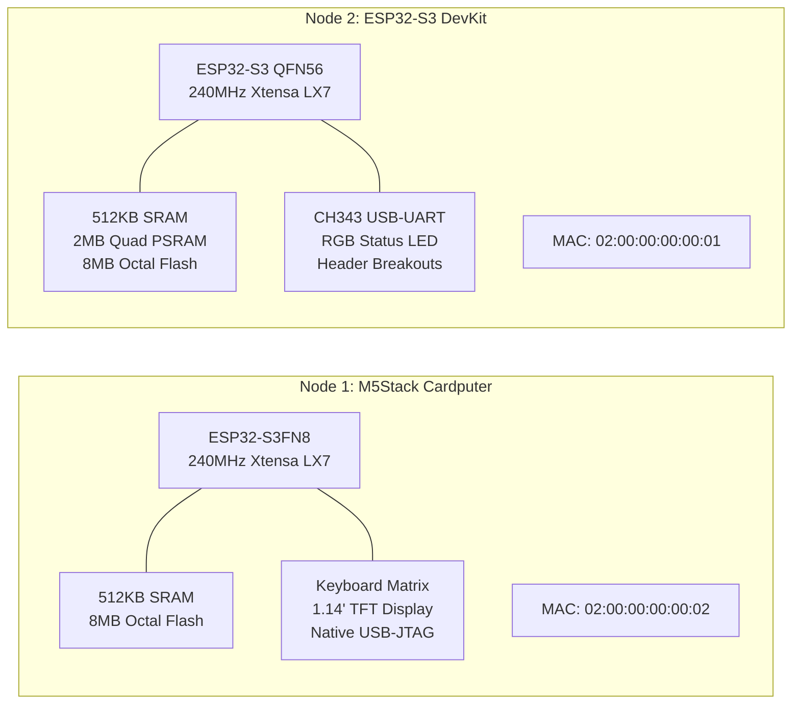

# Hardware Specifications

<div class="blueprint-card">
  <strong>Silicon Target</strong>: Espressif ESP32-S3 (Xtensa Dual-Core 32-bit LX7 @ 240 MHz)<br>
  <strong>Harvard Architecture</strong>: Separate 384KB ROM, 512KB SRAM, 16KB RTC RAM, External SPI Flash &amp; PSRAM<br>
  <strong>Radio Engine</strong>: 2.4 GHz Wi-Fi (802.11 b/g/n) + Bluetooth 5 (LE) + ESP-NOW 2.0
</div>

Kube32 runs directly on real hardware across physical development boards. This document details the pin mappings, memory configurations, and physical interfaces.

---

## Physical Board Profiles



### Node 1: M5Stack Cardputer (Master Control Plane)
- **SoC**: ESP32-S3FN8 with embedded 8MB flash.
- **PSRAM**: None (0MB). All control-plane data structures are optimized for in-memory internal SRAM execution.
- **Factory MAC**: `02:00:00:00:00:02`.
- **Role**: Master Control Plane (`esp32-node-01`).
- **Power Switch**: Slide switch on the left edge. Must be in the **UP (ON)** position to enable USB data and charging lines.
- **Serial USB Port**: Native USB-JTAG controller (`303A:1001`).

### Node 2: ESP32-S3 DevKit (Worker Node)
- **SoC**: ESP32-S3 QFN56 chip revision v0.2.
- **PSRAM**: 2MB Quad SPI PSRAM (`APMemory APS1604M-3SQR`).
- **Factory MAC**: `02:00:00:00:00:01`.
- **Role**: Worker Node (`esp32-node-02`).
- **Serial USB Port**: Dedicated CH343 USB-UART bridge (`1A86:55D3`).

---

## Memory Map & Allocation Strategy

ESP32-S3 memory is partitioned between the FreeRTOS kernel, networking buffers, and Kube32 subsystems:

```
0x3FC8_0000 +-----------------------------------------------+
            |  FreeRTOS Kernel & System DRAM (128 KB)       |
0x3FCA_7310 +-----------------------------------------------+
            |  Internal Dynamic Heap Pool (265 KB)          |
            |  - Radix Tree State Store (Node 1)            |
            |  - Network Packets & Socket Buffers           |
0x3FCE_9710 +-----------------------------------------------+
            |  DMA / Peripheral Reserved SRAM (32 KB)       |
0x3FCF_0000 +-----------------------------------------------+
            |  IRAM / Cache Cache-Line Alignment            |
0x3C00_0000 +===============================================+
            |  External SPI PSRAM (Node 2 Only: 2048 KB)    |
            |  - Wasm3 Sandboxed Container Heap             |
            |  - TinyML Wake-Word Tensor Workspace          |
            |  - Shared IPC Ringbuffers                     |
0x3C20_0000 +-----------------------------------------------+
```

### Dynamic PSRAM Detection & Fallback
The firmware binary automatically detects PSRAM availability via `CONFIG_SPIRAM_IGNORE_NOTFOUND=y`. If external RAM is absent (Node 1), the memory allocator dynamically constrains container allocations to internal SRAM:

```cpp
// Runtime memory pooling inspection
size_t free_sram  = heap_caps_get_free_size(MALLOC_CAP_INTERNAL);
size_t free_psram = heap_caps_get_free_size(MALLOC_CAP_SPIRAM);
```

---

## Peripheral & Pin Mapping Matrix

| Physical Pin | Function / Resource | Permitted Capability | Default Hardware |
| :--- | :--- | :--- | :--- |
| **GPIO 10** | Digital Output | `GPIO_WRITE` | Status LED Indicator |
| **GPIO 1** | Analog Input | `ADC_READ` | ADC1 Channel 0 Sensor Capture |
| **GPIO 43** | UART0 TX | System Console (Restricted) | CH343 USB-UART Interface |
| **GPIO 44** | UART0 RX | System Console (Restricted) | CH343 USB-UART Interface |
| **GPIO 19** | USB D- | Native JTAG (Restricted) | Cardputer USB-C Data Line |
| **GPIO 20** | USB D+ | Native JTAG (Restricted) | Cardputer USB-C Data Line |

---

## Watchdog & Power Safeguards

Kube32 enforces dual hardware watchdog protection:
1. **Task Watchdog Timer (TWDT)**: FreeRTOS tasks feed the watchdog on every event loop iteration (`osal::System::feed_watchdog()`). Tasks blocked longer than 5 seconds trigger a targeted stack unwinding.
2. **Interrupt Watchdog Timer (IWDT)**: Protects against ISR locks, resetting the chip if an interrupt handler takes longer than 300 ms.
3. **Brownout Detector**: Hard-coded to 2.7V threshold to prevent flash corruption during power dips when transmitting high-power 802.11 frames.
