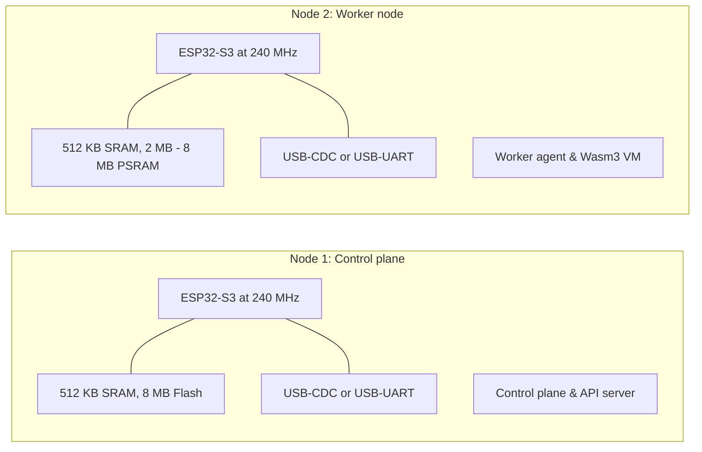

# Hardware specifications

<div class="blueprint-card">
  <strong>Processor</strong>: Espressif ESP32-S3 dual-core Xtensa LX7 running at 240 MHz.<br>
  <strong>Memory architecture</strong>: 384 KB ROM, 512 KB internal SRAM, optional external Quad/Octal SPI PSRAM.<br>
  <strong>Radios</strong>: 2.4 GHz Wi-Fi (802.11 b/g/n) and ESP-NOW 2.0.
</div>

Kube32 runs on bare metal on physical ESP32-S3 silicon. This page outlines the pin mappings, memory allocations, and hardware boundaries.

---

## Board configurations



### Node 1: Control plane node
- **Processor**: ESP32-S3 dual-core Xtensa LX7 at 240 MHz.
- **Internal SRAM**: 512 KB.
- **External PSRAM**: Optional. The control plane, radix store, and scheduler run entirely inside internal SRAM.
- **Flash storage**: 8 MB or 16 MB SPI Flash.
- **Role**: Cluster control plane (`esp32-node-01`).
- **Interfaces**: USB-CDC / JTAG or external USB-to-UART bridge.

### Node 2: Worker node
- **Processor**: ESP32-S3 dual-core Xtensa LX7 at 240 MHz.
- **Internal SRAM**: 512 KB.
- **External PSRAM**: 2 MB to 8 MB Quad SPI or Octal SPI PSRAM.
- **Role**: Workload execution node (`esp32-node-02`).
- **Interfaces**: USB-CDC / JTAG or external USB-to-UART bridge.

---

## Node identity and MAC addressing

ESP32-S3 microcontrollers contain a factory-burned 48-bit MAC address in their one-time-programmable eFuse block:

- Each node derives its unique cluster identity from its eFuse MAC.
- During boot, Node 1 initializes the Wi-Fi SoftAP interface (`Kube32-Cluster`) on IP `192.168.4.1`.
- Worker nodes associate with the SoftAP as stations, receive DHCP assignments (`192.168.4.2` and above), and register themselves with the API server.

---

## Memory layout

The ESP32-S3 memory splits between the FreeRTOS kernel, networking buffers, and Kube32 components:

```
0x3FC8_0000 +-----------------------------------------------+
            | FreeRTOS kernel and system DRAM (128 KB)      |
0x3FCA_7310 +-----------------------------------------------+
            | Internal heap (265 KB)                        |
            | - In-memory radix store (Node 1)              |
            | - Wi-Fi and socket buffers                    |
0x3FCE_9710 +-----------------------------------------------+
            | DMA and peripheral reserved SRAM (32 KB)      |
0x3FCF_0000 +-----------------------------------------------+
            | IRAM and instruction cache                    |
0x3C00_0000 +===============================================+
            | External SPI PSRAM (Node 2: 2048 KB - 8192 KB)|
            | - Wasm3 container memory                      |
            | - TinyML tensor buffers                       |
            | - Shared IPC ring buffers                     |
0x3C80_0000 +-----------------------------------------------+
```

The firmware automatically detects whether external PSRAM is installed via `CONFIG_SPIRAM_IGNORE_NOTFOUND=y`. If external RAM is absent, the memory allocator restricts container allocations to available internal SRAM.

---

## Pin allocations and capabilities

| Physical pin | Hardware function | Matching capability | Description |
| :--- | :--- | :--- | :--- |
| **GPIO 10** | Digital output | `GPIO_WRITE` | General user output or status LED |
| **GPIO 1** | Analog input | `ADC_READ` | ADC1 channel 0 analog sensor input |
| **GPIO 43** | UART0 TX | System console | Dedicated to system console output |
| **GPIO 44** | UART0 RX | System console | Dedicated to system console input |
| **GPIO 19** | USB D- | Native JTAG/OTG | Hardware USB differential data minus |
| **GPIO 20** | USB D+ | Native JTAG/OTG | Hardware USB differential data plus |

---

## Watchdogs and brownout protection

Kube32 configures hardware watchdogs to ensure reliable operation in headless environments:

1. **Task watchdog (TWDT)**: Core tasks feed the watchdog on each loop iteration via `osal::System::feed_watchdog()`. If a task blocks longer than 5 seconds, FreeRTOS triggers an alert and resets the task.
2. **Interrupt watchdog (IWDT)**: If an interrupt handler runs longer than 300 milliseconds, the hardware watchdog resets the core to prevent deadlocks.
3. **Brownout detector**: Configured at a 2.7V threshold so sudden power dips during Wi-Fi transmission do not corrupt flash storage.
