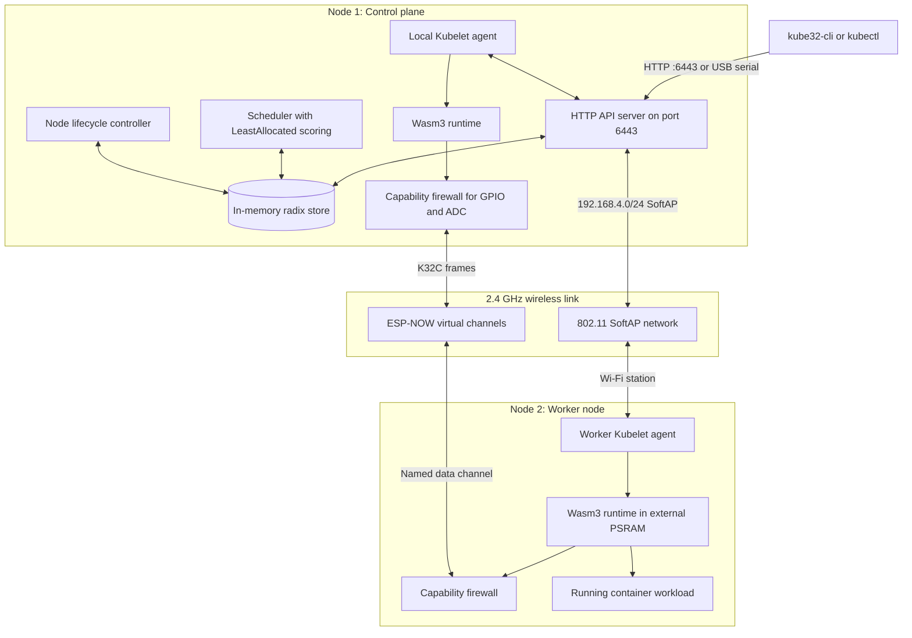
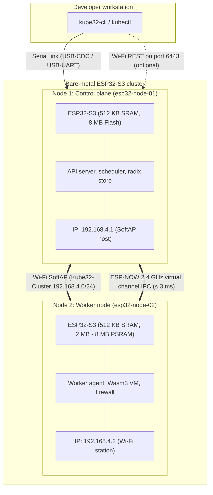

# Kube32

  <strong>Target</strong>: ESP32-S3 microcontroller cluster running FreeRTOS. 
  <strong>Design</strong>: Kubernetes control plane and WebAssembly runtime in 47 KB of RAM. 
  <strong>API</strong>: Kubernetes Core API v1 and Apps v1 over HTTP and serial.

Kube32 runs a Kubernetes-compatible control plane and a WebAssembly runtime directly on ESP32-S3 microcontrollers. It does not run Linux. It provides declarative scheduling, memory sandboxing, peripheral access controls, and direct node-to-node messaging on real silicon.

If you work with microcontrollers, Kube32 lets you deploy code as small WebAssembly binaries instead of reflashing entire firmware images every time logic changes. If you work with Kubernetes or edge clusters, Kube32 lets you use familiar tools like `kubectl` and standard Pod manifests to manage microcontrollers as real nodes.

  

    
47 KB

    
RAM used out of 320 KB

  

  

    
1.59 MB

    
Firmware binary size

  

  

    
&lt; 15 ms

    
Cold container start time

  

  

    
0 B

    
Heap allocations on query path

  

---

## How it works

The cluster splits into a master control plane node and one or more worker nodes.

---

## What makes up the system

### In-memory radix store
Standard Kubernetes uses etcd, which requires several gigabytes of memory and fast disks. Kube32 stores all cluster state in an in-memory prefix tree inside SRAM. Read requests use a bump-allocated memory arena to avoid heap churn. Prefix scans for `/registry/pods/` or `/registry/nodes/` complete in microseconds.

### Autonomous scheduler
The scheduler runs every second on Core 0. It checks resource limits, matches node labels, and applies a LeastAllocated scoring algorithm. Workloads that request more memory than a board has available stay in a Pending state.

### Wasm3 runtime sandbox
Workloads run as WebAssembly bytecode rather than native ELF binaries. The interpreter restricts guest execution to a bounded memory block, typically 32 KB to 64 KB. If guest code crashes or divides by zero, the runtime catches the trap and terminates the container. The underlying ESP32-S3 kernel and other tasks continue running uninterrupted.

### Hardware capability firewall
Microcontrollers often share pins across multiple buses. A bug in user code could accidentally trigger an actuator or write to a flash line. Kube32 intercepts hardware calls at the runtime boundary. Containers only get access to specific GPIO pins or ADC channels if their manifest explicitly lists the matching capability in `securityContext`.

### ESP-NOW virtual channel IPC
Instead of opening heavy TCP sockets across Wi-Fi for sensor data, Kube32 routes inter-pod messages over raw ESP-NOW frames. Packets carry a 22-byte header with a CRC16-CCITT checksum and 32-bit hashes for channel names. Latency between boards stays under 3 milliseconds.

---

## Hardware setup

