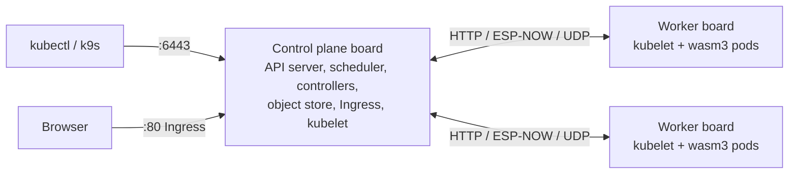

# Kube32

Kube32 is a Kubernetes-compatible control plane and WebAssembly pod runtime for ESP32-S3 microcontrollers, written in C++17. One firmware image runs on every board, and the same sources build `kube32-sim`, a host simulator for macOS and Linux. A board with PSRAM runs the control plane, including the API server, scheduler, controllers, journaled object store, and Ingress controller. Every board runs a kubelet that executes pods as WebAssembly modules in the wasm3 interpreter, with access to storage and hardware peripherals granted per pod.

## Where to start

| Topic | Page |
| --- | --- |
| Run the simulator or boot a two-board cluster | [Quick start](quickstart.md) |
| Supported boards, memory layout, and pin capacities | [Hardware specification](hardware-spec.md) |
| Flash firmware and configure nodes over USB serial | [Flashing and the serial console](flashing-troubleshooting.md) |
| Configure `kubectl`, k9s, TLS, and bearer tokens | [Cluster access](cluster-access.md) |
| Build and package WebAssembly pods in C, Rust, or AssemblyScript | [Writing app pods](app-development.md) |
| Services, Ingress routing, pod-to-pod HTTP, and event topics | [Networking and Ingress](networking.md) |
| Control plane journal, persistent volumes, and node storage | [Storage and persistence](storage.md) |
| Claim GPIO, I2C, UART, ADC, display, keypad, and speaker resources | [Peripherals and capabilities](peripherals.md) |
| Four-pod issue tracker running across a devkit and Cardputer | [Tessera example](examples/tessera.md) |
| Control plane, kubelet, and runtime internals | [Architecture overview](architecture/index.md) |
| Supported Kubernetes API resources, subresources, and semantics | [Kubernetes API reference](api-reference.md) |
| `kube32-cli`, `kube32-sim`, and serial console commands | [CLI and serial reference](cli-reference.md) |

