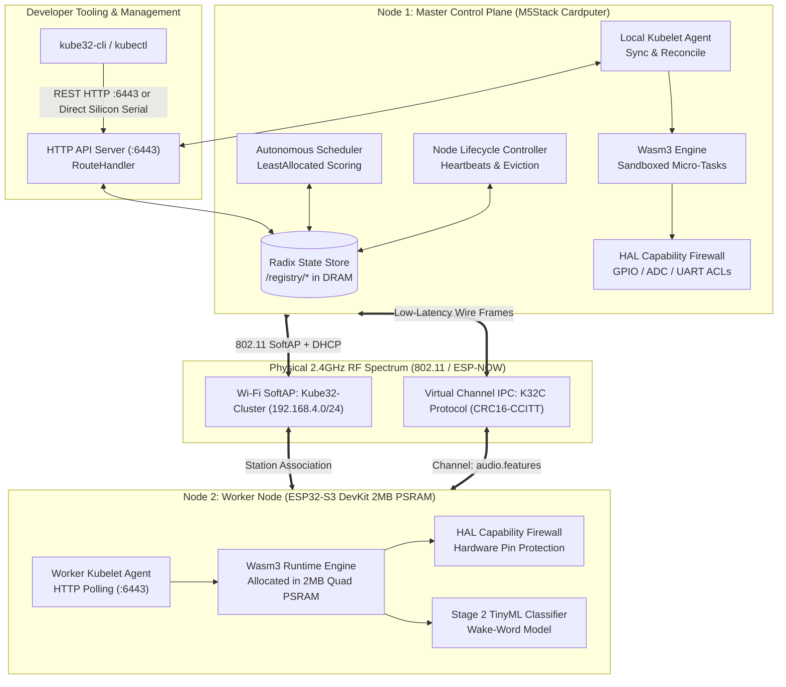

# Kube32 Blueprint Specification

<div class="blueprint-card">
  <strong>System Specification</strong>: Embedded Kubernetes Control Plane &amp; WebAssembly Micro-Runtime for ESP32-S3 SoC<br>
  <strong>Target Architecture</strong>: Xtensa Dual-Core LX7 @ 240MHz | Harvard Architecture | Dual-SRAM / Quad-PSRAM<br>
  <strong>API Standard</strong>: Kubernetes Core API <code>v1</code> &amp; Apps <code>v1</code> REST Specification
</div>

Kube32 is an embedded orchestration control plane and sandboxed container runtime purpose-built for physical microcontroller clusters. It brings declarative workload orchestration, autonomous scheduling, hardware capability isolation, and inter-node virtual channel IPC to resource-constrained microcontrollers without running Linux or an underlying operating system beyond FreeRTOS.

<div class="metric-grid">
  <div class="metric-card">
    <div class="metric-value">47 KB</div>
    <div class="metric-label">RAM Footprint (14.5% Limit)</div>
  </div>
  <div class="metric-card">
    <div class="metric-value">1.59 MB</div>
    <div class="metric-label">Xtensa LX7 Firmware Binary</div>
  </div>
  <div class="metric-card">
    <div class="metric-value">&lt; 15 ms</div>
    <div class="metric-label">Cold-Start Pod Spawning</div>
  </div>
  <div class="metric-card">
    <div class="metric-value">100%</div>
    <div class="metric-label">Memory Sandboxed (Wasm3)</div>
  </div>
</div>

---

## Architectural Blueprint

The Kube32 distributed cluster divides responsibilities across physical nodes while maintaining unified declarative state via an embedded in-memory Radix State Store.



---

## Core Innovations

### 1. Embedded Radix State Store
Unlike standard Kubernetes deployments requiring `etcd`, Kube32 uses an embedded in-memory Radix Tree (`kube32::storage::RadixTreeStore`) running on the microcontroller.
- **Zero dynamic memory allocation** on query paths through `MonotonicArena`.
- Instant prefix lookups (`/registry/nodes/`, `/registry/pods/{namespace}/`).
- Atomic lease renewal and TTL expiration.

### 2. Autonomous LeastAllocated Scheduler
Workloads submitted via manifests are autonomously scheduled without external cloud controllers.
- Evaluates CPU cores, allocatable internal SRAM, and external Quad PSRAM.
- Checks hardware capability predicates (`hardware.kube32.io/gpio`, `hardware.kube32.io/adc`).
- Honors `nodeSelector` requirements (e.g. `kubernetes.io/hostname: esp32-node-02`).

### 3. Wasm3 Sandboxed Container Execution
Containers in Kube32 are compiled to WebAssembly (Wasm) bytecode and executed inside an isolated interpreter runtime (`Wasm3`).
- **Memory Safety**: Guest code cannot access host registers, interrupt tables, or FreeRTOS data structures.
- **Panic Protection**: Workload traps (e.g., division by zero, stack overflow) terminate only the container without resetting the ESP32 kernel.

### 4. Hardware Capability Firewall
Containers cannot manipulate peripherals directly. All hardware interactions pass through a capability firewall:
- Peripheral access control lists (ACLs) enforced at the syscall boundary.
- Granular capability flags: `GPIO_WRITE`, `GPIO_READ`, `ADC_READ`, `UART_READ`, `CHANNEL_IPC`.
- Unauthorized peripheral access triggers container eviction.

### 5. ESP-NOW Virtual Channel IPC (`K32C` Protocol)
Micro-services distributed across separate ESP32 chips communicate via peer-to-peer ESP-NOW packets without IP routing overhead:
- Dedicated wire framing (`K32C` magic `0x4B333243`).
- **CRC16-CCITT** integrity and **FNV-1a 32-bit** hash addressing.
- Enables multi-node dataflow pipelines (e.g., sensor preprocessor on Node 1 streaming features to TinyML classifier on Node 2).

---

## Hardware Cluster Topology

```
+-------------------------------------------------------------------------------+
|                       CLUSTER HARDWARE BLUEPRINT                              |
+-------------------------------------------------------------------------------+
|                                                                               |
|  [NODE 1: MASTER CONTROL PLANE]               [NODE 2: WORKER AGENT]         |
|  Device: M5Stack Cardputer                    Device: ESP32-S3 DevKit         |
|  SoC:    ESP32-S3FN8 (Xtensa LX7)             SoC:    ESP32-S3 QFN56 (Rev 0.2)|
|  Memory: 512KB SRAM (0MB PSRAM)               Memory: 512KB SRAM + 2MB PSRAM  |
|  MAC:    02:00:00:00:00:02                    MAC:    02:00:00:00:00:01       |
|  IP:     192.168.4.1 (SoftAP Host)            IP:     192.168.4.2 (Station)   |
|  Port:   /dev/cu.usbmodem2101                 Port:   /dev/cu.usbmodem578E0184|
|                                                                               |
|                    \                             /                            |
|                     \                           /                             |
|              802.11 SoftAP                ESP-NOW 2.0                         |
|             "Kube32-Cluster"             Virtual Channel                      |
|             (192.168.4.0/24)            "audio.features"                      |
|                                                                               |
+-------------------------------------------------------------------------------+
```
