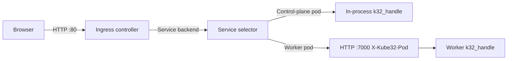

# Services, Ingress, calls and NetworkPolicy

The control plane runs an HTTP Ingress controller on port 80, and every node (including the control plane) runs a pod HTTP server on port 7000 and reports that port in `status.daemonEndpoints.kubeletEndpoint.Port` on its `Node` object. On the host simulator, set these ports with `--ingress-port` and `--pod-port`. Services select running pods by label for Ingress routing, `k32_http_call` requests, and environment variable injection. Pods also reach HTTP and HTTPS hosts outside the cluster with `k32_http_call`, restricted by `NetworkPolicy` objects.



## Services and Endpoints

`core/v1` `Service` objects support `get`, `list`, `watch`, `create`, `update`, `patch`, and `delete`. A Service selects `Running`, non-terminating pods in the same namespace whose labels match `spec.selector`.

Each entry in `spec.ports` maps `port` to `targetPort`, which is either a port number or a `containerPort` name from the pod spec. Omitting `targetPort` defaults it to `port`. A pod's `status.podIP` is the IP address of the node running it.

The API server computes read-only `core/v1` `Endpoints` and `discovery.k8s.io/v1` `EndpointSlice` objects on read from Services and their matching pods:

- `Endpoints` groups addresses into `subsets` by resolved target ports. Pods with the `Ready` condition set to `True` appear in `addresses`, and other selected pods appear in `notReadyAddresses`.
- `EndpointSlice` sets `addressType: IPv4`, labels each slice with `kubernetes.io/service-name`, sets `ownerReferences` to the Service, and populates `conditions.ready`, `conditions.serving`, and `conditions.terminating`.

## Service environment variables

When a pod starts, the kubelet injects environment variables for every Service in the same namespace that has a selector, unless the Service sets `clusterIP: None` or `type: ExternalName`, or the pod spec sets `enableServiceLinks: false`. Every pod also receives `KUBERNETES_SERVICE_HOST` and `KUBERNETES_SERVICE_PORT` for the API server, even when `enableServiceLinks` is `false`.

For a Service named `<svc>` with uppercase underscore prefix `<SVC>`, the host is the first ready address in the Service's `Endpoints`, or the local node IP when the Service selects the starting pod itself. The port is the resolved target port. The kubelet reads the Services and Endpoints of the namespace as two lists and parses them one item at a time:

| Variable | Value |
| --- | --- |
| `<SVC>_SERVICE_HOST` | Ready backing pod IP |
| `<SVC>_SERVICE_PORT` | First resolved target port |
| `<SVC>_SERVICE_PORT_<NAME>` | Resolved target port for the named Service port |
| `<SVC>_PORT` | `<proto>://<host>:<port>` for the first port |
| `<SVC>_PORT_<PORT>_<PROTO>` | `<proto>://<host>:<port>` |
| `<SVC>_PORT_<PORT>_<PROTO>_PROTO` | Lowercase protocol, such as `tcp` |
| `<SVC>_PORT_<PORT>_<PROTO>_PORT` | Target port number |
| `<SVC>_PORT_<PORT>_<PROTO>_ADDR` | Backing pod IP |

Pods read environment variables with `k32_env_get(key, key_len, out, out_cap)`.

## Ingress controller

The Ingress controller in `src/app/ingress_controller.cpp` and `src/app/ingress_routes.cpp` listens on port 80 and routes requests from `networking.k8s.io/v1` `Ingress` objects. It rebuilds the routing table when an Ingress, Service, or Pod changes in the store, at most once every 250 ms on the request path and on a 1 s tick. The controller writes its IP address to `status.loadBalancer.ingress[0].ip`, which populates the `ADDRESS` column in `kubectl get ingress`. The ingress worker uses a 16 KiB stack in PSRAM (8 KiB of internal RAM on boards without PSRAM), and calls into control-plane pods run on the node's shared interpreter stack.

The API server does not serve `IngressClass` resources. The controller routes any Ingress with `spec.ingressClassName` unset or set to `kube32`, and ignores other values.

### Host and path matching

The controller normalizes the `Host` header to lowercase and strips the port. It evaluates rules in three host groups:

1. Exact host match.
2. Wildcard match, where `*.domain` matches a single subdomain label.
3. Rules without a `host` field.

The controller consults only the most specific host group that has matching rules. Within that group, paths match by `pathType`:

- `Exact` matches the request path byte for byte.
- `Prefix` and `ImplementationSpecific` match path segments and ignore a trailing slash on the rule. `/api` matches `/api` and `/api/x`, but not `/apix`.

The longest matching path wins, and `Exact` wins ties over `Prefix`. When two Ingresses define the same host, path, and `pathType`, the first Ingress in `namespace/name` order wins. Unmatched requests go to `spec.defaultBackend` if configured, or return `404` JSON.

### Service backends

A `service` backend references a Service in the same namespace by `port.number` or `port.name`:

- When a selected `Running` pod runs on the control plane, the worker calls its `k32_handle` export in-process without a network hop.
- When the selected pods run on worker nodes, the controller load-balances across them in round-robin order and proxies the request over HTTP/1.1 keep-alive to the pod's node IP and resolved target port with the header `X-Kube32-Pod: <namespace>/<name>`.
- When the Service selects no running pod, the controller returns `503` with `Retry-After: 2`.

### StaticBundle resource backends

A `resource` backend serves files embedded into the firmware at build time from `images/web/<bundle>/`:

```yaml
backend:
  resource:
    apiGroup: kube32.io
    kind: StaticBundle
    name: <bundle>
```

- When a route uses `pathType: Prefix` under a sub-path, the controller strips the matched prefix before looking up the file.
- When a file has a `.gz` variant and the client sends `Accept-Encoding: gzip`, the controller serves it with `Content-Encoding: gzip`. A file stored only in `.gz` form returns `406` to clients that do not accept gzip.
- Requests for `/` or extension-less paths that match no file fall back to `/index.html` in the bundle for single-page applications.
- `/index.html` uses `Cache-Control: no-cache`, and all other files use `Cache-Control: public, max-age=3600`.

### Ingress and pod event annotations

| Annotation | Kind | Format | Behaviour |
| --- | --- | --- | --- |
| `kube32.io/event-stream` | Ingress | `"<path>=<topic>[,<topic>...][;<path>=...]"` | Serves `<path>` as a `text/event-stream` Server-Sent Events endpoint. The controller sends each message on a listed channel topic as an SSE frame and takes the `event` name from the payload's `type` or `t` field. Deleting the Ingress closes its streams. |
| `kube32.io/cluster-telemetry` | Ingress | `"<path>"` | Serves cluster telemetry JSON on `GET <path>`. |
| `kube32.io/stats-topic` | Ingress | `"<topic>"` | Publishes `{"t":"stats","ingress":"<ns>/<name>","rps":N,"viewers":N}` once per second on `<topic>`. |
| `kube32.io/event-topics` | Pod | `<topic>[,<topic>...]` | Delivers messages published on the listed channel topics from any node to the pod's `k32_event` export on the `k32_events` thread, which uses a 6 KiB stack in internal RAM or 8 KiB in PSRAM; `k32_event` itself runs on the node's shared interpreter stack. |

`kube32.io/event-stream` also accepts two built-in topic names generated by the controller:

- `kube32.cluster` sends a `cluster` SSE event with cluster telemetry JSON every 2 s while a client is connected.
- `kube32.presence` sends a `presence` SSE event with `{"viewers":N}` whenever the stream's viewer count changes.

## Calls from pods with k32_http_call

Pods call Services in the cluster and HTTP and HTTPS hosts outside it synchronously with `k32_http_call`, declared in `include/runtime/k32_app_abi.h`:

```c
int32_t k32_http_call(const char* method, uint32_t method_len,
                      const char* url, uint32_t url_len,
                      const char* headers, uint32_t headers_len,
                      const uint8_t* body, uint32_t body_len,
                      uint8_t* resp, uint32_t resp_cap,
                      uint32_t* resp_len, uint32_t timeout_ms);
```

The calling container must grant the `SERVICE_CALL` capability:

```yaml
securityContext:
  capabilities:
    add: ["SERVICE_CALL"]
```

`url` takes the form `http://<host>[:<port>]<path>` or `https://<host>[:<port>]<path>`. The host of an `http://` URL resolves the way a Kubernetes DNS name resolves inside a pod:

| Host | Target |
| --- | --- |
| `<service>` | The Service in the caller's namespace |
| `<service>.<namespace>` | That Service. When no such Service exists, the name is looked up as a host outside the cluster |
| `<service>.<namespace>.svc`, `<service>.<namespace>.svc.cluster.local` | The Service |
| An IPv4 address or any other DNS name | A host outside the cluster |

- An `https://` URL always names a host outside the cluster, because pods serve plain HTTP. See [HTTPS](#https).
- A Service's port defaults to its first port, a host's port to `80` (`443` for `https://`).
- `headers` takes optional `Name: value\r\n` lines.
- `timeout_ms` defaults to `5000` when `0`, up to a maximum of `60000`. It bounds the whole call: the name lookup, the connection and the response.
- The host copies up to `resp_cap` bytes of the response body into `resp` and writes the copied byte count to `*resp_len`.
- The calling pod's thread blocks until the call returns. Stopping the pod interrupts the call.
- When `NetworkPolicy` objects restrict the calling pod, every connection is checked against them (see [NetworkPolicy](#networkpolicy)).

### Services

- The control plane resolves Services from the object store and invalidates its cache when a `Service` or `Pod` changes. Worker nodes fetch the `Service` and its `Endpoints` from the API server and cache the result for 3 s.
- Only `Content-Type`, `Cookie`, `X-Request-Id`, and `Accept-Encoding` from caller headers reach the target pod.
- The host calls a backing pod on the same node in-process on the caller's thread, which requires 16 KiB of free native stack on boards or 128 KiB on the simulator. For a pod on another node, the host sends an HTTP/1.1 request over a keep-alive connection pool to the target node's pod HTTP server with `X-Kube32-Pod` and `X-Kube32-Call-Chain`.

### Hosts outside the cluster

- The node looks names up with its own resolver: lwIP and the name server from DHCP on the boards (`.local` names over mDNS), the operating system on the simulator. Name lookups are not subject to NetworkPolicy.
- Each call opens a connection of its own with `Connection: close`. The node reads the response as it arrives and closes the connection when the response is complete, or as soon as the body exceeds `resp_cap` (`K32_ERR_TOOBIG` with the first `resp_cap` bytes copied; `k32_http_status()` then returns the response's status).
- The host receives the `Host` header from the URL and every caller header except `X-Kube32-*` and the headers the connection owns (`Host`, `Content-Length`, `Connection`, `Transfer-Encoding`, `Keep-Alive`, `Upgrade`, `TE`, `Trailer`, `Expect`). Interim `1xx` responses are skipped.
- Redirects return to the caller as they are.
- The response head (status line and headers) may take up to 8 KiB on the control plane, which makes every `https://` connection, and up to 1 KiB on workers. A larger head fails the call with `K32_ERR_IO`.
- Workers on the cluster access point reach hosts outside the cluster through the control plane (see [Routing for the cluster access point](#routing-for-the-cluster-access-point)).

### HTTPS

The control plane makes every `https://` connection: directly for its own pods, and through its [egress gateway](#egress-gateway) for pods on workers. Workers make no TLS connections.

- **Certificates.** The server's certificate chain must lead to a root in the firmware's certificate bundle and name the URL's host, as a DNS name or an IPv4 address. The bundle is the ESP-IDF common CA subset of Mozilla's list, which covers nearly all public sites. Once SNTP has set the control plane's clock, certificates outside their validity dates are refused too. A refused certificate returns `K32_ERR_CERT`, and any other handshake failure returns `K32_ERR_TLS`. The control plane logs `[EGRESS] <pod> -> https://<host>:<port>: certificate rejected: <reason>` at most once per second. The simulator trusts the operating system's roots and the PEM file given with `--egress-ca`.
- **Sessions.** TLS runs on up to two session threads with 12 KiB stacks in PSRAM, started on the first call, and mbedTLS allocates its buffers from PSRAM. The calling pod waits for its session. When both sessions are in use, the call returns `K32_ERR_BUSY` at once.
- **Connections.** TLS 1.2. Each call opens a connection of its own and handles the request and response as a plain HTTP call to a host outside the cluster does.

#### Egress gateway

A worker's service client forwards each `https://` call of its pods to the API server on the control plane:

```
POST /apis/kube32.io/v1/egress?pod=<namespace>/<name>&timeout=<ms>&limit=<bytes>
Authorization: Bearer <cluster token>
Content-Type: message/http

GET https://example.com/path HTTP/1.1
<the pod's request headers>

<the pod's request body>
```

`timeout` is what is left of the pod's `timeout_ms`, and `limit` is its `resp_cap`. The API worker hands the connection to a TLS session and goes back to serving the API. The gateway streams the host's response back with the host's status, chunked as it arrives, and stops after `limit` + 1 body bytes. Every gateway answer carries `X-Kube32-Egress-Result`: the host's status, or the `K32_ERR_*` code of a call that failed before the host answered, with an HTTP `4xx` or `5xx` status (`503` and `Retry-After: 1` when every session is in use). The worker returns that code to the pod. An API server without the gateway answers `404`, which the worker reports as `K32_ERR_NOTSUP`.

The gateway makes calls only for pods, and only on behalf of nodes:

- When the API server has a bearer token (`K32_CMD:TOKEN`), the request must carry it, as kubelets do. A holder of the token can name any pod, since the token already grants full access to the API.
- Without a token, the request must come from the `InternalIP` of the node the named pod is bound to. This keeps out devices that are not nodes, but the API server itself then accepts any client, including one that registers a Node of its own.
- In both cases the named pod must exist and be bound to a node, and the gateway checks the call against that pod's NetworkPolicies in the object store, as it checks the control plane's own pods.

Pods share their node's address, so a pod that can reach the API server could name another pod of its node. With a token, a pod needs the token to do so.

The connection from a worker to the gateway is plain HTTP over the cluster network, like the kubelet's API requests. The call's URL, headers, body, answer, and the bearer token cross the cluster access point protected by its WPA2 password. TLS and its certificate checks cover the connection from the control plane to the host.

A refused call returns `K32_ERR_PERM` to the pod, and the control plane logs `[EGRESS] gateway refused <address> (pod <pod>): <reason>` at most once per second. When the worker closes the connection (its pod stopped or timed out), the gateway ends the call and frees the session.

### Return values

| Return value | Code | Meaning |
| --- | --- | --- |
| HTTP status | `100`..`599` | Response status from the target pod or host |
| `K32_ERR_PERM` | `-1` | Pod lacks the `SERVICE_CALL` capability, no NetworkPolicy allows the connection, or the egress gateway refused the pod's node |
| `K32_ERR_NOENT` | `-2` | Service or port not found, no ready pod selected, or the host name does not resolve |
| `K32_ERR_IO` | `-5` | Target node or control plane unreachable, or the connection failed |
| `K32_ERR_TOOBIG` | `-7` | Response body exceeded `resp_cap`; first `resp_cap` bytes are copied |
| `K32_ERR_NOMEM` | `-12` | Insufficient native stack for an in-process call |
| `K32_ERR_FAULT` | `-14` | Pointer or length out of bounds in linear memory |
| `K32_ERR_BUSY` | `-16` | `https://`: every TLS session of the control plane is in use; retry later |
| `K32_ERR_INVAL` | `-22` | Malformed URL or arguments |
| `K32_ERR_LOOP` | `-40` | Target pod is already in `X-Kube32-Call-Chain`, or chain length reached 8 |
| `K32_ERR_TLS` | `-71` | `https://`: the TLS handshake failed |
| `K32_ERR_NOTSUP` | `-95` | `https://` in a cluster whose control plane makes no TLS connections |
| `K32_ERR_TIMEOUT` | `-110` | No complete response within `timeout_ms` |
| `K32_ERR_CONNREFUSED` | `-111` | The host refused the connection |
| `K32_ERR_HOSTUNREACH` | `-113` | No route to the host |
| `K32_ERR_CERT` | `-129` | `https://`: the certificate is not trusted, names another host, or is outside its validity dates |

## NetworkPolicy

`networking.k8s.io/v1` `NetworkPolicy` objects restrict the connections `k32_http_call` opens, to Services and to hosts outside the cluster, with Kubernetes egress semantics:

- A pod that no policy with `Egress` in `spec.policyTypes` selects (`spec.podSelector`, in the policy's namespace) may open any connection.
- A pod that such policies select may open only the connections that an egress rule of one of them allows. `egress: []` allows none.
- A rule allows a connection when one of its `to` peers and one of its `ports` match. A rule without `to` matches every destination, a rule without `ports` every port.
- `ipBlock.cidr`, minus the blocks in `except`, matches the destination address: the address of a host outside the cluster, or the pod IP of a pod behind a Service.
- `podSelector` and `namespaceSelector` match the pods behind a Service and their namespace; `podSelector` alone matches pods in the policy's namespace. Every namespace carries the label `kubernetes.io/metadata.name: <name>`. Selectors never match hosts outside the cluster.
- `port` matches the target port of a pod behind a Service or the port of a host, as a number, as a range up to `endPort`, or as the name of a `containerPort` of the target pod. Only `protocol: TCP` matches.
- A call to a Service goes to one of its pods that the policies allow. When they allow none, or deny the host, the call returns `K32_ERR_PERM` and the node logs `[NETPOL] <pod> -> <target> denied: <reason>`, at most once per second.

The API server validates policies as kube-apiserver does, and defaults `spec.policyTypes` (`Ingress`, plus `Egress` when the policy has egress rules) and `protocol: TCP`. `kubectl get netpol` prints the pod selector.

From `examples/egress-policy.yaml`, a policy that lets the probe of `examples/egress.yaml` reach TCP port 8000 on hosts outside the cluster access point's subnet, and nothing else:

```yaml
apiVersion: networking.k8s.io/v1
kind: NetworkPolicy
metadata:
  name: egress-probe
  namespace: default
spec:
  podSelector:
    matchLabels:
      app: egress-probe
  policyTypes: ["Egress"]
  egress:
    - to:
        - ipBlock:
            cidr: 0.0.0.0/0
            except: ["192.168.4.0/24"]
      ports:
        - protocol: TCP
          port: 8000
```

### Enforcement and propagation

The node of the calling pod enforces the policies, except for `https://` calls of pods on workers, which the control plane checks at the egress gateway with the policies and pod labels in its object store.

- The control plane reads policies, pods and namespaces from its object store. A change applies from the next call.
- A worker's kubelet records the labels of the node's pods at every pod sync (every 2 s on the boards) and loads the policies of a namespace before the first pod of that namespace starts on the node. It lists the policies of every namespace with pods on the node again every 5 s. A policy change reaches a worker within about 7 s, a change to a calling pod's labels within one pod sync.
- A worker reads a pod behind a Service from the API server when a rule compares its labels or port names, and keeps it for 3 s.
- A worker that has not loaded the policies of a pod's namespace denies the pod's calls.

## Routing for the cluster access point

When the control plane has Wi-Fi credentials (`K32_CMD:WIFI`) and keeps the `Kube32-Cluster` access point on, it joins that network as a station and serves the access point at `192.168.4.1`. While the station holds an address:

- The control plane forwards traffic from the access point's stations to the station network with NAT (lwIP NAPT). The NAT table takes 16 KiB, from PSRAM, when the uplink first comes up.
- The access point's DHCP server offers the station's name server, with two-minute leases. A worker that joined before the uplink came up learns the name server when it renews its lease, within a minute.
- When the station loses its address, the control plane turns NAT off until the station has one again.

The control plane logs `[NET] uplink up: NAT from the cluster AP on, DNS <server> offered (internal RAM <n> bytes, PSRAM <n> bytes)` and `[NET] uplink down: NAT from the cluster AP off`.

## Serving files from a pod image with k32_resp_asset

A request pod streams static files from its own image bundle with `k32_resp_asset`:

```c
int32_t k32_resp_asset(const char* path, uint32_t path_len, uint32_t status);
```

- For an embedded image `wasm://embedded/<name>`, the bundle directory is `images/web/<name>/` in the firmware. For an SD card image `wasm://sd/<name>`, the bundle directory is `<card>/kube32/images/<name>/`.
- `path` is relative to the bundle root, such as `"index.html"` or `"js/app.js"`. Passing `0` for `status` sends `200 OK`.
- The host streams the file directly from flash or card storage without copying it into Wasm linear memory, sets `Content-Type` from the file extension, prefers the `.gz` variant when the client accepts gzip (returning `406` if only the `.gz` file exists and the client does not accept gzip), handles `HEAD` requests, and sends any headers queued earlier with `k32_resp_header`.
- The call returns `0` after sending the response, or `K32_ERR_NOENT` when the file does not exist. On `K32_ERR_NOENT`, the host sends nothing and keeps pending headers intact so the pod can write a fallback response.

## Service and Ingress example

From `examples/echo.yaml`:

```yaml
apiVersion: v1
kind: Pod
metadata:
  name: echo
  namespace: default
  labels:
    app: echo
  annotations:
    kube32.io/event-topics: echo.events
spec:
  nodeSelector:
    node-role.kubernetes.io/control-plane: ""
  restartPolicy: Always
  containers:
    - name: echo
      image: wasm://embedded/echo
      ports:
        - containerPort: 7000
          name: http
      env:
        - name: GREETING
          value: "hello from echo"
      resources:
        requests:
          memory: 64Ki
          hardware.kube32.io/ipc: "1"
        limits:
          memory: 64Ki                 # one Wasm page
      securityContext:
        capabilities:
          add: ["CHANNEL_IPC"]
---
apiVersion: v1
kind: Service
metadata:
  name: echo
  namespace: default
spec:
  selector:
    app: echo
  ports:
    - name: http
      port: 80
      targetPort: 7000
---
apiVersion: networking.k8s.io/v1
kind: Ingress
metadata:
  name: echo
  namespace: default
  annotations:
    kube32.io/event-stream: "/echo/events=echo.events,kube32.presence"
spec:
  rules:
    - http:
        paths:
          - path: /echo
            pathType: Prefix
            backend:
              service:
                name: echo
                port:
                  number: 80
```

Apply the manifest and test the route and SSE stream:

```
kubectl --context kube32 apply -f examples/echo.yaml
curl -s -X POST http://<control-plane-ip>/echo/hello
curl -sN http://<control-plane-ip>/echo/events
```

## Limitations

- `Endpoints` and `EndpointSlice` are read-only and do not support `watch`.
- The API server does not serve `IngressClass` objects, and the Ingress controller routes only Ingresses with `ingressClassName: kube32` or unset.
- NetworkPolicy ingress rules are stored and not enforced.
- `https://` calls use TLS 1.2; a host that accepts only TLS 1.3 fails with `K32_ERR_TLS`.
