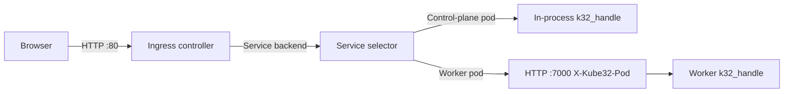

# Services, Ingress and pod-to-pod calls

The control plane runs an HTTP Ingress controller on port 80, and every node (including the control plane) runs a pod HTTP server on port 7000 and reports that port in `status.daemonEndpoints.kubeletEndpoint.Port` on its `Node` object. On the host simulator, set these ports with `--ingress-port` and `--pod-port`. Services select running pods by label for Ingress routing, `k32_http_call` requests, and environment variable injection.



## Services and Endpoints

`core/v1` `Service` objects support `get`, `list`, `watch`, `create`, `update`, `patch`, and `delete`. A Service selects `Running`, non-terminating pods in the same namespace whose labels match `spec.selector`.

Each entry in `spec.ports` maps `port` to `targetPort`, which is either a port number or a `containerPort` name from the pod spec. Omitting `targetPort` defaults it to `port`. A pod's `status.podIP` is the IP address of the node running it.

The API server computes read-only `core/v1` `Endpoints` and `discovery.k8s.io/v1` `EndpointSlice` objects on read from Services and their matching pods:

- `Endpoints` groups addresses into `subsets` by resolved target ports. Pods with the `Ready` condition set to `True` appear in `addresses`, and other selected pods appear in `notReadyAddresses`.
- `EndpointSlice` sets `addressType: IPv4`, labels each slice with `kubernetes.io/service-name`, sets `ownerReferences` to the Service, and populates `conditions.ready`, `conditions.serving`, and `conditions.terminating`.

## Service environment variables

When a pod starts, the kubelet injects environment variables for every Service in the same namespace that has a selector, unless the Service sets `clusterIP: None` or `type: ExternalName`, or the pod spec sets `enableServiceLinks: false`. Every pod also receives `KUBERNETES_SERVICE_HOST` and `KUBERNETES_SERVICE_PORT` for the API server, even when `enableServiceLinks` is `false`.

For a Service named `<svc>` with uppercase underscore prefix `<SVC>`, the host is the first ready address in the Service's `Endpoints`, or the local node IP when the Service selects the starting pod itself. The port is the resolved target port. The kubelet reads the Services and Endpoints of the namespace as two lists and parses them one item at a time:

| Variable | Value |
| --- | --- |
| `<SVC>_SERVICE_HOST` | Ready backing pod IP |
| `<SVC>_SERVICE_PORT` | First resolved target port |
| `<SVC>_SERVICE_PORT_<NAME>` | Resolved target port for the named Service port |
| `<SVC>_PORT` | `<proto>://<host>:<port>` for the first port |
| `<SVC>_PORT_<PORT>_<PROTO>` | `<proto>://<host>:<port>` |
| `<SVC>_PORT_<PORT>_<PROTO>_PROTO` | Lowercase protocol, such as `tcp` |
| `<SVC>_PORT_<PORT>_<PROTO>_PORT` | Target port number |
| `<SVC>_PORT_<PORT>_<PROTO>_ADDR` | Backing pod IP |

Pods read environment variables with `k32_env_get(key, key_len, out, out_cap)`.

## Ingress controller

The Ingress controller in `src/app/ingress_controller.cpp` and `src/app/ingress_routes.cpp` listens on port 80 and routes requests from `networking.k8s.io/v1` `Ingress` objects. It rebuilds the routing table when an Ingress, Service, or Pod changes in the store, at most once every 250 ms on the request path and on a 1 s tick. The controller writes its IP address to `status.loadBalancer.ingress[0].ip`, which populates the `ADDRESS` column in `kubectl get ingress`. The ingress worker uses a 16 KiB stack in PSRAM (8 KiB of internal RAM on boards without PSRAM), and calls into control-plane pods run on the node's shared interpreter stack.

The API server does not serve `IngressClass` resources. The controller routes any Ingress with `spec.ingressClassName` unset or set to `kube32`, and ignores other values.

### Host and path matching

The controller normalizes the `Host` header to lowercase and strips the port. It evaluates rules in three host groups:

1. Exact host match.
2. Wildcard match, where `*.domain` matches a single subdomain label.
3. Rules without a `host` field.

The controller consults only the most specific host group that has matching rules. Within that group, paths match by `pathType`:

- `Exact` matches the request path byte for byte.
- `Prefix` and `ImplementationSpecific` match path segments and ignore a trailing slash on the rule. `/api` matches `/api` and `/api/x`, but not `/apix`.

The longest matching path wins, and `Exact` wins ties over `Prefix`. When two Ingresses define the same host, path, and `pathType`, the first Ingress in `namespace/name` order wins. Unmatched requests go to `spec.defaultBackend` if configured, or return `404` JSON.

### Service backends

A `service` backend references a Service in the same namespace by `port.number` or `port.name`:

- When a selected `Running` pod runs on the control plane, the worker calls its `k32_handle` export in-process without a network hop.
- When the selected pods run on worker nodes, the controller load-balances across them in round-robin order and proxies the request over HTTP/1.1 keep-alive to the pod's node IP and resolved target port with the header `X-Kube32-Pod: <namespace>/<name>`.
- When the Service selects no running pod, the controller returns `503` with `Retry-After: 2`.

### StaticBundle resource backends

A `resource` backend serves files embedded into the firmware at build time from `images/web/<bundle>/`:

```yaml
backend:
  resource:
    apiGroup: kube32.io
    kind: StaticBundle
    name: <bundle>
```

- When a route uses `pathType: Prefix` under a sub-path, the controller strips the matched prefix before looking up the file.
- When a file has a `.gz` variant and the client sends `Accept-Encoding: gzip`, the controller serves it with `Content-Encoding: gzip`. A file stored only in `.gz` form returns `406` to clients that do not accept gzip.
- Requests for `/` or extension-less paths that match no file fall back to `/index.html` in the bundle for single-page applications.
- `/index.html` uses `Cache-Control: no-cache`, and all other files use `Cache-Control: public, max-age=3600`.

### Ingress and pod event annotations

| Annotation | Kind | Format | Behaviour |
| --- | --- | --- | --- |
| `kube32.io/event-stream` | Ingress | `"<path>=<topic>[,<topic>...][;<path>=...]"` | Serves `<path>` as a `text/event-stream` Server-Sent Events endpoint. The controller sends each message on a listed channel topic as an SSE frame and takes the `event` name from the payload's `type` or `t` field. Deleting the Ingress closes its streams. |
| `kube32.io/cluster-telemetry` | Ingress | `"<path>"` | Serves cluster telemetry JSON on `GET <path>`. |
| `kube32.io/stats-topic` | Ingress | `"<topic>"` | Publishes `{"t":"stats","ingress":"<ns>/<name>","rps":N,"viewers":N}` once per second on `<topic>`. |
| `kube32.io/event-topics` | Pod | `<topic>[,<topic>...]` | Delivers messages published on the listed channel topics from any node to the pod's `k32_event` export on the `k32_events` thread, which uses a 6 KiB stack in internal RAM or 8 KiB in PSRAM; `k32_event` itself runs on the node's shared interpreter stack. |

`kube32.io/event-stream` also accepts two built-in topic names generated by the controller:

- `kube32.cluster` sends a `cluster` SSE event with cluster telemetry JSON every 2 s while a client is connected.
- `kube32.presence` sends a `presence` SSE event with `{"viewers":N}` whenever the stream's viewer count changes.

## Pod-to-pod calls with k32_http_call

Pods call Services synchronously with `k32_http_call`, declared in `include/runtime/k32_app_abi.h`:

```c
int32_t k32_http_call(const char* method, uint32_t method_len,
                      const char* url, uint32_t url_len,
                      const char* headers, uint32_t headers_len,
                      const uint8_t* body, uint32_t body_len,
                      uint8_t* resp, uint32_t resp_cap,
                      uint32_t* resp_len, uint32_t timeout_ms);
```

The calling container must grant the `SERVICE_CALL` capability:

```yaml
securityContext:
  capabilities:
    add: ["SERVICE_CALL"]
```

- `url` takes the form `http://<service>[.<namespace>][:<port>]<path>` and accepts `.svc` and `.svc.cluster.local` suffixes. When omitted, the namespace defaults to the caller's namespace and the port defaults to the Service's first port.
- The control plane resolves Services from the object store and invalidates its cache when a `Service` or `Pod` changes. Worker nodes fetch the `Service` and its `Endpoints` from the API server and cache the result for 3 s.
- `headers` takes optional `Name: value\r\n` lines. Only `Content-Type`, `Cookie`, `X-Request-Id`, and `Accept-Encoding` from caller headers reach the target pod.
- `timeout_ms` defaults to `5000` when `0`, up to a maximum of `60000`.
- The host calls a backing pod on the same node in-process on the caller's thread, which requires 16 KiB of free native stack on boards or 128 KiB on the simulator. For a pod on another node, the host sends an HTTP/1.1 request over a keep-alive connection pool to the target node's pod HTTP server with `X-Kube32-Pod` and `X-Kube32-Call-Chain`.
- The host copies up to `resp_cap` bytes of the response body into `resp` and writes the copied byte count to `*resp_len`.

| Return value | Code | Meaning |
| --- | --- | --- |
| HTTP status | `100`..`599` | Response status from the target pod |
| `K32_ERR_PERM` | `-1` | Pod lacks the `SERVICE_CALL` capability |
| `K32_ERR_NOENT` | `-2` | Service or port not found, or no ready pod selected |
| `K32_ERR_IO` | `-5` | Target node unreachable or connection failed |
| `K32_ERR_TOOBIG` | `-7` | Response body exceeded `resp_cap`; first `resp_cap` bytes are copied |
| `K32_ERR_NOMEM` | `-12` | Insufficient native stack for an in-process call |
| `K32_ERR_FAULT` | `-14` | Pointer or length out of bounds in linear memory |
| `K32_ERR_INVAL` | `-22` | Malformed URL or arguments |
| `K32_ERR_LOOP` | `-40` | Target pod is already in `X-Kube32-Call-Chain`, or chain length reached 8 |
| `K32_ERR_TIMEOUT` | `-110` | No complete response within `timeout_ms` |

## Serving files from a pod image with k32_resp_asset

A request pod streams static files from its own image bundle with `k32_resp_asset`:

```c
int32_t k32_resp_asset(const char* path, uint32_t path_len, uint32_t status);
```

- For an embedded image `wasm://embedded/<name>`, the bundle directory is `images/web/<name>/` in the firmware. For an SD card image `wasm://sd/<name>`, the bundle directory is `<card>/kube32/images/<name>/`.
- `path` is relative to the bundle root, such as `"index.html"` or `"js/app.js"`. Passing `0` for `status` sends `200 OK`.
- The host streams the file directly from flash or card storage without copying it into Wasm linear memory, sets `Content-Type` from the file extension, prefers the `.gz` variant when the client accepts gzip (returning `406` if only the `.gz` file exists and the client does not accept gzip), handles `HEAD` requests, and sends any headers queued earlier with `k32_resp_header`.
- The call returns `0` after sending the response, or `K32_ERR_NOENT` when the file does not exist. On `K32_ERR_NOENT`, the host sends nothing and keeps pending headers intact so the pod can write a fallback response.

## Service and Ingress example

From `examples/echo.yaml`:

```yaml
apiVersion: v1
kind: Pod
metadata:
  name: echo
  namespace: default
  labels:
    app: echo
  annotations:
    kube32.io/event-topics: echo.events
spec:
  nodeSelector:
    node-role.kubernetes.io/control-plane: ""
  restartPolicy: Always
  containers:
    - name: echo
      image: wasm://embedded/echo
      ports:
        - containerPort: 7000
          name: http
      env:
        - name: GREETING
          value: "hello from echo"
      resources:
        requests:
          memory: 64Ki
          hardware.kube32.io/ipc: "1"
        limits:
          memory: 64Ki                 # one Wasm page
      securityContext:
        capabilities:
          add: ["CHANNEL_IPC"]
---
apiVersion: v1
kind: Service
metadata:
  name: echo
  namespace: default
spec:
  selector:
    app: echo
  ports:
    - name: http
      port: 80
      targetPort: 7000
---
apiVersion: networking.k8s.io/v1
kind: Ingress
metadata:
  name: echo
  namespace: default
  annotations:
    kube32.io/event-stream: "/echo/events=echo.events,kube32.presence"
spec:
  rules:
    - http:
        paths:
          - path: /echo
            pathType: Prefix
            backend:
              service:
                name: echo
                port:
                  number: 80
```

Apply the manifest and test the route and SSE stream:

```
kubectl --context kube32 apply -f examples/echo.yaml
curl -s -X POST http://<control-plane-ip>/echo/hello
curl -sN http://<control-plane-ip>/echo/events
```

## Limitations

- `Endpoints` and `EndpointSlice` are read-only and do not support `watch`.
- The API server does not serve `IngressClass` objects, and the Ingress controller routes only Ingresses with `ingressClassName: kube32` or unset.
