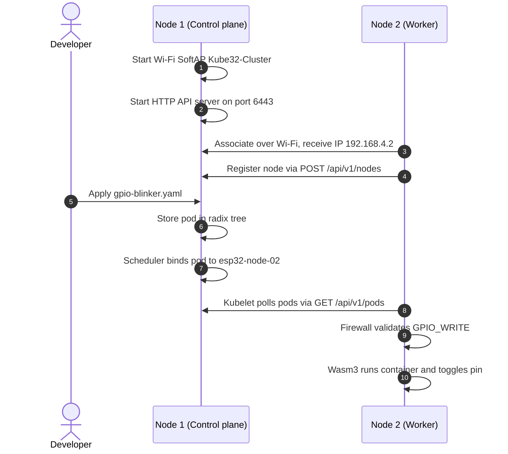

# Quickstart guide

<div class="blueprint-card">
  <strong>Execution target</strong>: Two connected ESP32-S3 microcontroller boards.<br>
  <strong>Prerequisites</strong>: Python 3.10+, PlatformIO or esptool, and USB cables.<br>
  <strong>Cluster access</strong>: USB serial or local Wi-Fi on port 6443.
</div>

This guide walks through compiling firmware, flashing two ESP32-S3 boards, and deploying your first WebAssembly container.

---

## 1. Hardware setup

A minimal Kube32 cluster uses two ESP32-S3 boards:

| Node role | Recommended hardware | Interface | Memory specification |
| :--- | :--- | :--- | :--- |
| **Node 1 (Control plane)** | Standard ESP32-S3 | Native USB-CDC or USB-UART | 512 KB SRAM, 8 MB Flash |
| **Node 2 (Worker)** | ESP32-S3 with PSRAM | Native USB-CDC or USB-UART | 512 KB SRAM, 2 MB - 8 MB PSRAM, 8 MB Flash |



---

## 2. Compile the firmware

Build the firmware using PlatformIO and the ESP-IDF framework:

```bash
pio run -e esp32s3
```

This compiles three target binaries in `.pio/build/esp32s3/`:

- `bootloader.bin` at offset `0x0000`
- `partitions.bin` at offset `0x8000`
- `firmware.bin` at offset `0x20000`

---

## 3. Flash the boards

Both boards run the unified firmware image. At boot time, the firmware automatically detects available memory (SRAM vs PSRAM) and starts the control plane or worker agent services.

### Flash Node 1 (Control plane)
Connect the first board to your workstation:

```bash
# Replace /dev/ttyACM0 with your board serial port
bash scripts/flash.sh /dev/ttyACM0 460800
```

### Flash Node 2 (Worker node)
Connect the second board to your workstation:

```bash
# Replace /dev/ttyACM1 with your board serial port
bash scripts/flash.sh /dev/ttyACM1 460800
```

!!! note
    On macOS, serial devices typically appear as `/dev/cu.usbmodem*` or `/dev/cu.usbserial*`. On Linux, they appear as `/dev/ttyACM*` or `/dev/ttyUSB*`. On Windows, they appear as `COM*`.

---

## 4. Check cluster status

You can query cluster state over the USB serial interface or over local Wi-Fi.

=== "Over USB serial"

    ```bash
    ./cli/kube32-cli --port /dev/ttyACM0 status
    ```

    Output:
    ```
    Connecting to Kube32 cluster at /dev/ttyACM0...

    === CLUSTER NODES ===
    NAME             STATUS     ROLES          INTERNAL-IP      ALLOCATABLE-MEM
    ------------------------------------------------------------------------
    esp32-node-01    Ready      control-plane  192.168.4.1      400Ki
    esp32-node-02    Ready      worker         192.168.4.2      2048Ki

    === CLUSTER PODS ===
    NAMESPACE    NAME                     NODE             STATUS       MEMORY
    ------------------------------------------------------------------------
    (No active pods deployed)
    ```

=== "Over Wi-Fi"

    Connect your workstation to the `Kube32-Cluster` Wi-Fi network with password `kube32password`, then run:

    ```bash
    ./cli/kube32-cli --server http://192.168.4.1:6443 status
    ```

---

## 5. Deploy a workload

Deploy `examples/gpio-blinker.yaml`. This manifest requests permission to toggle a GPIO pin:

```bash
./cli/kube32-cli --port /dev/ttyACM0 apply -f examples/gpio-blinker.yaml
```

Output:
```
pod/gpio-blinker applied successfully -> scheduled to esp32-node-02 (HTTP 201)
```

Verify that the pod is running:

```bash
./cli/kube32-cli --port /dev/ttyACM0 status
```

Output:
```
=== CLUSTER PODS ===
NAMESPACE    NAME                     NODE             STATUS       MEMORY
------------------------------------------------------------------------
default      gpio-blinker             esp32-node-02    Running      32Ki
```

---

## 6. Read live logs

Open a serial monitor on Node 2 to watch the container execute:

```bash
python3 -c "
import serial
with serial.Serial('/dev/ttyACM1', 115200) as s:
    while True:
        line = s.readline()
        if line: print(line.decode('utf-8', errors='replace').strip())
"
```

Output:
```
Kubelet: Sync assigned pods: found default/gpio-blinker on esp32-node-02
Firewall: Auditing capabilities for default/gpio-blinker
Firewall: Capability granted: GPIO_WRITE on pin 10
Wasm3: Spawning container default/gpio-blinker with 32 KiB heap
Container: GPIO pin 10 set to HIGH
Container: GPIO pin 10 set to LOW
Worker heartbeat: Node esp32-node-02, free heap 2235900 bytes
```
