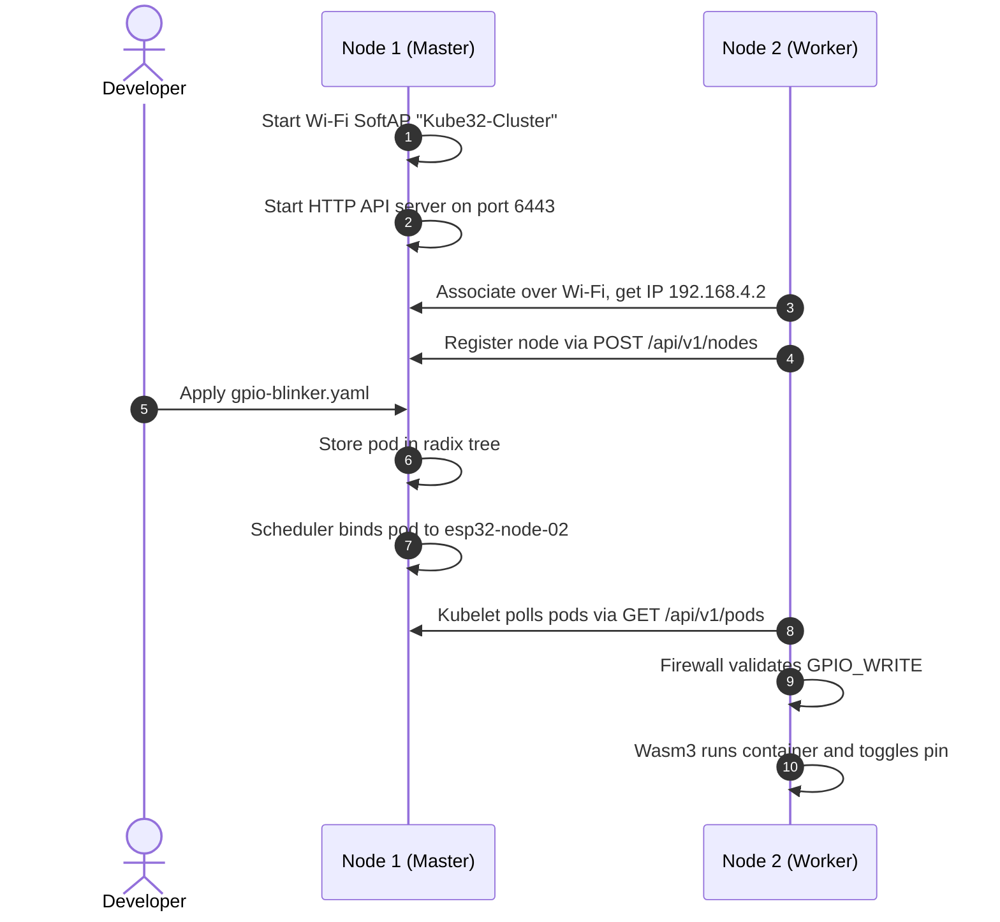

# Quickstart guide

<div class="blueprint-card">
  <strong>Execution target</strong>: Two connected ESP32-S3 boards.<br>
  <strong>Tools needed</strong>: Python 3.10+, PlatformIO, and USB-C cables.<br>
  <strong>Connection options</strong>: USB serial or Wi-Fi on port 6443.
</div>

This guide walks through compiling firmware, flashing two ESP32-S3 boards, and deploying your first WebAssembly container.

---

## 1. Hardware setup

We use two boards for this cluster:

| Node role | Board | USB interface | Memory |
| :--- | :--- | :--- | :--- |
| **Node 1 (Control plane)** | M5Stack Cardputer | Native USB-JTAG | 512 KB SRAM, 8 MB Flash, 0 MB PSRAM |
| **Node 2 (Worker)** | ESP32-S3 DevKit | CH343 USB-UART | 512 KB SRAM, 2 MB Quad PSRAM, 8 MB Flash |



---

## 2. Compile the firmware

Build the firmware with PlatformIO and ESP-IDF:

```bash
~/.platformio/penv/bin/pio run -e esp32s3
```

This creates three binaries in `.pio/build/esp32s3/`:
- `bootloader.bin` at offset `0x0000`
- `partitions.bin` at offset `0x8000`
- `firmware.bin` at offset `0x20000`

---

## 3. Flash the boards

Both boards run the exact same firmware binary. Each board determines its role at boot time from its factory MAC address.

### Flash Node 1 (M5Stack Cardputer)
Push the slide switch on the left edge of the Cardputer to the UP position so the USB controller gets power:

```bash
bash scripts/flash.sh /dev/cu.usbmodem2101 460800
```

### Flash Node 2 (ESP32-S3 DevKit with 2 MB PSRAM)
The CH343 USB-UART chip on the dev board needs 256-byte paced transfers to prevent buffer overruns:

```bash
bash scripts/flash.sh /dev/cu.usbmodem578E0184461 460800
```

---

## 4. Check cluster status

You can query cluster state over the USB serial cable or over Wi-Fi.

=== "Over USB serial (recommended)"

    ```bash
    ./cli/kube32-cli --port /dev/cu.usbmodem2101 status
    ```

    Output:
    ```
    Connecting to Kube32 Cluster at /dev/cu.usbmodem2101...

    === CLUSTER NODES ===
    NAME             STATUS     ROLES          INTERNAL-IP      ALLOCATABLE-MEM
    ------------------------------------------------------------------------
    esp32-node-01    Ready      control-plane  192.168.4.1      400Ki
    esp32-node-02    Ready      worker         192.168.4.2      2048Ki

    === CLUSTER PODS ===
    NAMESPACE    NAME                     NODE             STATUS       MEMORY
    ------------------------------------------------------------------------
    (No active pods deployed)
    ```

=== "Over Wi-Fi"

    Connect your workstation to the `Kube32-Cluster` Wi-Fi network with password `kube32password`, then run:

    ```bash
    ./cli/kube32-cli --server http://192.168.4.1:6443 status
    ```

---

## 5. Deploy a workload

Deploy `examples/gpio-blinker.yaml`. This manifest requests permission to toggle a GPIO pin:

```bash
./cli/kube32-cli --port /dev/cu.usbmodem2101 apply -f examples/gpio-blinker.yaml
```

Output:
```
pod/gpio-blinker applied successfully -> scheduled to esp32-node-02 (HTTP 201)
```

Check the status to verify that the pod is running:

```bash
./cli/kube32-cli --port /dev/cu.usbmodem2101 status
```

```
=== CLUSTER PODS ===
NAMESPACE    NAME                     NODE             STATUS       MEMORY
------------------------------------------------------------------------
default      gpio-blinker             esp32-node-02    Running      32Ki
```

---

## 6. Read live logs

Open a serial monitor on Node 2 to watch the container run:

```bash
python3 -c "
import serial
with serial.Serial('/dev/cu.usbmodem578E0184461', 115200) as s:
    while True:
        line = s.readline()
        if line: print(line.decode('utf-8', errors='replace').strip())
"
```

Output:
```
Kubelet: Sync assigned pods: found default/gpio-blinker on esp32-node-02
Firewall: Auditing capabilities for default/gpio-blinker
Firewall: Capability granted: GPIO_WRITE on pin 10
Wasm3: Spawning container default/gpio-blinker with 32 KiB heap
Container: GPIO pin 10 set to HIGH
Container: GPIO pin 10 set to LOW
Worker heartbeat: Node esp32-node-02, free heap 2235900 bytes
```
