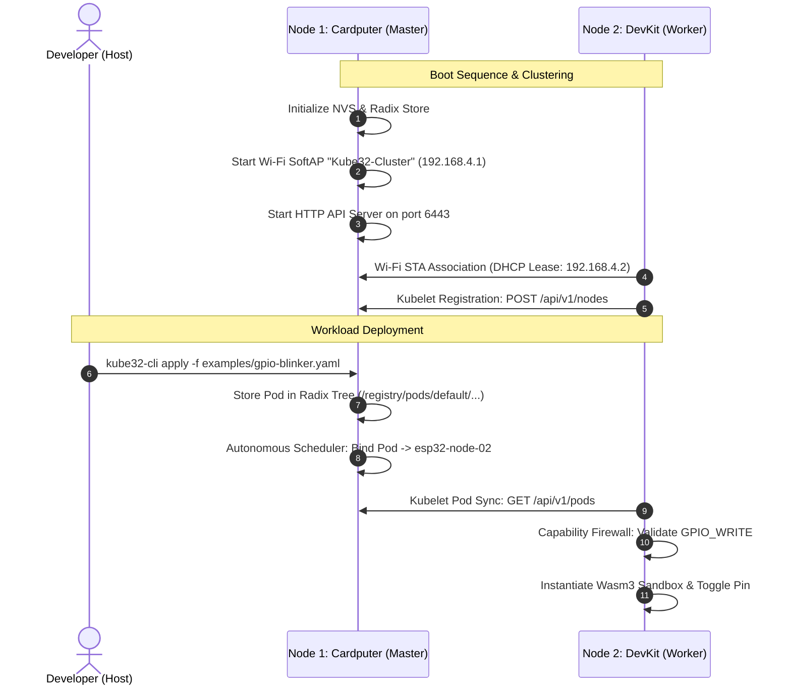

# Quickstart Guide

<div class="blueprint-card">
  <strong>Execution Target</strong>: Dual ESP32-S3 Physical Cluster<br>
  <strong>Tooling</strong>: <code>kube32-cli</code> / <code>kubectl</code> / PlatformIO ESP-IDF<br>
  <strong>Deployment Protocol</strong>: Dual-mode (Direct Silicon Serial &amp; HTTP REST :6443)
</div>

This guide walks through configuring, flashing, and operating a two-node Kube32 physical cluster using an M5Stack Cardputer as the master control plane and an ESP32-S3 dev board with 2MB Quad PSRAM as a worker node.

---

## 1. Hardware Prerequisites

| Node Role | Target Hardware | Serial Interface | Memory Configuration |
| :--- | :--- | :--- | :--- |
| **Node 1 (Control Plane)** | M5Stack Cardputer | Native USB-JTAG (`303A:1001`) | 512KB SRAM, 8MB Flash (0MB PSRAM) |
| **Node 2 (Worker)** | ESP32-S3 DevKit | CH343 USB-UART (`1A86:55D3`) | 512KB SRAM, 2MB Quad PSRAM, 8MB Flash |



---

## 2. Compiling the Production Firmware

Compile the unified firmware image using PlatformIO and the ESP-IDF toolchain:

```bash
# Compile Xtensa LX7 firmware binary
~/.platformio/penv/bin/pio run -e esp32s3
```

The build produces three critical silicon images in `.pio/build/esp32s3/`:
- `bootloader.bin` (offset `0x0000`)
- `partitions.bin` (offset `0x8000`)
- `firmware.bin` (offset `0x20000`)

---

## 3. Flashing Physical Silicon

### Flashing Node 1 (M5Stack Cardputer)
Ensure the slide switch on the left edge of the Cardputer is pushed **UP (ON)** to power the USB controller:

```bash
bash scripts/flash.sh /dev/cu.usbmodem2101 460800
```

### Flashing Node 2 (ESP32-S3 DevKit with 2MB PSRAM)
The CH343 USB-UART bridge requires 256-byte paced block writes to avoid FIFO buffer overruns:

```bash
bash scripts/flash.sh /dev/cu.usbmodem578E0184461 460800
```

> [!TIP]
> Both boards use the identical binary image. Node roles are determined dynamically at boot based on factory eFuse MAC addresses.

---

## 4. Inspecting Cluster Health

Use `cli/kube32-cli` to inspect nodes and running workloads. The CLI supports querying directly over the USB serial interface or via Wi-Fi HTTP:

=== "Direct Silicon Serial Mode (Recommended)"

    ```bash
    # Query cluster nodes via Master USB port
    ./cli/kube32-cli --port /dev/cu.usbmodem2101 status
    ```

    Output:
    ```
    Connecting to Kube32 Cluster at /dev/cu.usbmodem2101...

    === CLUSTER NODES ===
    NAME             STATUS     ROLES          INTERNAL-IP      ALLOCATABLE-MEM
    ------------------------------------------------------------------------
    esp32-node-01    Ready      control-plane  192.168.4.1      400Ki
    esp32-node-02    Ready      worker         192.168.4.2      2048Ki

    === CLUSTER PODS ===
    NAMESPACE    NAME                     NODE             STATUS       MEMORY
    ------------------------------------------------------------------------
    (No active pods deployed)
    ```

=== "Wi-Fi HTTP REST Mode"

    ```bash
    # Query over 802.11 network when associated with "Kube32-Cluster"
    ./cli/kube32-cli --server http://192.168.4.1:6443 status
    ```

---

## 5. Deploying Your First Workload

Deploy `examples/gpio-blinker.yaml`, which declares a micro-container requesting the `GPIO_WRITE` capability:

```bash
./cli/kube32-cli --port /dev/cu.usbmodem2101 apply -f examples/gpio-blinker.yaml
```

Output:
```
pod/gpio-blinker applied successfully -> scheduled to [esp32-node-02] (HTTP 201)
```

Verify that the Autonomous Scheduler placed the pod and that the Kubelet executed the container:

```bash
./cli/kube32-cli --port /dev/cu.usbmodem2101 status
```

```
=== CLUSTER PODS ===
NAMESPACE    NAME                     NODE             STATUS       MEMORY
------------------------------------------------------------------------
default      gpio-blinker             esp32-node-02    Running      32Ki
```

---

## 6. Live Silicon Telemetry

Stream logs from Node 2 over its serial monitor to view capability validation and hardware execution:

```bash
python3 -c "
import serial
with serial.Serial('/dev/cu.usbmodem578E0184461', 115200) as s:
    while True:
        line = s.readline()
        if line: print(line.decode('utf-8', errors='replace').strip())
"
```

Live output:
```
[KUBELET] Sync assigned pods: found default/gpio-blinker on esp32-node-02
[FIREWALL] Auditing capabilities for default/gpio-blinker...
[FIREWALL] Capability GRANTED: GPIO_WRITE on pin 10
[WASM3] Spawning container default/gpio-blinker (heap: 32KiB)...
[CONTAINER] GPIO Pin 10 set to HIGH
[CONTAINER] GPIO Pin 10 set to LOW
[WORKER-HEARTBEAT] Node: esp32-node-02 | Free Heap: 2235900 bytes | Pipeline: ACTIVE
```
