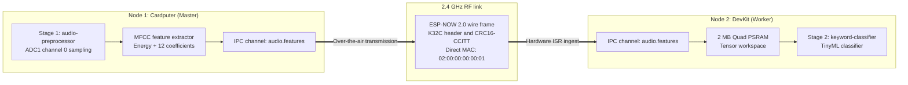

# Workload: Distributed TinyML pipeline

<div class="blueprint-card">
  <strong>Manifest</strong>: <code>examples/distributed-pipeline.yaml</code><br>
  <strong>Pattern</strong>: Coarse-grained pipeline partitioning across two boards.<br>
  <strong>Inter-node link</strong>: Virtual channel <code>audio.features</code> over ESP-NOW 2.0 with CRC16-CCITT.
</div>

This guide walks through deploying a distributed dataflow pipeline split across two physical ESP32-S3 microcontrollers.

Stage 1 runs on Node 1 (Cardputer). It samples an analog audio input and extracts a 12-coefficient MFCC feature vector. Node 1 broadcasts these features over an ESP-NOW virtual channel. Stage 2 runs on Node 2 (DevKit with 2 MB PSRAM), receiving the feature stream and classifying wake words in external memory.

---

## Distributed pipeline manifest

```yaml
# Stage 1: Audio capture and feature extraction pod on Node 1
apiVersion: v1
kind: Pod
metadata:
  name: audio-preprocessor
  namespace: default
  labels:
    app: voice-pipeline
    stage: frontend
spec:
  nodeSelector:
    kubernetes.io/hostname: esp32-node-01
  containers:
    - name: mfcc-extractor
      image: wasm://edge/mfcc-extractor:v1
      resources:
        limits:
          memory: 48Ki
        requests:
          memory: 32Ki
          hardware.kube32.io/adc: "1"
      securityContext:
        capabilities:
          add:
            - ADC_READ
            - CHANNEL_IPC
      env:
        - name: KUBE32_IPC_CHANNEL
          value: "audio.features"
---
# Stage 2: TinyML classification pod on Node 2
apiVersion: v1
kind: Pod
metadata:
  name: keyword-classifier
  namespace: default
  labels:
    app: voice-pipeline
    stage: inference
spec:
  nodeSelector:
    kubernetes.io/hostname: esp32-node-02
  containers:
    - name: tinyml-classifier
      image: wasm://edge/tinyml-classifier:v1
      resources:
        limits:
          memory: 64Ki
        requests:
          memory: 48Ki
          hardware.kube32.io/gpio: "2"
      securityContext:
        capabilities:
          add:
            - GPIO_WRITE
            - CHANNEL_IPC
      env:
        - name: KUBE32_IPC_CHANNEL
          value: "audio.features"
```

---

## Pipeline topology



---

## Deploying the pipeline

Apply the manifest using `kube32-cli`:

```bash
./cli/kube32-cli --port /dev/cu.usbmodem2101 apply -f examples/distributed-pipeline.yaml
```

Output:
```
pod/audio-preprocessor applied successfully -> scheduled to esp32-node-01 (HTTP 201)
pod/keyword-classifier applied successfully -> scheduled to esp32-node-02 (HTTP 201)
```

Verify that the scheduler assigned each pod to its target board:

```bash
./cli/kube32-cli --port /dev/cu.usbmodem2101 status
```

Output:
```
=== CLUSTER PODS ===
NAMESPACE    NAME                     NODE             STATUS       MEMORY
------------------------------------------------------------------------
default      audio-preprocessor       esp32-node-01    Running      48Ki
default      keyword-classifier       esp32-node-02    Running      64Ki
```

---

## Triggering pipeline dataflow

Trigger the Stage 1 feature extraction and radio transmission over serial:

```bash
./cli/kube32-cli --port /dev/cu.usbmodem2101 pipeline
```

### Node 1 master telemetry

```
PIPELINE-OTA-TX: Transmitting Stage 1 MFCC features (52 bytes) over ESP-NOW to Node 2 (02:00:00:00:00:01)...
PIPELINE-OTA-TX: ESP-NOW transmission result: 0 (0 = OK)
```

### Node 2 worker telemetry

```
PIPELINE-OTA-RX: Accepted live RF packet from esp32-node-01 (52 bytes)
PIPELINE-OTA-RX: Energy Level: 0.875 | Features: 1.25, -0.42, 0.91, 2.14, ...
PIPELINE-PSRAM: Allocated TinyML feature tensor at 0x3c018240 in 2MB Quad PSRAM
PIPELINE-PSRAM: TinyML inference on PSRAM -> keyword 'WAKE_WORD_DETECTED' (confidence: 99.1%)
PIPELINE-PSRAM: Distributed pipeline silicon execution: COMPLETE & VERIFIED
```
