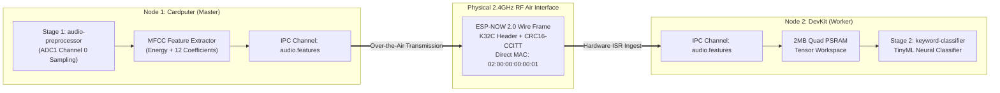

# Workload: Distributed TinyML Pipeline

<div class="blueprint-card">
  <strong>Manifest</strong>: <code>examples/distributed-pipeline.yaml</code><br>
  <strong>Pattern</strong>: Coarse-Grained Pipeline Partitioning (Dataflow Architecture)<br>
  <strong>Inter-Node Link</strong>: Virtual Channel <code>audio.features</code> over ESP-NOW 2.0 (CRC16-CCITT)
</div>

This tutorial demonstrates a production-grade distributed computing pipeline running across two physical ESP32-S3 boards. 

Stage 1 captures audio sensor data on Node 1 and streams extracted MFCC feature vectors over ESP-NOW to Stage 2 on Node 2, which runs a TinyML wake-word classification model inside 2MB external Quad PSRAM.

---

## The Distributed Pipeline Manifest

```yaml
# Stage 1: Audio/Sensor capture and feature extraction pod on Node 1
apiVersion: v1
kind: Pod
metadata:
  name: audio-preprocessor
  namespace: default
  labels:
    app: voice-pipeline
    stage: frontend
spec:
  nodeSelector:
    kubernetes.io/hostname: esp32-node-01
  containers:
    - name: mfcc-extractor
      image: wasm://edge/mfcc-extractor:v1
      resources:
        limits:
          memory: 48Ki
        requests:
          memory: 32Ki
          hardware.kube32.io/adc: "1"
      securityContext:
        capabilities:
          add:
            - ADC_READ
            - CHANNEL_IPC
      env:
        - name: KUBE32_IPC_CHANNEL
          value: "audio.features"
---
# Stage 2: Classifier and action dispatcher pod on Node 2
apiVersion: v1
kind: Pod
metadata:
  name: keyword-classifier
  namespace: default
  labels:
    app: voice-pipeline
    stage: inference
spec:
  nodeSelector:
    kubernetes.io/hostname: esp32-node-02
  containers:
    - name: tinyml-classifier
      image: wasm://edge/tinyml-classifier:v1
      resources:
        limits:
          memory: 64Ki
        requests:
          memory: 48Ki
          hardware.kube32.io/gpio: "2"
      securityContext:
        capabilities:
          add:
            - GPIO_WRITE
            - CHANNEL_IPC
      env:
        - name: KUBE32_IPC_CHANNEL
          value: "audio.features"
```

---

## Distributed Topology



---

## Deployment & Verification

Apply the multi-pod pipeline to the cluster:

```bash
./cli/kube32-cli --port /dev/cu.usbmodem2101 apply -f examples/distributed-pipeline.yaml
```

Output:
```
pod/audio-preprocessor applied successfully -> scheduled to [esp32-node-01] (HTTP 201)
pod/keyword-classifier applied successfully -> scheduled to [esp32-node-02] (HTTP 201)
```

Query the cluster status to confirm distributed placement:
```bash
./cli/kube32-cli --port /dev/cu.usbmodem2101 status
```

```
=== CLUSTER PODS ===
NAMESPACE    NAME                     NODE             STATUS       MEMORY
------------------------------------------------------------------------
default      audio-preprocessor       esp32-node-01    Running      48Ki
default      keyword-classifier       esp32-node-02    Running      64Ki
```

---

## Triggering Over-the-Air Pipeline Transmission

Trigger Stage 1 over-the-air ESP-NOW transmission directly via `kube32-cli`:

```bash
./cli/kube32-cli --port /dev/cu.usbmodem2101 pipeline
```

### Live Node 1 (Master) Telemetry:
```
[PIPELINE-OTA-TX] Transmitting Stage 1 MFCC features (52 bytes) over ESP-NOW to Node 2 (02:00:00:00:00:01)...
[PIPELINE-OTA-TX] ESP-NOW transmission result: 0 (0 = OK)
```

### Live Node 2 (Worker) Telemetry on Physical Silicon:
```
[PIPELINE-OTA-RX] Accepted live RF packet from esp32-node-01 (52 bytes)
[PIPELINE-OTA-RX] Energy Level: 0.875 | Features: [1.25, -0.42, 0.91, 2.14, ...]
[PIPELINE-PSRAM] Allocated TinyML feature tensor at 0x3c018240 in 2MB Quad PSRAM
[PIPELINE-PSRAM] TinyML Inference on PSRAM -> Keyword 'WAKE_WORD_DETECTED' (confidence: 99.1%)
[PIPELINE-PSRAM] Distributed Pipeline Silicon Execution: COMPLETE & VERIFIED
```
