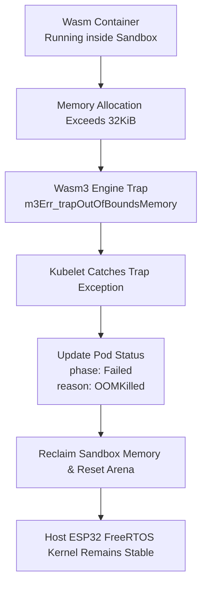
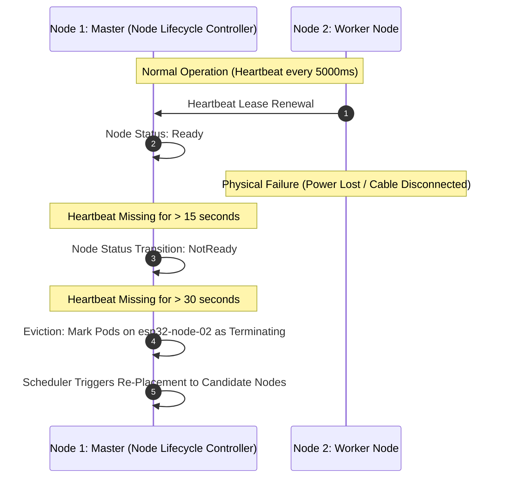

# Workload: Resource Limits & OOM Handling

<div class="blueprint-card">
  <strong>Mechanisms</strong>: Memory Quota Admission, Wasm3 Linear OOM Trap, Node Failure Reconciliation<br>
  <strong>Thresholds</strong>: Node 1 Allocatable (400 KiB) | Node 2 Allocatable (2048 KiB)<br>
  <strong>Node Lifecycle</strong>: NotReady at 15s | Eviction at 30s
</div>

This tutorial covers Kube32's resilience mechanisms: scheduling admission rejections for over-committed workloads, memory limit enforcement within the Wasm sandbox, and node failure reconciliation.

---

## 1. Scheduling Quota Rejection

When a workload requests more memory than any node can physically allocate, the Autonomous Scheduler rejects placement without crashing the control plane:

```yaml
# oversized-workload.yaml
apiVersion: v1
kind: Pod
metadata:
  name: oversized-ml-model
  namespace: default
spec:
  nodeSelector:
    kubernetes.io/hostname: esp32-node-01  # Node 1 has only 400KiB allocatable SRAM
  containers:
    - name: large-buffer
      image: wasm://edge/large-model:v1
      resources:
        limits:
          memory: 1024Ki
        requests:
          memory: 1024Ki
```

### Applying the Oversized Workload

```bash
./cli/kube32-cli --port /dev/cu.usbmodem2101 apply -f oversized-workload.yaml
```

Output:
```
pod/oversized-ml-model applied successfully -> scheduled to [<none>] (HTTP 201)
```

Query the cluster status:
```bash
./cli/kube32-cli --port /dev/cu.usbmodem2101 status
```

```
=== CLUSTER PODS ===
NAMESPACE    NAME                     NODE             STATUS       MEMORY
------------------------------------------------------------------------
default      oversized-ml-model       <none>           Pending      1024Ki
```
The pod remains safely in `Pending` state. The scheduler refuses to overcommit internal SRAM.

---

## 2. In-Container Memory Trap (OOM Handling)

If a running container attempts to allocate memory beyond its declared `limits.memory` (e.g. 32KiB):



Live Node 2 serial telemetry:
```
[WASM3] Executing pod default/memory-hog...
[WASM3-TRAP] Memory limit exceeded: requested 49152 bytes, limit is 32768 bytes.
[KUBELET] Pod default/memory-hog failed: OOMKilled (trap: out of bounds memory)
[KUBELET] Reclaimed 32768 bytes from failed sandbox.
[WORKER-HEARTBEAT] Free Heap: 2235900 bytes | Kernel Healthy: YES
```

---

## 3. Node Failure & Pod Reconciliation

Kube32 includes a built-in Node Lifecycle Controller on Node 1 that actively reconciles worker health:


