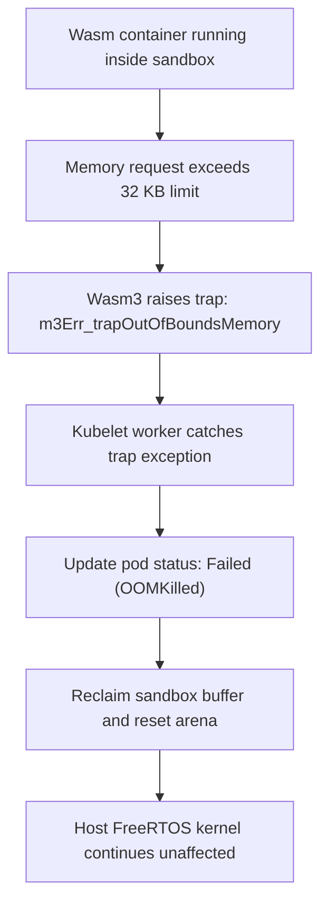
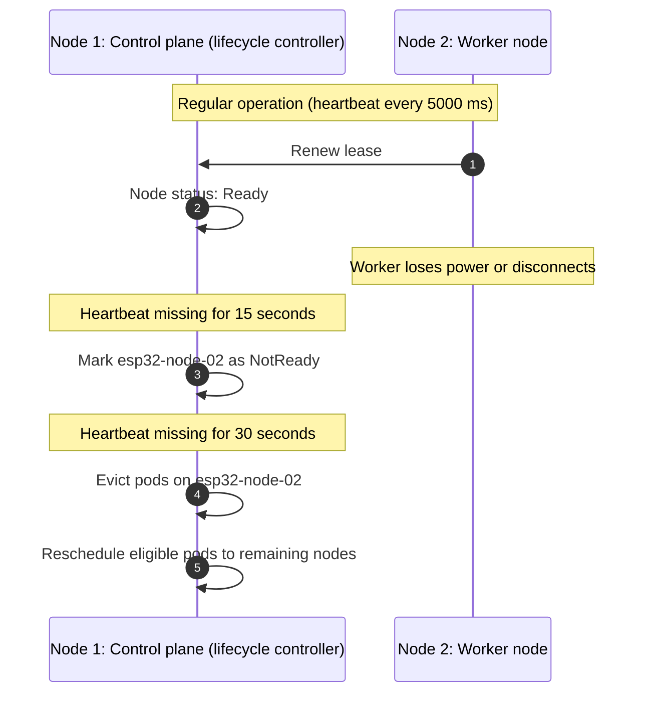

# Workload: Resource limits and fault recovery

<div class="blueprint-card">
  <strong>Mechanisms</strong>: Memory quota admission, Wasm3 runtime traps, and node failure reconciliation.<br>
  <strong>Node capacities</strong>: Node 1 allocatable (400 KB) and Node 2 allocatable (2,048 KB).<br>
  <strong>Failure thresholds</strong>: Node marked NotReady at 15s; eviction begins at 30s.
</div>

This guide demonstrates how Kube32 protects microcontrollers from out-of-memory faults, crashes in guest code, and hardware node dropouts.

---

## 1. Admission quota rejection

When a pod requests more memory than any node has available, the scheduler leaves the pod unassigned rather than overloading a microcontroller:

```yaml
# oversized-workload.yaml
apiVersion: v1
kind: Pod
metadata:
  name: oversized-ml-model
  namespace: default
spec:
  nodeSelector:
    kubernetes.io/hostname: esp32-node-01  # Node 1 has 400 KB allocatable SRAM
  containers:
    - name: large-buffer
      image: wasm://edge/large-model:v1
      resources:
        limits:
          memory: 1024Ki
        requests:
          memory: 1024Ki
```

Apply the oversized workload:

```bash
./cli/kube32-cli --port /dev/ttyACM0 apply -f oversized-workload.yaml
```

Output:
```
pod/oversized-ml-model applied successfully -> scheduled to <none> (HTTP 201)
```

Check the pod status:

```bash
./cli/kube32-cli --port /dev/ttyACM0 status
```

Output:
```
=== CLUSTER PODS ===
NAMESPACE    NAME                     NODE             STATUS       MEMORY
------------------------------------------------------------------------
default      oversized-ml-model       <none>           Pending      1024Ki
```

The pod remains in `Pending` state. The scheduler does not assign it to Node 1 because 1,024 KB exceeds the 400 KB allocatable capacity.

---

## 2. In-container memory traps

If guest code attempts to allocate beyond its configured limit (such as 32 KB):



Telemetry logged by Node 2:

```
WASM3: Executing pod default/memory-hog...
WASM3-TRAP: Memory limit exceeded: requested 49152 bytes, limit is 32768 bytes
KUBELET: Pod default/memory-hog failed: OOMKilled (trap: out of bounds memory)
KUBELET: Reclaimed 32768 bytes from failed sandbox
WORKER-HEARTBEAT: Free Heap: 2235900 bytes | Kernel healthy: YES
```

The Wasm3 sandbox absorbs the out-of-bounds fault. The underlying FreeRTOS kernel does not crash.

---

## 3. Node failure and pod reconciliation

The node lifecycle controller running on Node 1 tracks worker heartbeats over Wi-Fi leases:


